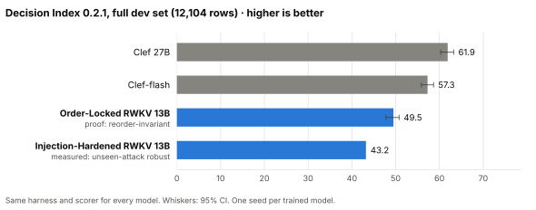
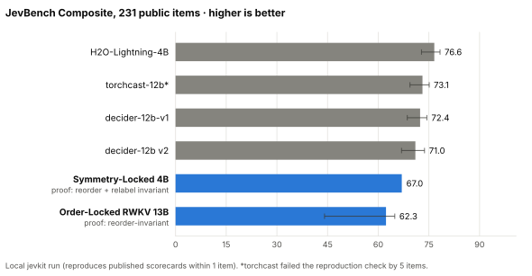
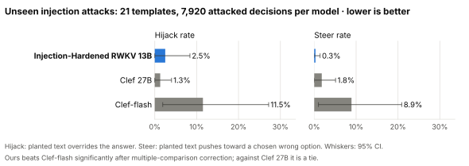
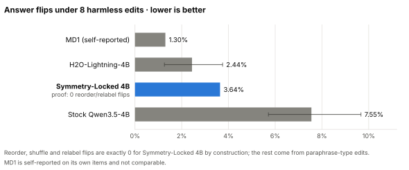
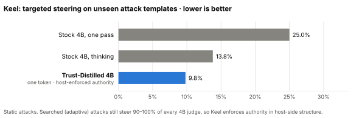
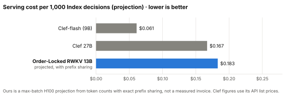

# State-Space-Decision-Model

**Mission.** Build an attention-free state-space *decision model* (text path: no softmax over positions, no KV cache that grows with length) that beats Cloudflare's Clef and Clef-flash on the Decision Index 0.2.1 with a paired confidence interval above zero, independent reproduction and a submitted PR to the Index, while carrying control-theoretic and host-side safety guarantees stated exactly as proven (`SAFETY_SPEC.md`). Capability, calibration, steer/hijack resistance, interpretability evidence, latency and cost are always reported together. A language model is then grown from that decision parent: every text output passes through checked, typed semantic programs (Track L), never an unchecked text path. Full goal and exit conditions: `GOAL.md`.

Two owning agents work the repo: **Claude = Track D** (decision model, `claude/*` branches) and **Codex = Track L** (language growth, `codex/*`). Human teammates and their coding agents work on `collab/<github-user>/<topic>` branches; see `HANDOFF.md` (humans) and `AGENT_HANDOFF.md` (agents).

## Results so far (benchmark card, 2026-10-15)

We have three trained decision models, each named for the guarantee it carries, plus Keel, a host-side safety layer around a small judge. None beats Clef on raw capability yet. The best Decision Index score is 80% of Clef 27B and 86% of Clef-flash. The guarantees are where the models stand out: zero answer flips from reordering or relabelling options (proven, not just measured), and far fewer successful injection attacks than Clef-flash on templates never seen in training. Blue bars are ours; grey bars are other systems run on the same harness. Every number traces to a receipt listed on the [benchmark card](https://github.com/apumutyala/State-Space-Decision-Model/blob/claude/benchmark-card/docs/benchmark_card/ssdm-benchmark-card.html). The charts are rebuilt by `docs/results/make_charts.py`.

| Model | Code name | What it is |
|---|---|---|
| Order-Locked RWKV 13B | D19 | RWKV-7, fully attention-free (constant-size memory, no KV cache), joint decision head. Best Decision Index score |
| Injection-Hardened RWKV 13B | D13 | RWKV-7, trained to ignore instructions planted in the content it reads |
| Symmetry-Locked 4B | JEV3-LM-S | Qwen3.5-4B hybrid (75% Gated DeltaNet) with a symmetric fork readout. Best JevBench Composite |
| Trust-Distilled 4B (Keel) | Keel student | One-token judge whose authority is enforced by the host, not the model |

### Capability

<picture>
  <source media="(prefers-color-scheme: dark)" srcset="docs/results/decision_index-dark.svg">
  
</picture>

<picture>
  <source media="(prefers-color-scheme: dark)" srcset="docs/results/jevbench-dark.svg">
  
</picture>

### Safety and robustness

<picture>
  <source media="(prefers-color-scheme: dark)" srcset="docs/results/injection_attacks-dark.svg">
  
</picture>

<picture>
  <source media="(prefers-color-scheme: dark)" srcset="docs/results/answer_flips-dark.svg">
  
</picture>

<picture>
  <source media="(prefers-color-scheme: dark)" srcset="docs/results/keel_steering-dark.svg">
  
</picture>

| Property | Symmetry-Locked 4B | Order-Locked RWKV 13B | Injection-Hardened RWKV 13B | Clef 27B | Clef-flash | H2O-4B |
|---|---|---|---|---|---|---|
| Option reorder cannot change the answer | Proven | Proven | Proven | not claimed | not claimed | Fails 6/139 |
| Option relabel cannot change the answer | Proven | 8.6% flips | untested | not claimed | not claimed | Fails 5/139 |
| Unseen-attack hijack rate | untested | untested | 2.5% | 1.3% | 11.5% | untested |
| Unseen-attack steer rate | untested | untested | 0.3% | 1.8% | 8.9% | untested |
| Calibration, 10-bin ECE on Index dev | — | 0.041 | — | 0.014 | 0.031 | — |
| Conformal prediction sets hold their stated rate | Holds (0.92 at 90%) | Holds | Holds | Holds | Holds | — |
| Certified "safe to act" at ≤5% error (test valid for correlated items) | None | None | None | None | None | — |

Keel's host-side layer passed a bounded exhaustive check: no unauthorized action can run, deferred or held actions never execute, the full review queue never auto-approves, and receipts are tamper-evident and replayable. It caught all 5 deliberately broken kernels.

### Cost

<picture>
  <source media="(prefers-color-scheme: dark)" srcset="docs/results/serving_cost-dark.svg">
  
</picture>

### What these results do not show

- Each trained model has one seed, and everything is measured on development sets. Local JevBench uses the 231 open items, not the leaderboard's sealed set. Nothing has been confirmed on a sealed set yet.
- Adaptive (searched) attacks still steer 90–100% of every 4B judge, ours included. That is why Keel enforces authority outside the model.
- No model, ours or Clef's, earns a "safe to act" certificate once the test accounts for related questions. An earlier per-decision test said our 13B model was more actionable than Clef-flash; we withdrew it because that test was too lenient.
- The serving cost for our model is a projection, not a measured invoice.
- None of our models has been submitted to the public JevBench or Decision Index leaderboards, whose scales differ from our local runs.

## Build status (snapshot of 2026-10-06, `agent-main` @ `3b4169a`)

_This table records infrastructure progress as of 6 October. Model results since then are in the section above._

Takeaway: all CPU-side machinery is built and merged; the first H100 jobs have run; **no model capability number exists yet**. Nothing in `SAFETY_SPEC.md` is claimed as achieved.

| Area | State | Evidence |
|---|---|---|
| Decision Index harness (m0-a) | Done. Reproduces the official kit on DEV (gap 0.0); DEV 12,104 / TEST 12,161 rows as ID+hash manifests; TEST sealed | PR #7, `receipts/2026-10-06-D-m0-harness/` |
| `decide()` adapter + replay fixture (m0-b) | Done; handed to Track L | PR #6, #24, `receipts/2026-10-06-D-m0-decide/` |
| Safety eval + PREREG (m0-c) | Done (pipeline). Smoke on Qwen3-0.6B qualifies nothing | PR #8, #22, `safety_eval/PREREG.md` |
| H100 hardware qualification (m1) | `job-jbw22` $0.07 stopped at numerics gate (fla #640, fixed PR #41). `job-c4zkm` $0.74: phases A+B pass (0.8B one-layer GDN ΔNLL −0.0036, KL 0.017); phase C 9B OOM at 68.9 GB (fixed PR #48, modelled 31–33 GB). C-only re-run `job-b69gs` submitted 2026-10-06T17:36Z (max $6.93; receipt on issue #3) | issue #3, `LEDGER.md`, `jobs/qual/` |
| RWKV7-13.3B stock readout (m1 fallback, stage A) | `job-mhc3h` $0.56 stopped by the rate guard: per-option prompt recompute projected 763 min vs 75-min cap. Fix (state-fork readout, ~27 min projected) in PR #50, **open, changes requested** | issue #3, PR #50, `jobs/PERF_AUDIT.md` (branch `claude/readout-fork`) |
| Clef-flash baseline (job A) | `job-sgihj` ($1.40): **Clef-flash scores 56.8 [55.4, 58.2] on the 12,104-row DEV slice** (knowledge 51.7, language 53.8, retrieval 48.1, tools 80.8, arts 51.3), consistent with the ≈57.1 public figure. Parity with Cloudflare's systemone arithmetic: max \|Δp\| 5e-5 on 64 rows. Clef-native silently truncates 51 long rows; Clef-native passes 4 control-token ids vs 0 on our encoder. The job's final composite step crashed on a truncated side file (reporting bug; the score is unaffected). Jobs B (GCG) and C (Clef-27B) not submitted | issue #3, `jobs/clef_baseline/JOB_SPEC.md` |
| 9B one-layer probe, full 8-layer conversion | Spec only; gated on the qualification verdict | `jobs/probe9b/`, `jobs/DECISION_TREE.md` |
| m2 heads × calibration factorial | Code merged, CPU dry run passed, 150k training set built ($0). Blocked on parent selection and promotion margins (issue #36) | PR #14, #27, #29, #39, #44 |
| controlsafe (G15 trust gate, G16 protected judge, G4 snapshots, persistence, G14 monitor) | Built and CPU-tested on tiny random models; G14 detection weak/unvalidated; no training arm yet | PR #42, `controlsafe/CONTROLSAFE.md` |
| SAFETY_SPEC (G1–G14 guarantee table) | Written, v1.2; PR #18 **open, not merged** | branch `claude/safety-spec` |
| Track L (L0a–L0f CPU prerequisites) | Merged: interface 0.1(.1), kernel, renderer, typed planner, fixtures, evaluator, public output, training records, paired comparison, CPU probe prep. L0g (≤$20 hardware qualification) and L0h (learned L0) not started | PR #4–#5, #10–#13, #15, #17, #21, #25, #37, #46; `plans/codex/L0_PHASES.md` |
| Spend | SF Compute credits $525 ($500 promo expires 2026-10-27T06:53Z); spent $1.37 + running jobs; workspace cap $33 | `LEDGER.md`, issue #3 |

## Repo map

| Path | What it is |
|---|---|
| `GOAL.md`, `PLAN.md`, `COORDINATION.md`, `INTERFACE.md`, `STATUS.md`, `LEDGER.md` | Standing goal; merged plan (tiers, milestones, spend lines); working rules (branches, PRs, reviews, spend ladder); D→L contract notes; per-track status; spend and negative-results ledger |
| `HANDOFF.md`, `AGENT_HANDOFF.md` | Onboarding for human teammates / for collaborators' coding agents |
| `decide/` | The `decide(request) -> response` adapter (schema, limits, fail-closed untrusted-text encoder, experimental provenance), with replay/oracle/HF-readout backends |
| `harness/` | Decision Index 0.2.1 slicing, paired cluster-bootstrap CIs, calibration (debiased/Smooth ECE), MDE; `INDEX_NOTES.md` is the rulebook |
| `safety_eval/` | Attack families (hijack, D1 steer A/B, GCG-lite), metrics, G4 erase-and-check certificate, G5 LTT selective risk, controlsafe arms; `PREREG.md` |
| `controlsafe/` | Recurrence-level mechanisms: G15 trust gate, G16 protected judge, persistence bounds, Gramians, G4 snapshot reuse, G14 monitor; `CONTROLSAFE.md` |
| `convert/` | Attention→GDN conversion pipeline (alignment, KL ordering, accept/rollback), qualification stages, memory model, readout |
| `heads/`, `train/` | Decision heads (integrator, fork, snapshot, Head B, Clef-attention control), backbone interface, LoRA trainer, eval card, G12/G13 promotion rule; `train/M2_RUN_SPEC.md` |
| `data/` | m2 training-data build: pinned train-split sources, SystemOne converter, schema/injection augmentation, contamination guard; `SOURCES.md`, `TEACHERS.md` |
| `baselines/`, `third_party/cloudflare_clef/` | Clef/Clef-flash `decide()` backend over Cloudflare's vendored joint head, probes, GCG |
| `jobs/` | SF Compute job specs and runners (qual, probe9b, rwkv7, clef_baseline, m2_pilot, m2_parent_arm), cost arithmetic, rate guard, `DECISION_TREE.md` |
| `probes/`, `scripts/`, `configs/` | MQAR/NIAH/ppl/MMLU probes, decision scripts, cost model, pinned job configs |
| `language_growth/`, `fixtures/language_growth/` | Track L: typed semantic kernel, renderer, planner, D bridge, evaluator, public-output wrapper (CPU only, no learned model) |
| `interfaces/DECISION_LANGUAGE_V0.md` | Canonical D→L contract (0.1.1). Changes need both owners and a version bump |
| `techniques/` | Technique catalog (`CATALOG.md`) and notes 01–08 with evidence grades; 09 (safety literature) lives on `claude/safety-spec` |
| `reviews/`, `analysis/`, `plans/`, `coordination/` | Fact-check and pressure test of the original plans; adversarial plan reviews; original plans; cross-track handoff notes |
| `receipts/` | One directory per reported number: commit, command, hashes, seeds, hardware, cost |
| `tests/`, `fixtures/replay/` | CPU test suite (~670 tests) and the replay fixture |

## Quick start (CPU; GPU work is never run on a laptop)

```bash
# Python >= 3.10 (3.12 used). UTF-8 mode is mandatory: the harness refuses to import without it.
uv venv .venv && uv pip install torch --index-url https://download.pytorch.org/whl/cpu
uv pip install transformers==5.14.1 pytest numpy pyarrow
pip install -e harness -e data          # optional: enables data/tests; harness/tests also need the kit below
# Official Index kit, only if you need the suite: clone apolinario/decision-index @ 87d4650b
# with core.autocrlf=false and `pip install --no-deps` it.

python -X utf8 -m pytest tests -q                              # ~8 min CPU
python -X utf8 -m pytest tests/clef tests/controlsafe -q
python -m unittest discover -s language_growth/tests -p "test_kernel*.py" -v
python -m jobs.common.costs                                    # every job's worst case / expected $
```

**Data is not in git.** The Decision Index suite is not redistributable; it is rebuilt locally with the kit (`suite rebuild`, ~7 GB download, 17 GB working; HLE is gated on the Hub). `harness/manifests/` holds only row IDs and hashes. The **TEST slice is sealed**: `harness/cli.py` refuses to load it unless `SSDM_UNSEAL_TEST=1` *and* `SSDM_PREREG=<committed pre-registration>` are set, and every unseal is logged to `receipts/test-unseal-log.jsonl`. Never open or tune on it, and never on Index test items. Training records (20k, 150k) live outside the repo (`ssdm-data/m2/build/...`) with their sha256 pinned in `data/manifests/`. Model weights come from the HF cache at the revisions pinned in `jobs/*/JOB_SPEC.md`.

## Where to read next

- `HANDOFF.md`: the story so far, architecture, what is measured vs built, failures, open decisions, plan.
- `AGENT_HANDOFF.md`: hard rules for coding agents, orientation order, extension points, reading list, open research directions.
- `GOAL.md` → `PLAN.md` → `SAFETY_SPEC.md` (branch `claude/safety-spec`, PR #18) → `COORDINATION.md` → `interfaces/DECISION_LANGUAGE_V0.md`.

Private repo. Commits are authored as the contributor; the owners commit as Apuroop Mutyala with no AI trailers.
