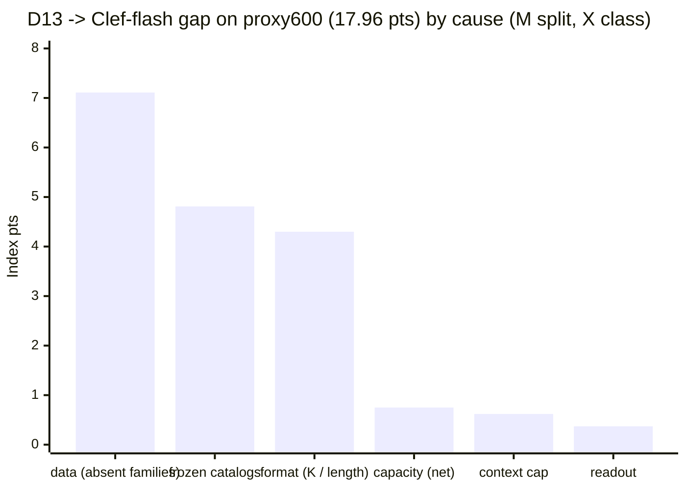

# Gap and funding (2026-10-09): where D13 loses to both Clefs, the long-term plan per $, and the funding ask

Agent B. CPU only, $0. **M** = measured with the frozen scorer (`harness.score` + `harness.bootstrap`, B 2,000, seed 0,
case clusters; nothing frozen edited). **X** = judgement. Every "pts" is Index points on proxy600 (644 DEV rows, ids sha
`7d42c398…`) unless it says full DEV. proxy600 tracks the 2,008 subset (Spearman 0.94) but is not a claim set.

## 0. Takeaway first

1. **The gap is 17.96 pts to Clef-flash and 23.49 to Clef 27B on proxy600 (M).** D13 41.07 [37.57, 45.22]; Clef-flash
   59.03; Clef 27B 64.56 (the Clefs' own full-DEV 32k runs, restricted to the same 644 rows). Paired:
   −17.96 [−21.92, −12.53] and −23.49 [−28.00, −18.69]. **Tools (−36.9) and retrieval (−23.6) are the two areas that
   lose most** (paired area CIs exclude 0); language is within reach (−5.9 [−13.6, +1.6]).
2. **About 60% of the Clef-flash gap is data and format, and both are fixable with allowed data (X class, M points):**
   - **data, 7.11 pts:** task families absent from D13's 24k draw: CRUXEval 2.15, PhishNChips 1.44, ForecastBench 1.04,
     HoVer 0.91, ESCI 0.54, VAST 0.45, RAGTruth 0.42, Habermas 0.20, ACOS 0.16.
   - **format, 4.30 pts:** families that ARE trained, but never in the eval's shape: API-Bank K 53 (1.49), BANKING77 K 77
     (1.12), ContractNLI 3.9k-token documents (0.56), MMLU-Pro K 10 (0.54), BRIGHT and ToolRet long rows (0.08 after the
     context carve-out), FinEntity (0.27), CLINC K 151 + OOS (0.25). D13 trains at K <= 16 and T <= 2,048.
   - **frozen, 4.81 pts:** the 9 held-out catalogs (Home appliances alone 3.10). No data may target them. Only general
     capacity moves them.
   - **context, 0.62 pts (M):** 6 retrieval rows hit the 16,384-token input cap. Giving them Clef-flash's own answers
     adds 0.62 (0.72 with Clef 27B's). The registered claim protocol already reads every row in full (B-PREREG-CLAIM).
   - **readout, 0.37 pts:** the pre-registered parameter-free rules R1 + R2 (PR #238).
   - **capacity, net 0.75** (gross −2.61, offset by +1.86 where D13 already beats Clef-flash: GSM8K, ANLI, BBH, GPQA,
     NLI4CT). The main gross loss is When2Call (−1.72), where D13 regressed from D1 (55.6 → 23.8).
3. **Against Clef 27B the same picture holds, with more data loss** (data 10.57, format 5.39, frozen 5.13, capacity 1.31,
   context 0.72, readout 0.37). Clef 27B's extra lead over Clef-flash is mostly RAGTruth (86 vs 17), PhishNChips,
   CLINC and Habermas: knowledge and judgement that come from the 27B backbone.
4. **Top 3 levers by expected pts per $ (section 2):**

   | # | Lever | Expected gain | Cost | pts per $ |
   |---|---|---|---|---|
   | 1 | **Full-read input + readout rules R1/R2 + RAGTruth polarity check** (no retraining; they ride on the full-DEV run the claim needs anyway) | +0.8 to +2.0 | $7 incremental ($45 incl. the full DEV) | **~0.1–0.25** |
   | 2 | **One clean "D13 head + data/format-matched draw" cell:** the absent families plus K 53 / 77 / 151 / 10 views and a T = 4,096 rung, a full epoch with cosine + best-ckpt | +4 to +6 (0.4–0.5 transfer of 11.4 pts) | $36–56 expected ($126 worst) | **~0.08–0.12** |
   | 3 | **Recipe scale on that cell:** r256 (Clef's rank), 2 epochs on a 230k–1M clean synthetic draw, joint-head ablation | +1 to +3 | $60–130 per arm | ~0.02–0.04 |

   Every other lever is below 0.02 pts/$ or is an option bet: test-time permutation averaging, open-weight
   pseudo-labels, and the Q9-AF backbone. **Q9-AF is the only route whose ceiling reaches Clef-flash**, but it is a
   ~30% bet (X).
5. **Honest ceiling.** With levers 1–3 the RWKV7 line projects to **~47–52 on proxy600**, roughly 45–50 on full DEV.
   That is ~7–12 pts short of Clef-flash. The remaining gap is the frozen catalogs (4.8) plus the unreached part of
   data/format at 0.4–0.5 transfer, i.e. backbone capacity.
   - **Beating Clef-flash with a paired CI > 0 needs a stronger attention-free backbone.** The candidate is Q9-AF v2:
     Clef-flash's own Qwen3.5-9B, which is already 75% GDN, with its last 8 attention layers converted.
   - **Clef 27B (61.89 full DEV) is out of reach on any funded tier (X).**
   - **2× on cost/latency is not available on this prefill-only workload (M, 2026-10-08).** The one real RWKV advantage
     is long inputs: constant memory and no 32k substitution. That is a narrow claim (section 2.6).
6. **Funding (section 3, aligned with agent-a's page: $1,000 / $2,500):**

   | Tier | Buys | Expected Index |
   |---|---|---|
   | **~$25 left now** | RAGTruth train-split polarity readout ($7.25) and an H1 hijack on D13 (~$4); the rest goes toward the D13 v3w full DEV ($37.93 hold) | D13 41–42 on proxy (rules + polarity); no claim |
   | **$1,000** | Claim-grade evidence on D13, then 3–4 clean data/format/recipe cells → champion → 2 full DEVs + heldout safety; 1 Q9-AF v2 clean conversion + screen; the RWKV-Qwen3-30B-A3B screen | proxy **45–50** / full DEV **43–48**. P(beat Clef-flash, CI > 0) ≈ 5% (X) |
   | **$2,500** | Everything in $1k, plus the Q9-AF v2 Clef recipe (r256 joint head on 300k+), 1M-row multi-epoch RWKV cells, 3 claim runs, kernel work for the cost axis | RWKV line **47–52**; Q9-AF line **45–57** (wide). P(beat Clef-flash) ≈ 20% (X); P(beat Clef 27B) < 5% |

## 1. Gap breakdown: D13 vs Clef-flash and Clef 27B by family

**Inputs (M).**

| Arm | File | Index (proxy600) |
|---|---|---:|
| D13 (job-hjwpq, art-cr9a2) | `d13_land/dl/x/final/out/screen/child.results.jsonl` | **41.07** [37.57, 45.22] |
| D1 + v3w (reference) | `rab_d1_repro/final/out/readout_ab/child.v3w.results.jsonl` | 37.71 |
| Clef-flash (job-t5yg2) | `clef_t5yg2_land/dl/clef-flash-index-full/index/decide_32k_substituted/results.jsonl` | **59.03** |
| Clef 27B (job-zfexa) | `clef_zfexa_land/x/clef-index-full/index/decide_32k_substituted/results.jsonl` | **64.56** |

- The Clef files are their full-DEV runs (57.29 / 61.89 on 12,104 rows), restricted to the 644 proxy ids. Clef reads
  better on proxy600 than on full DEV (+1.7 / +2.7), while D1 + v3w reads ~1 pt LOWER on proxy600 than on the 2,008 subset (37.71 vs 38.67), so expect the full-DEV gaps to be ~1–3 pts smaller than these (X).
- Paired, D13 minus each Clef (case-cluster bootstrap):

  | area | vs Clef-flash | vs Clef 27B |
  |---|---|---|
  | knowledge | −13.7 [−25.6, −3.0] | −15.8 [−26.6, −4.6] |
  | language | −5.9 [−13.6, +1.6] | −15.3 [−23.4, −8.0] |
  | retrieval | −23.6 [−32.4, −11.6] | −36.0 [−46.1, −21.8] |
  | tools | −36.9 [−46.7, −26.7] | −33.9 [−43.6, −24.4] |
  | arts | −14.3 [−27.9, +9.5] | −20.5 [−34.1, −8.0] |
  | **Index** | **−17.96 [−21.92, −12.53]** | **−23.49 [−28.00, −18.69]** |

- Per-family gaps are 100 × w_n × (skill_D13 − skill_Clef). They are exactly additive (each benchmark depends only on
  its own rows, and the weights are fixed). The script asserts that they sum to the scorer's Index difference.
- **Attribution rule (X):** each family gets one primary class from its eval shape, measured from the rows (K = options
  per question, tokens), and from D13's training draw (the D1-24k audited rebuild, drawn ids sha 8884d1a8: mmlu_aux K 4,
  glaive/toolace, anli, nq, hellaswag, clinc/banking at K <= 16, when2call, winogrande, gsm8k, humicroedit, sst5,
  boolq; T <= 2,048; D1 saw ~11k of the 24k rows on its clock).
- **Measured carve-outs:** readout R1 BFCL +0.21 and R2 SATA +0.16 (`READOUT_LEVERS_D13_2026-10-09.md`). Context: the
  Clef answers transplanted onto D13's 6 refused rows, M here.

**Per family (sorted by gap to Clef-flash; "frozen" = heldout-draw-v1 catalog):**

| # | family (area) | rows | max K | median tok | D13 | Clef-flash | Clef 27B | gap vs flash | gap vs 27B | class | evidence |
|---|---|---:|---:|---:|---:|---:|---:|---:|---:|---|---|
| 9 | Home-Appliance (tools) | 12 | 9 | 1915 | 0.0 | 91.7 | 75.0 | -3.10 | -2.54 | frozen | Home appliances, 18 q/case, case-exact; R4 joint decoding falsified (DEAD_ENDS) |
| 43 | CRUXEval-output-choice (knowledge) | 15 | 10 | 130 | 0.0 | 89.8 | 79.5 | -2.15 | -1.90 | data | CRUXEval: 0 rows in D1-24k (synthetic CRUXEval exists in D16/D17 draws); precedent: 877 GSM8K rows took D1 from 9.6 to 69.2 (subset) |
| 62 | When2Call MCQ (tools) | 21 | 4 | 687 | 23.8 | 74.6 | 74.6 | -1.72 | -1.72 | capacity | When2Call: in draw (895 rows); D13 regressed vs D1 55.6 -> 23.8 (tool_call AUROC 0.87 -> 0.59) |
| 3 | API-Bank-tool-selection (tools) | 25 | 53 | 6510 | 59.2 | 95.9 | 91.8 | -1.49 | -1.32 | format | API-Bank: eval K 53, 6.5k tok/row; D1-24k max K 16, T 2,048 |
| 56 | PhishNChips phishing decisions (retrieval) | 19 | 2 | 674 | 0.0 | 47.4 | 68.4 | -1.44 | -2.08 | data | PhishNChips: no training analog in any draw; D13 0.0 (answers 'legitimate' 17/19) |
| 4 | BANKING77 (retrieval) | 23 | 77 | 729 | 66.2 | 97.0 | 100.0 | -1.12 | -1.23 | format | BANKING77: eval K 77; train_max_k 16 dropped every K77 row |
| 48 | ForecastBench-binary (arts) | 18 | 2 | 1133 | 16.0 | 78.5 | 56.2 | -1.04 | -0.67 | data | ForecastBench: absent; global yes/no train prior 14-19% yes vs 28% gold (leaves Index 0.3) |
| 32 | MuSR (knowledge) | 15 | 5 | 1324 | 47.0 | 89.4 | 89.4 | -1.01 | -1.01 | frozen | MuSR |
| 44 | CLadder (knowledge) | 15 | 2 | 162 | 60.0 | 100.0 | 100.0 | -0.96 | -0.96 | frozen | CLadder |
| 61 | HoVer claim verification (retrieval) | 20 | 2 | 334 | 40.0 | 70.0 | 80.0 | -0.91 | -1.21 | data | HoVer: absent from D1-24k (in 100k-v3 / v2e) |
| 11 | ContractNLI (language) | 12 | 3 | 3908 | 52.3 | 75.1 | 65.1 | -0.56 | -0.31 | format | ContractNLI: 3.9k-token docs (100% > 2,048), NotMentioned 42%; anli short 3-way |
| 57 | MMLU-Pro (knowledge) | 18 | 10 | 177 | 56.3 | 75.0 | 87.5 | -0.54 | -0.90 | format | MMLU-Pro: eval K 10; mmlu_aux K 4 only |
| 37 | Amazon-ESCI (retrieval) | 19 | 4 | 268 | 7.5 | 25.2 | 34.2 | -0.54 | -0.81 | data | Amazon-ESCI: no 4-way E/S/C/I analog (nq binary only) |
| 36 | BRIGHT-retrieval (retrieval) | 16 | 2 | 9248 | 21.6 | 34.5 | 38.4 | -0.47 | -0.61 | format | BRIGHT: 9.2k tok, 32 docs/query; 5 queries refused by the 16k cap (split to context) |
| 41 | VAST (language) | 15 | 3 | 175 | 11.8 | 30.4 | 36.7 | -0.45 | -0.61 | data | VAST: absent from D1-24k |
| 59 | RAGTruth response-level hallucination (language) | 15 | 1 | 807 | 0.0 | 17.1 | 86.2 | -0.42 | -2.10 | data | RAGTruth: absent from D1-24k; D13 AUROC 0.18 = polarity misread (flip +1.18 diag, unclaimed) |
| 28 | WinoGrande (language) | 18 | 2 | 66 | 88.9 | 100.0 | 100.0 | -0.33 | -0.33 | capacity | WinoGrande: in draw, matched prior |
| 33 | SATA-Bench (knowledge) | 15 | 2 | 1361 | 32.5 | 46.0 | 46.0 | -0.32 | -0.32 | frozen | SATA (R2 top-m rule +0.16 split to readout) |
| 39 | FinEntity-entity-given (language) | 15 | 3 | 235 | 88.9 | 100.0 | 100.0 | -0.27 | -0.27 | format | FinEntity: sst5 score regression vs 3-way choice |
| 5 | CLINC150+OOS (retrieval) | 23 | 151 | 1086 | 54.2 | 61.0 | 88.9 | -0.25 | -1.26 | format | CLINC150: eval K 151 + 21% OOS; train K <= 16, OOS 0.8% |
| 2 | ToolRet-retrieval (tools) | 21 | 2 | 7467 | 62.7 | 69.4 | 68.5 | -0.23 | -0.20 | format | ToolRet: 7.5k tok, 32 docs/query; 1 query refused (split to context) |
| 29 | HellaSwag (language) | 18 | 4 | 258 | 92.6 | 100.0 | 100.0 | -0.22 | -0.22 | capacity | HellaSwag: in draw |
| 1 | BFCL-tool-selection (tools) | 25 | 2 | 975 | 89.7 | 94.8 | 100.0 | -0.21 | -0.42 | capacity | BFCL: in draw (glaive/toolace); R1 exactly-one rule +0.21 split to readout |
| 50 | Habermas-consensus (arts) | 10 | 4 | 1074 | 28.6 | 42.9 | 71.4 | -0.20 | -0.59 | data | Habermas: absent from D1-24k |
| 45 | HLE-text-MC (knowledge) | 18 | 12 | 193 | 13.6 | 20.2 | 0.0 | -0.19 | +0.39 | capacity | HLE |
| 38 | ACOS-category-sentiment (language) | 20 | 2 | 8046 | 14.9 | 21.7 | 26.7 | -0.16 | -0.29 | data | ACOS: absent; 58 q/row, 8k-token rows (also format) |
| 21 | Humicroedit (arts) | 9 | 2 | 78 | 0.0 | 11.1 | 11.1 | -0.15 | -0.15 | capacity | Humicroedit: in draw 50/50, neither arm discriminates |
| 20 | BPoMP-original-limerick (arts) | 24 | 2 | 167 | 91.7 | 94.4 | 100.0 | -0.04 | -0.12 | frozen | BPoMP |
| 22 | POP909-chord-pitch-class (arts) | 9 | 129 | 2582 | 0.0 | 0.0 | 37.0 | +0.00 | -0.51 | frozen | POP909 K 129 |
| 23 | CFColor-preference (arts) | 10 | 2 | 243 | 0.0 | 0.0 | 0.0 | +0.00 | +0.00 | capacity | CFColor: 0 for every arm |
| 31 | ChessBench-legal-move (knowledge) | 15 | 47 | 397 | 15.4 | 15.4 | 8.3 | +0.00 | +0.17 | frozen | ChessBench K 47 |
| 40 | iSarcasmEval-A-Ar (language) | 15 | 2 | 63 | 0.0 | 0.0 | 0.0 | +0.00 | +0.00 | capacity | iSarcasm: 0 for every arm |
| 64 | New Yorker caption matching (arts) | 8 | 5 | 157 | 68.8 | 68.8 | 68.8 | +0.00 | +0.00 | frozen | New Yorker |
| 42 | NLI4CT-2024 (language) | 27 | 2 | 485 | 49.5 | 41.6 | 62.1 | +0.19 | -0.31 | data | NLI4CT: clinical domain absent (train split quarantined for premise overlap) |
| 25 | GPQA-Diamond (knowledge) | 14 | 4 | 166 | 14.3 | 4.8 | 23.8 | +0.27 | -0.27 | capacity | GPQA |
| 58 | BBH fixed-option tasks (knowledge) | 18 | 18 | 184 | 59.7 | 43.6 | 59.7 | +0.46 | +0.00 | frozen | BBH |
| 12 | ANLI (language) | 18 | 3 | 160 | 65.2 | 41.8 | 49.4 | +0.69 | +0.46 | capacity | ANLI (D13 > Clef) |
| 30 | GSM8K-10 (knowledge) | 16 | 10 | 169 | 93.1 | 55.6 | 62.5 | +0.90 | +0.73 | capacity | GSM8K (D13 > Clef) |

**Class totals (pts; negative means D13 trails):**

| class | vs Clef-flash (net) | gross loss / gain | vs Clef 27B (net) | what moves it |
|---|---:|---|---:|---|
| data | −7.11 | −7.30 / +0.19 | −10.57 | train-split or synthetic views of the absent families, at gold base rates |
| frozen | −4.81 | −5.28 / +0.46 | −5.13 | nothing targeted (rule); only backbone/recipe capacity |
| format | −4.30 | −4.92 / 0 | −5.39 | K 53 / 77 / 151 / 10 catalog views; T = 4,096 rung; long-document NLI |
| capacity | −0.75 | −2.61 / +1.86 | −1.31 | rank, steps, backbone; When2Call is a D13 regression to undo |
| context | −0.62 (M) | | −0.72 (M) | read every row in full (already the registered claim protocol) |
| readout | −0.37 (M) | | −0.37 | R1 + R2 (PR #238, pre-registered) |

**What the evidence says per class:**
- **Data is the largest bucket, and it has precedent.** GSM8K went from 9.6 to 69.2 on 877 rows (D1, subset). CRUXEval
  (0 rows in D13's draw, skill 0 vs 89.8) is the cleanest next case. PhishNChips and ForecastBench sit next to
  label-prior collapses that the training mix created (yes/no prior 14–19% yes vs 28% gold; DATA_LEVERS §0). D16/D17
  and the v3b draw already carry most of these families. The open question is transfer at volume, which only a cell
  can measure.
- **Format is the second bucket.** It is the reason D13's tools and retrieval areas lose most:
  - Every scored API-Bank row is K 53 at ~6.5k tokens, and BANKING77 is K 77. D13 trained neither shape:
    `train_max_k` 16 dropped every K 77 row, and T 2,048 drops every long row.
  - D9 (T = 4,096 + K 255) never landed. The format views are generatable from on-disk train splits (DATA_LEVERS ranks
    1, 5, 6, 7, 10).
- **Frozen catalogs, 4.8 pts.** No allowed lever targets them. Home appliances is 0/12 cases in every RWKV arm, and
  joint decoding was falsified (R4). This bucket is the clearest sign that the remaining gap is backbone capacity.
- **Capacity is small net, but When2Call is a real D13 regression.** It dropped from D1's 55.6 to 23.8, and tool-call
  AUROC fell from 0.87 to 0.59. Any champion that combines D13's head with D1-era data must re-check it.
- **Context and readout are cheap and already registered:** 0.62 + 0.37. Both are diagnostic on proxy600 and become
  claimable only on DEV minus proxy600 (B-PREREG-RR).

## 2. Whole-stack long-term plan, ranked by expected Index pts per $

**Costs.** H100 billed $0.0495/min ($2.97/h; `jobs/m2_first_cell/job_params.json`). The platform quotes $0.063/min
($3.78/h; `jobs/common/costs.py` QUOTE_USD_PER_MIN). Measured anchors:
- proxy600 screen cell: $14 (D13) to $28 (D10w).
- 380-min cell: ~$36 expected / $86 worst; 780-min (one epoch of 45k): ~$56 / $126.
- full DEV eval: $37.93; Clef full DEV: $7.66; hijack: ~$4; heldout safety: ~$12.

Gains are on proxy600 vs D13 41.07 (X unless marked M).

| rank | lever | expected pts | cost | pts/$ | next experiment | falsified if |
|---|---|---|---|---|---|---|
| 1 | **Input + readout (no retraining).** Read every row in full, R1 BFCL exactly-one, R2 SATA top-m, RAGTruth polarity from a TRAIN-split readout | +0.8 to +2.0 (0.62 + 0.37 M diag; polarity 0–1.18) | $7.25 (polarity); the rest rides on the claim's full DEV | 0.1–0.25 (∞ incremental) | D13 v3w full DEV in claim mode (rules vs no-rules, DEV − proxy600, n 11,460), plus the RAGTruth train readout (pkg2) | rules − v3w paired CI ≤ 0 on DEV − proxy600; RAGTruth train AUROC ≥ 0.5 (no inversion), so no flip |
| 2 | **Data + format cell on the D13 head.** Clean v3b-lineage draw with the absent families (CRUXEval, HoVer, VAST, Habermas, RAGTruth, ESCI, synthetic PhishNChips at ~46% phishing, yes/no rebalanced to 30–50% yes) + K 53/77/151/10 catalog views + T = 4,096 rung; one full epoch, cosine + best-ckpt + collapse guard | +4 to +6 (0.4–0.5 × 11.4 pts data+format) | $36–56 expected / $126 worst | **0.08–0.12** | D19-class cell: D13 joint head × v3b draw + format views, proxy600 screen vs D13 | screen − D13 < +2 with format families flat (API-Bank, BANKING77, MMLU-Pro skill within ±5): transfer ≪ 0.4, so data stops being the lever |
| 3 | **Recipe scale.** r256 (Clef's rank; D5a result lost to the size cap, now fixed), 2 epochs on 230k–1M clean synthetic rows (B-1), lr_head sweep | +1 to +3 | $60–130 per arm | 0.02–0.04 | r256 vs r64 on rank 2's winner, same draw and clock | r256 − r64 ≤ +0.5 on the screen (no capacity headroom in LoRA) |
| 4 | **Open-weight pseudo-labels for families with no train split.** Clef 27B / Qwen3.5 labels on SYNTHETIC inputs (phishing emails, forecasting-style yes/no), with injected rows masked (kd-injmask) | +0.5 to +1.5 | ~$40 (teacher export + one cell) | 0.01–0.04 | Clef 27B export over a 10k synthetic PhishNChips/forecast pool, folded into rank 2's draw | the cell's PhishNChips/ForecastBench skill stays < 20 (D2 showed plain KD adds nothing: −0.47) |
| 5 | **Test-time compute.** Permutation/order averaging (`decide/debias.py`), readout ensembles (v1+v3w per family) | +0.3 to +1.5 (stock v3p +1.50 [−0.75, 3.57] ns; label prior already fixed by training) | k × full DEV ($38 per extra pass) | ~0.01 | 2-order averaging on the champion, proxy600 only (~$6) | proxy paired diff ≤ +0.5; it also doubles cost/latency, so it needs > +1 to justify |
| 6 | **Backbone, attention-free only** (GOAL / issue #140: hybrids cannot satisfy the goal; Q9-H2 was folded) | see below | | option value | | |
| 6a | Q9-AF v2: convert Clef-flash's own Qwen3.5-9B (24 GDN + 8 attention) to all-GDN, RADLADS-style (~0.35–0.7B tokens), KD on CLEAN full-eval-v1-decontaminated text, then the Clef recipe | if the conversion holds within −4 of stock Q9 (38.27 subset): ceiling 47–55 full DEV | conversion ~$90–150 + recipe cell ~$60–120 + screens | 0.005–0.03, but the only route to parity | job-7ji99 clean conversion → stock proxy600 screen (pre-registered STRONG ≥ −4 / ADVANCE ≥ −10 / FOLD) | paired diff vs stock Q9 < −10 (FOLD), or KL gate fails at L3/L27 again |
| 6b | Larger RWKV7 | 0 | | | none: g1k-13.3b-20260930 is the newest and largest RWKV7 (g1i 2026-08-05 is older) | — |
| 6c | Other attention-free starts | screened: QRWKV6-32B 13.6, QRWKV-QwQ-32B 11.9 / 17.6 vs stock RWKV7 27.3 (M) | $16 per screen | ~0.02 | RWKV-Qwen3-30B-A3B (hxa07c, 0 attention layers) stock screen | stock proxy600 < 27.3 (it does not beat stock RWKV7) |
| 7 | **Cost/latency axis** (no Index pts) | 2× vs Clef 27B only with fp8 + fused kernels (~$0.072 vs $0.167 per 1k rows, X); never vs Clef-flash | $10–30 microbenchmarks | n/a | (a) long-input curve: RWKV vs Clef 27B latency and memory at 8k/16k/32k/48k tokens; (b) fused element-wise + CUDA WKV microbench | (a) Clef 27B ≤ 2× RWKV latency at 32k → no long-context 2× claim; (b) MFU < 47% at large calls → no batch 2× claim |

**Notes per axis.**
- **Data scale vs Clef.** Clef-flash's whole 17.5-pt lead over stock Qwen3.5-9B comes from post-training a frozen
  backbone (Clef blog; `techniques/10`). So volume on the right shapes is what matters, not pretraining.
  - Our cells see ~11k–30k rows on their clocks. Volume matters most for CRUXEval, PhishNChips, the K 53/77/151
    catalogs and long-document NLI.
  - The families already near ceiling (HellaSwag, WinoGrande, FinEntity, GSM8K) need none.
- **Training recipe.** Fixed rules already hold: cosine LR, best-ckpt and a collapse guard (D10 and D1-fla dead ends);
  fla is for training only.
  - Full fine-tuning of 13.3B is ~4× the memory and is not priced in. The joint head is kept (D13 +3.36 vs D1 v3w on
    proxy, ns).
  - The When2Call regression says the head needs a tool-call-option format check.
- **Distillation from Clef as a soft-label teacher is a dead end.** D2 scored −0.47, and the teacher follows injections
  on 23% of d1a rows. The only teacher use left is labels for families with no train split (rank 4), always
  open-weight and injection-masked.
- **Literature fit.** Pure SSMs lag Transformers on in-context and copying tasks (MMLU 5-shot, phonebook) at 8B, while
  hybrids close the gap (NVIDIA 2024). That matches our tools/retrieval losses, which are long catalogs and long
  documents.
  - Distilled pure-recurrent models keep most of the teacher's quality at a tiny token budget: Llamba (<0.1% of
    pretraining tokens), RADLADS (350–700M tokens, <$2,000 for 72B), Mamba-in-the-Llama.
  - That is the case for 6a. Our own screens of RADLADS conversions were poor (QRWKV6/QwQ below stock RWKV7), so 6a
    must be gated by a stock screen before any recipe spend.

## 3. Funding request (aligned with agent-a's page, tiers $1,000 / $2,500)

Agent-a's page already covers D13's screen, D2's discard, D14, the hygiene checks (attack, doc-overlap and Fingerprint
guards) and the D18/D19 queue. This section maps B's ranked levers onto the same tiers.

| Tier | Experiments (in order) | $ (expected) | Expected Index |
|---|---|---|---|
| **~$25 left now** | RAGTruth train-split polarity readout (pkg2, $7.25); H1 hijack on D13 (~$4); remainder toward the D13 v3w full DEV hold ($37.93, not yet covered) | $11 + hold | proxy 41–42 (diagnostic); no full-DEV claim yet |
| **$1,000** | (1) D13 full DEV in claim mode + heldout_v1 safety + hijack: $55. (2) Rank-2 data+format cell × 3 variants (mix, T = 4,096 rung, yes/no rebalance): $170. (3) Rank-3 r256 + 2-epoch arms × 2: $200. (4) Champion combine + 2 full DEVs + Clef rules parity rescore: $100. (5) Q9-AF v2 clean conversion + stock screen (6a gate only): $150. (6) RWKV-Qwen3-30B-A3B screen + long-input latency curve: $35. (7) Retries/preemption reserve ~25%: $250 | ~$960 | RWKV champion proxy **45–50**, full DEV **43–48** (vs Clef-flash 57.29). P(paired CI > 0 vs Clef-flash) ≈ 5% (X). Delivers a claim-grade full-DEV package either way |
| **$2,500** | Everything in $1k, plus: (8) if 6a passes, the Clef recipe on Q9-AF (r256 joint head, 300k+ clean rows, 2 arms): $400–600. (9) 1M-row B-1 synthetic draw, multi-epoch RWKV cells × 3: $400. (10) Pseudo-label teacher export (rank 4) + cell: $80. (11) 3 more full-DEV claim runs + safety: $200. (12) Cost-axis kernels (fused element-wise, CUDA WKV, fp8 gate): $100. (13) Reserve: whatever (8) leaves, $200–400 | ~$2,500 | RWKV line **47–52**. Q9-AF line **45–57** (wide; conditional on the conversion gate). P(beat Clef-flash, CI > 0) ≈ 20%; P(beat Clef 27B) < 5% (X) |

**What each tier answers:**
- **$1,000:** is data/format transfer ≥ 0.4 at volume? If so, the RWKV line plateaus near 48. Can an attention-free
  Qwen3.5-9B conversion keep its stock Index?
- **$2,500:** does the converted backbone plus the Clef recipe reach Clef-flash?
- **Stop rule:** if the $1k tier's best cell is < 45 proxy AND 6a folds, stop funding capability. Spend the remainder
  on the claim-grade negative-result package (gap attribution + roofline cost analysis).

## 4. Caveats
- proxy600 has 9–25 rows per family. Per-family skill SEs are 7–15, so every class split is X, and the area CIs are
  wide (arts and language include 0 vs Clef-flash).
- The "data" class assumes allowed sources exist. They exist on disk for everything except PhishNChips (synthetic only)
  and ESCI (a download, behind the doc-overlap guard). NLI4CT train stays quarantined.
- The 0.4–0.5 transfer factor is the gap-breakdown rule (median in-draw transfer 0.51, `GAP_BREAKDOWN_B_2026-10-08.md`).
  It is the dominant uncertainty in every tier's range.
- ForecastBench leaves Index 0.3, so its 1.04 counts only for 0.2.1.

## 5. Reproduce
    CUDA_VISIBLE_DEVICES= python -X utf8 -I analysis/gap_funding/gap_funding.py . analysis/gap_funding/gap_funding.json
    python -X utf8 -I analysis/gap_funding/attribute.py analysis/gap_funding/gap_funding.json analysis/gap_funding/attribution.json
Outputs: `gap_funding.json` (per-family skills, weights, shapes, paired area CIs, context transplant),
`attribution.json` (class split per Clef), `family_table.md` (the table above).

## Sources
- RWKV-7 "Goose" (Peng et al., 2025): https://arxiv.org/abs/2503.14456
- RWKV7-13.3B g1i 2026-08-05 card (older than our g1k-20260930): https://huggingface.co/RWKV/RWKV7-13.3B-20260805
- RADLADS (Goldstein et al., COLM 2025): https://arxiv.org/abs/2505.03005
- Llamba (Bick et al., 2025): https://arxiv.org/abs/2502.14458
- The Mamba in the Llama (Wang et al., 2024): https://arxiv.org/abs/2408.15237
- An Empirical Study of Mamba-based Language Models (NVIDIA, 2024): https://arxiv.org/abs/2406.07887
- Falcon Mamba 7B (TII, 2024): https://arxiv.org/abs/2410.05355
- Clef recipe and backbone: https://blog.cloudflare.com/clef-decision-models/ (via `techniques/10-clef-recipe-and-gap-attribution.md`)
- Internal: `DATA_LEVERS_2026-10-09.md`, `GAP_BREAKDOWN_B_2026-10-08.md` (claude/b-gap-breakdown);
  `READOUT_LEVERS_D13_2026-10-09.md` (claude/b-readout-levers-d13); `COST_LATENCY / THROUGHPUT_MAXBATCH /
  MFU_HEADROOM / PREFIX_CACHE_2026-10-08.md` (stack/rwkv7/cost-latency); `jobs/backbone_screen/JOB_SPEC.md`
  (claude/backbone-scout).
