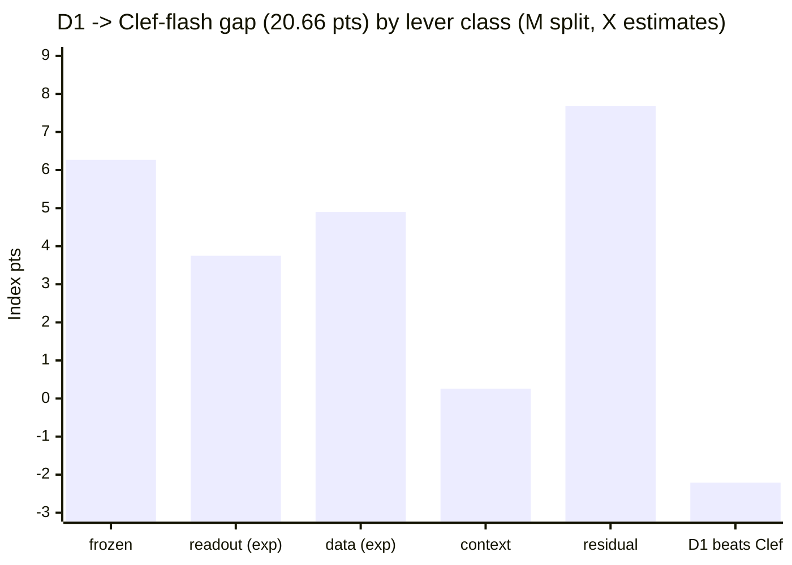

# Gap breakdown B (2026-10-08): where D1 (35.12) and v3w (31.07) lose to Clef-flash (55.78), and which lever closes each piece

Agent B analysis, CPU only, $0. Extends Agent A's `research-notes/D1_GAP_BREAKDOWN.md` (per-benchmark D1 transplants,
error classes, label priors). New here: the **v3w** arm, **paired bootstrap SE per family**, a **readout-vs-training
split** (v1/v2/v2f/v3/v3c/v3p/v3r/v3w stock vs D1), **per question type**, **B1 45k / 100k-v2 coverage**, and a
**lever class + expected points per family**. Labels: **M** = measured with the frozen scorer, **X** = judgement.

## 0. Takeaway first

1. **The D1 gap is 20.66 pts (M). 6.27 of it (30%) sits on the 9 frozen catalogs and cannot be worked** (Home appliances
   3.10, MuSR 1.15, CLadder 1.00, BPoMP 0.36, New Yorker 0.36, Chess 0.18, BBH 0.10, SATA 0.06, POP909 -0.03).
2. **The non-frozen gap is 14.39 net = 16.60 on families where Clef-flash wins, minus 2.21 where D1 already beats it**
   (iSarcasm, RAGTruth, ANLI, GSM8K, VAST). Of the 16.60 (X, rules in section 3):
   - **readout ~ +3.75**: stock v3w gains carried onto the trained cell (API-Bank 1.42, MMLU-Pro 0.83, BANKING77 0.57,
     When2Call 0.28, ACOS 0.23, CRUXEval 0.22, ESCI 0.21). Assumes the stock readout gain composes with training; untested.
   - **data ~ +4.90**: families absent or dropped in D1 that the 45k / 100k-v2 draws now cover (CRUXEval, NLI4CT,
     PhishNChips, WinoGrande, ContractNLI, CLINC, BANKING77, When2Call, HellaSwag, Habermas, ACOS).
   - **context ~ +0.26**: only 8 rows (ToolRet 3, BRIGHT 5; 11.8k-21k tokens) return no result; the Clef-flash transplant
     of exactly those rows is **+0.20** (M). Inference context length is **not** a lever on this subset.
   - **residual ~ 7.68**: pure capacity / knowledge families (ForecastBench 0.87, Humicroedit 0.52, HLE 0.18, cfcolor
     0.18 = 1.75) plus the part of the R/D families the 0.4 transfer rule does not reach (5.93). That 5.93 is upside if
     transfer beats 0.4, capacity otherwise.
3. **The readout is not free on top of training.** v3w - v1 is +6.21 on stock, but +2.21 of it lands on frozen catalogs
   and -2.03 is loss on families D1 relies on (VAST -0.76, NLI4CT -0.51, BFCL -0.34, HellaSwag -0.18, CLINC -0.10) (M).
   A uniform v3w on D1 nets ~ +2.0; keeping v1 ids on those families (selection by family type, fit on train) gets ~ +3.75.
4. **Calibration / prior is spent as an Index lever** (M). The cross-fitted per-benchmark prior correction is
   **-0.57 (label) / -0.83 (position)** on D1 and **-3.18 / -3.31** on v3w. Only over-calling regression families gain
   (PhishNChips +1.04, CRUXEval +0.49, NLI4CT +0.46, HoVer +0.40, ContractNLI +0.25), and these overlap the data levers.
5. **The v3w gap is 24.71 pts** (frozen 7.48, non-frozen 17.23). v3w trails D1 by 4.05. Training wins on BFCL, FinEntity,
   WinoGrande, ContractNLI, When2Call, SATA, ANLI and GSM8K; v3w wins on API-Bank, MMLU-Pro, PhishNChips, ACOS, CRUXEval,
   ESCI, New Yorker, Chess and Habermas (M). **The best composable candidate is D1-style training rendered in v3w with a
   per-family id choice** (the `b-train-v3w` template lane).
6. **Reachable from here (X): ~ +8.9 (readout 3.75 + data 4.90 + context 0.2), i.e. ~ 44 on the subset**, still ~ 12
   short of Clef-flash. Of those 12: 6.27 frozen, ~ 1.75 pure capacity, ~ 5.9 unreached R/D residual (mostly API-Bank,
   CRUXEval, NLI4CT, WinoGrande, ContractNLI, BANKING77, MMLU-Pro).

### Top 10 non-frozen levers by expected points (X)

| Rank | Lever | Families | Exp. pts | Evidence (M) | Next action |
|---|---|---|---|---|---|
| 1 | v3w word-id readout on the trained cell, keeping v1 ids where v3w hurts | API-Bank, MMLU-Pro, BANKING77, When2Call, ACOS, CRUXEval, ESCI | **+3.75** (+2.0 if uniform) | stock v3w - v1: API-Bank +1.42, MMLU-Pro +0.83, BANKING77 +0.57; losses VAST -0.76, NLI4CT -0.51, BFCL -0.34 | run `readout_ab` (stack/rwkv7/ckpt-readout) on the D1 checkpoint: v1 vs v3w vs per-family |
| 2 | Absent-family regression guard (low-rate yes/no, minority entailment) | PhishNChips, NLI4CT, ACOS, Habermas, HellaSwag | **+1.65** | D1 below stock: PhishNChips -0.72, NLI4CT -0.61, ACOS -0.29, HellaSwag -0.27, Habermas -0.19; PhishNChips prior xfit +1.04 | 100k-v2 low-rate views cover ACOS / NLI4CT / HoVer. **PhishNChips and Habermas have no analog in any draw**: add allowed phishing / argument-ranking views |
| 3 | k > 16 intent catalogs D1 dropped | BANKING77, CLINC | **+0.64** data (+0.57 readout in 1) | max_k 16 dropped all 2,578 drawn BANKING77 / CLINC rows; 100k-v2 has 6,438 banking + 10,000 clinc rows at max_k 255 | train 100k-v2 (D10) |
| 4 | CRUXEval procedure data | CRUXEval | **+0.73** data (+0.22 readout in 1) | D1 skill 0 vs Clef-flash 84.9; 2,400 synthetic rows in 45k / 100k-v2; GSM8K precedent 9.6 -> 69.2 from 877 rows | D4 / D10 already carry it: measure on landing |
| 5 | More WinoGrande + steps | WinoGrande | **+0.49** | in-draw 1,097 rows moved 44 -> 58 (ratio 0.25); 100k-v2 has 3,500 | D10 |
| 6 | Doc-level NLI at training length | ContractNLI | **+0.44** | 48 of 67 D1 k>=3 misses have gold at rank 2; median row 3.9k tokens, no training row > 2,048; prior +0.25 | ContractNLI-style long-document NLI views at T=4096 (not a frozen catalog) |
| 7 | API-Bank long catalogs at T=4096 | API-Bank | **+0.39** data (+1.42 readout in 1) | D1 trained 0 API-Bank rows; 1,680 of 2,284 API-Bank train rows are > 2,048 tokens; only 4 of 23 D1 misses are gold-rank-2 | T=4096 rung so the long rows enter the mix |
| 8 | When2Call volume | When2Call | **+0.15** data (+0.28 readout in 1; v3c +0.72) | ratio 0.51 from 895 rows; 100k-v2 has 3,867; 42 of 81 misses gold-rank-2 | D10 |
| 9 | FinEntity / sentiment volume | FinEntity | **+0.14** | sst5 analog ratio 0.61; 100k-v2 has 3.3x | D10; keep v1 ids (v3w -0.07) |
| 10 | Context: no-result rows | ToolRet, BRIGHT | **+0.20** ceiling | 8 rows of 11.8k-21k tokens return no result; Clef-flash fails 4 of them too | a chunked / state-carry readout for > 11k rows; low priority |

Not levers: ForecastBench (+0.87, leaves the index in 0.3), Humicroedit (+0.52; 1,521 in-draw rows moved nothing and
every miss is near-uniform), HLE, cfcolor, and the 9 frozen catalogs.

## 1. Inputs and receipts (M)

| Arm | File | Index (frozen scorer, 2,008-row subset, ids sha 6e4cb8df...) |
|---|---|---|
| D1 child (job-c7pq2, art-bm3e6) | `C:\Users\apumu\rescore_c7pq2\dl\x_final\out\units-child-index.json` (`index_results`) | **35.118** |
| D1 same-job stock parent | `...\x_final\out\parent_arm\units-index.json` | 24.846 |
| Stock readouts (job-fgu2c, art-ivu28) | `C:\Users\apumu\r3_fgu2c_land\work2\x\out\index\{v1,v2,v2f,v3,v3c,v3p,v3r,v3w}\results.jsonl` (byte-identical to `dl-land_r3-09p87n8s`) | v1 24.861, v2 27.313, v2f 29.098, v3 29.441, v3c 26.853, v3p 30.595, v3r 26.295, **v3w 31.068** |
| Clef-flash (job-sgihj) | `review-artifacts\rwkv7-baseline-preserve-20261007\clef-flash-job-sgihj-results.jsonl`, filtered to the subset | **55.780** |

- Scripts: `analysis/gap_b/{common,gap_b,levers}.py`, run with `python -X utf8 -I`. They only call
  `harness.score.decompose / point / weights` and `harness.bootstrap.replicate_skills` (1,000 paired cluster replicates,
  seed 0). Outputs: `analysis/gap_b/out/{gap_b.json, levers.json, table.md}`.
- Per-family gaps are exactly additive: each benchmark's value depends only on its own rows, and the weights are fixed.
  The per-family D1 gaps sum to 20.661 and the v3w gaps to 24.712 (asserted). A real transplant through the frozen
  scorer matches the weight x skill gap for API-Bank, CRUXEval and When2Call (asserted to 1e-6).
- D1 draw counts: Agent A's reproduced draw (`analysis-a/out/d1-draw-families.json`, sha 2bbbf180..., matches the job).
  45k / 100k-v2 counts: `b1-draw/receipts/2026-10-08-B1-draws/*/build-report.json`, `draws.*.by_family`.
- No row text was read beyond question type, option count and proxy_tokens. No TEST, held-out or cohort-v3 data touched.

## 2. Gap by area and by question type (M)

| Area | D1 gap | v3w gap | D1 train lift over v1 (same readout) |
|---|---|---|---|
| Tools | 6.51 | 7.86 | +2.83 |
| Knowledge | 5.36 | 6.77 | +4.15 |
| Retrieval | 3.11 | 3.03 | +1.29 |
| Language | 2.96 | 4.66 | +1.31 |
| Arts | 2.73 | 2.39 | +0.69 |
| **of which frozen** | **6.27** | **7.48** | +3.06 |
| **Total** | **20.66** | **24.71** | +10.27 |

Clef-flash answers transplanted by question type (answer level; non-additive because of F1 / set metrics):

| Question type | D1 | v3w | Biggest contributors (D1) |
|---|---|---|---|
| choice k = 2 | +8.08 | +10.57 | Home appliances, WinoGrande, NLI4CT, CLadder, CRUXEval-k2 0.76, PhishNChips-k2 0.64, ACOS |
| choice k 3-16 | +6.24 | +8.27 | CRUXEval-k3-16 1.21, ContractNLI, MuSR-k3-16 0.88, When2Call, MMLU-Pro |
| choice k > 16 | +4.56 | +4.23 | API-Bank 2.40, BANKING77 1.27, CLINC 0.89 |
| binary (noul) | -0.58 | -0.42 | RAGTruth (D1 beats Clef-flash); PhishNChips binary 0.00 |

Length (Clef-flash transplant on rows by proxy tokens): < 2,048: D1 +16.73 / v3w +20.34; 2,048-8,191: +4.02 / +4.02;
8,192-16,383: +0.39 / +0.91; >= 16,384 (3 rows): 0 / 0 (no arm, Clef-flash included, scores them).
No-result rows: 8 for D1 and v3w (ToolRet 13.7k-14.6k, BRIGHT 11.8k-21.2k), 4 for Clef-flash; transplant **+0.20**.

Rank structure of the misses on non-frozen families: D1 k >= 3 wrong 449, of which **214 (48%) have gold at rank 2**;
D1 k = 2 / binary wrong 969 (654 of them ACOS), 316 with p_gold >= 0.4. v3w: 495 / 215 (43%) and 388 / 109.

## 3. Per-family table (D1 and v3w vs Clef-flash, lever class, evidence, next action)

Columns: gaps are Clef-flash minus candidate in Index pts with paired-bootstrap SE (M). "D1 train lift" = D1 minus the
same-job stock arm, both on the v1 readout (M). "v3w - v1" and "best readout" = stock readout deltas (M). "D1 xfit prior"
= the better of the label / position cross-fitted prior correction on D1 (M; DEV-fit diagnostic). Analog rows = trained
items in the D1 draw / 45k D4 draw / 100k-v2 draw ("0*" = drawn but dropped by max_k 16). Lever class and expected points
are X: readout = clip(v3w - v1, 0, gap); data = 0.4 x (gap - readout), or the stock-revert value for regression families.
0.4 is conservative against the 0.51 median transfer ratio of in-draw families (BFCL 0.79, BRIGHT 0.84, ESCI 0.72,
FinEntity 0.61, When2Call 0.51, WinoGrande 0.25, MMLU-Pro 0.13, HellaSwag -0.67, Humicroedit 0, GSM8K 1.28).
Classes: R readout, D data, C capacity / knowledge, L context length, F frozen, - closed (D1 >= Clef-flash).

| # | Family | Area | Frozen | D1 gap (pts ± SE) | v3w gap (pts ± SE) | D1 train lift vs v1 | v3w − v1 readout | best readout | D1 xfit prior | D1 / 45k / 100k-v2 analog rows | Lever | Exp. pts readout / data | Next action |
|---|---|---|---|---|---|---|---|---|---|---|---|---|---|
| 9 | Home appliance simulator | tools | **F** | +3.10 ± 0.26 | +3.10 ± 0.26 | +0.00 | +0.00 | v3p +0.28 | +0.00 | — | F | 0.00 / 0.00 | measure only (frozen catalog) |
| 3 | API-Bank | tools |  | +2.40 ± 0.33 | +1.96 ± 0.37 | +1.09 | +1.42 | v3 +1.42 | +0.11 | ext:api_bank (<=2,048 tok only): 0 / 604 / 604 | R + D | 1.42 / 0.39 | v3w word ids on the trained cell (ckpt-readout job); api_bank rows >2,048 tok need the T=4096 rung |
| 43 | CRUXEval | knowledge |  | +2.03 ± 0.22 | +1.81 ± 0.30 | +0.00 | +0.22 | v3c +0.40 | +0.49 | ext:cruxeval synthetic: 0 / 2,400 / 2,400 | D + R | 0.22 / 0.73 | cruxeval synthetic 2,400 (45k/100k-v2); GSM8K precedent closed >100% from 877 records |
| 42 | NLI4CT | language |  | +1.36 ± 0.39 | +1.29 ± 0.47 | -0.61 | -0.51 | v2 -0.04 | +0.46 | none -> anli_claim (minority support): 0 / 0 / 3,000 | D (regression) + calib | 0.00 / 0.61 | anli_claim minority-support views (100k-v2); keep v1 ids (v3w -0.51) |
| 4 | BANKING77 | retrieval |  | +1.27 ± 0.21 | +1.33 ± 0.23 | +0.62 | +0.57 | v3p +0.83 | +0.16 | banking77 (k16 / full / member): 0* (1,127 drawn) / 5,000 / 6,438 | D + R | 0.57 / 0.28 | train the k>16 catalogs D1 dropped (100k-v2 has 6.4k banking rows, max_k 255) |
| 28 | WinoGrande | language |  | +1.22 ± 0.37 | +1.50 ± 0.39 | +0.41 | +0.14 | v2 +0.14 | -0.14 | winogrande: 1,097 / 1,200 / 3,500 | D + C | 0.00 / 0.49 | 3.2x winogrande in 100k-v2 + more steps; Clef-flash is 100 |
| 32 | MuSR | knowledge | **F** | +1.15 ± 0.34 | +1.42 ± 0.32 | +0.44 | +0.27 | v2 +0.35 | -0.27 | — | F | 0.00 / 0.00 | measure only (frozen catalog) |
| 11 | ContractNLI | language |  | +1.10 ± 0.14 | +1.48 ± 0.11 | +0.37 | -0.00 | v3c +0.34 | +0.25 | anli (sentence NLI; no doc-level NLI): 1,617 / 1,500 / 6,000 | D (+train-T) | 0.00 / 0.44 | doc-level NLI views at T=4096 (median row 3.9k tok; 72% of D1 misses are gold-rank-2) |
| 44 | CLadder | knowledge | **F** | +1.00 ± 0.35 | +1.67 ± 0.38 | +0.56 | +0.11 | v3w +0.11 | +0.11 | — | F | 0.00 / 0.00 | measure only (frozen catalog) |
| 57 | MMLU-Pro | knowledge |  | +0.98 ± 0.31 | +0.30 ± 0.27 | +0.08 | +0.83 | v3w +0.83 | -0.08 | mmlu_aux / mmlu_verify: 5,315 / 2,000 / 11,416 | R + C | 0.83 / 0.00 | v3w ids on trained cell (+0.83 on stock); mmlu_aux x1.6 + mmlu_verify (ratio was 0.13) |
| 5 | CLINC150+OOS | retrieval |  | +0.89 ± 0.26 | +0.97 ± 0.25 | -0.05 | -0.10 | v3r +0.17 | -0.31 | clinc150 (k16 / member): 0* (1,451 drawn) / 4,500 / 10,000 | D | 0.00 / 0.36 | clinc150_k16 7k + member 3k in 100k-v2; full 150-option catalogs still unsourced |
| 48 | ForecastBench | arts |  | +0.87 ± 0.18 | +0.91 ± 0.18 | +0.07 | +0.03 | v3w +0.03 | -0.28 | none: 0 / 0 / 0 | C (drops in 0.3) | 0.00 / 0.00 | none: ForecastBench leaves the 0.3 index |
| 62 | When2Call MCQ | tools |  | +0.67 ± 0.16 | +1.08 ± 0.17 | +0.67 | +0.28 | v3c +0.72 | +0.03 | when2call: 895 / 2,000 / 3,867 | D + R | 0.28 / 0.15 | when2call x4.3 in 100k-v2; v3c +0.72 / v3w +0.28 on stock |
| 56 | PhishNChips phishing decisions | retrieval |  | +0.64 ± 0.44 | -0.08 ± 0.38 | -0.72 | +0.00 | v3c +0.40 | +1.04 | none: 0 / 0 / 0 | D (regression) + calib | 0.00 / 0.64 | D1 over-calls (cross-fit prior +0.96); stock v1/v3w 52.6 > Clef-flash 50.0 |
| 21 | Humicroedit | arts |  | +0.52 ± 0.20 | +0.59 ± 0.18 | +0.00 | -0.07 | v3c +0.38 | +0.09 | humicroedit s1+s2: 1,521 / 1,000 / 3,000 | C | 0.00 / 0.00 | none: 1,521 in-draw records moved skill 0; every D1 miss is near-uniform (p_gold>=0.4) |
| 50 | Habermas Machine | arts |  | +0.48 ± 0.16 | +0.32 ± 0.15 | -0.19 | +0.00 | v2 +0.00 | -0.06 | none: 0 / 0 / 0 | D (regression) + C | 0.00 / 0.19 | absent family; revert the -0.19 regression |
| 29 | HellaSwag | language |  | +0.45 ± 0.23 | +0.45 ± 0.22 | -0.27 | -0.18 | v2 -0.09 | +0.18 | hellaswag: 1,455 / 1,100 / 4,000 | D (regression guard) | 0.00 / 0.27 | 4,000 hellaswag in 100k-v2; -9.3 skill is within noise |
| 38 | ACOS | language |  | +0.37 ± 0.14 | -0.15 ± 0.31 | -0.29 | +0.23 | v3w +0.23 | -0.06 | none -> clinc/banking member (ACOS-style low-rate yes/no): 0 / 0 / 3,275 | D (regression) + R | 0.23 / 0.14 | low-rate member views in 100k-v2; stock v3w 25.9 already beats Clef-flash 19.8 |
| 20 | BPoMP | arts | **F** | +0.36 ± 0.14 | +0.43 ± 0.15 | +0.60 | +0.53 | v3p +0.85 | +0.07 | — | F | 0.00 / 0.00 | measure only (frozen catalog) |
| 64 | New Yorker caption matching | arts | **F** | +0.36 ± 0.16 | +0.04 ± 0.12 | +0.18 | +0.49 | v2 +0.53 | +0.04 | — | F | 0.00 / 0.00 | measure only (frozen catalog) |
| 39 | FinEntity | language |  | +0.34 ± 0.15 | +0.93 ± 0.20 | +0.52 | -0.07 | v3w -0.07 | -0.17 | sst5 (loose): 604 / 700 / 2,000 | D | 0.00 / 0.14 | sst5 x3.3 in 100k-v2; keep v1 ids (v3w -0.07) |
| 37 | Amazon ESCI | retrieval |  | +0.21 ± 0.40 | +0.09 ± 0.45 | +0.55 | +0.68 | v3w +0.68 | -0.07 | nq retrieval (loose): 1,616 / 817 / 817 | R | 0.21 / 0.00 | v3w word ids (stock v3w 25.9 vs D1 21.7, Clef-flash 28.7) |
| 31 | ChessBench | knowledge | **F** | +0.18 ± 0.19 | -0.06 ± 0.20 | +0.12 | +0.40 | v3 +0.40 | +0.00 | — | F | 0.00 / 0.00 | measure only (frozen catalog) |
| 45 | HLE | knowledge |  | +0.18 ± 0.20 | +0.18 ± 0.20 | +0.00 | +0.00 | v3c +0.09 | +0.00 | mmlu_aux (loose): 5,315 / 2,000 / 11,416 | C | 0.00 / 0.00 | none (Clef-flash 6.2) |
| 23 | cfcolor | arts |  | +0.18 ± 0.17 | +0.13 ± 0.24 | -0.01 | +0.04 | v2 +0.21 | +0.08 | none: 0 / 0 / 0 | C | 0.00 / 0.00 | none (per-user colour preference; Clef-flash only 12.7) |
| 1 | BFCL | tools |  | +0.17 ± 0.10 | +1.15 ± 0.19 | +0.64 | -0.34 | v3w -0.34 | +0.00 | glaive_fc+toolace tool_select: 3,312 / 10,741 / 20,132 | D (near-closed) | 0.00 / 0.07 | keep BFCL in mix; do NOT adopt v3w word ids here (v3w-v1 = -0.34) |
| 2 | ToolRet | tools |  | +0.17 ± 0.12 | +0.57 ± 0.14 | +0.43 | +0.03 | v3p +0.14 | -0.87 | tool catalogs (glaive_catalog16/long): 0 / 5,000 / 15,602 | L + D | 0.00 / 0.00 | 3 rows 13.7k-14.6k tok return no result; tool-catalog views are in 45k/100k-v2 |
| 58 | BBH fixed-option tasks | knowledge | **F** | +0.10 ± 0.34 | +0.29 ± 0.35 | +0.39 | +0.19 | v3r +0.29 | +0.39 | — | F | 0.00 / 0.00 | measure only (frozen catalog) |
| 36 | BRIGHT | retrieval |  | +0.09 ± 0.19 | +0.32 ± 0.20 | +0.49 | +0.26 | v3c +0.35 | -0.42 | nq retrieval: 1,616 / 817 / 817 | L | 0.00 / 0.00 | 5 rows 11.8k-21k tok give no result (Clef-flash also fails 4) |
| 33 | SATA-Bench | knowledge | **F** | +0.06 ± 0.17 | +0.62 ± 0.18 | +0.73 | +0.17 | v3c +0.23 | -0.28 | — | F | 0.00 / 0.00 | measure only (frozen catalog) |
| 25 | GPQA Diamond | knowledge |  | +0.00 ± 0.56 | +0.41 ± 0.46 | +0.41 | +0.00 | v3p +0.14 | -0.27 | mmlu_aux: 5,315 / 2,000 / 11,416 | - (D1 = Clef) | 0.00 / 0.00 | none (14 questions) |
| 61 | HoVer claim verification | retrieval |  | +0.00 ± 0.31 | +0.40 ± 0.27 | +0.40 | +0.00 | v3p +0.80 | +0.40 | anli_claim (HoVer-style): 0 / 0 / 3,000 | - (D1 = Clef) | 0.00 / 0.00 | none |
| 22 | POP909-CL | arts | **F** | -0.03 ± 0.03 | -0.03 ± 0.03 | +0.05 | +0.05 | v3r +0.08 | +0.01 | — | F | 0.00 / 0.00 | measure only (frozen catalog) |
| 41 | VAST | language |  | -0.13 ± 0.20 | +0.25 ± 0.33 | -0.30 | -0.76 | v3c -0.55 | +0.01 | none (stance): 0 / 0 / 0 | - (D1 > Clef) | 0.00 / 0.00 | keep v1 ids: v3w -0.76 on stock is the largest readout risk |
| 30 | GSM8K | knowledge |  | -0.31 ± 0.32 | +0.13 ± 0.38 | +1.43 | +0.98 | v3 +0.98 | +0.10 | gsm8k: 877 / 4,238 / 4,238 | - (D1 > Clef) | 0.00 / 0.00 | none (do not upweight) |
| 12 | ANLI | language |  | -0.46 ± 0.40 | +0.05 ± 0.49 | +0.78 | +0.04 | v3c +0.13 | +0.10 | anli: 1,617 / 1,500 / 6,000 | - (D1 > Clef) | 0.00 / 0.00 | none |
| 59 | RAGTruth response-level hallucination | language |  | -0.58 ± 0.43 | -0.42 ± 0.43 | +0.47 | +0.30 | v3c +0.58 | -0.14 | boolq / anli_claim (loose): 1,227 / 1,700 / 7,000 | - (D1 > Clef) | 0.00 / 0.00 | none |
| 40 | iSarcasmEval | language |  | -0.72 ± 0.70 | -0.72 ± 0.72 | +0.23 | +0.00 | v2 +0.00 | -1.12 | none: 0 / 0 / 0 | - (D1 > Clef) | 0.00 / 0.00 | none |

## 4. Totals by lever class (D1 -> Clef-flash, Index pts)

| Class | Pts | Kind |
|---|---|---|
| Frozen (9 catalogs) | 6.27 | M; measure only. Home appliances alone is 3.10 (D1 skill 0 vs 91.7). It is frozen in heldout-draw-v1, so A's "case-exact readout fix" is out of scope here |
| Readout-reachable | 3.75 | X (selective v3w); +2.0 if v3w is applied uniformly (M deltas, additivity assumed) |
| Data-reachable | 4.90 | X (0.4 transfer rule; regression families = stock revert) |
| Context length (inference) | 0.26 | M ceiling 0.20 from the 8 no-result rows |
| Neither: pure capacity / knowledge | 1.75 | ForecastBench 0.87, Humicroedit 0.52, HLE 0.18, cfcolor 0.18 |
| Neither: unreached residual of R/D families | 5.93 | X; upside if transfer > 0.4, otherwise capacity |
| Families where D1 already beats Clef-flash | -2.21 | M (iSarcasm -0.72, RAGTruth -0.58, ANLI -0.46, GSM8K -0.31, VAST -0.13) |
| **Total** | **20.66** | |

## 5. Differences from Agent A's D1 breakdown

- The D1 per-benchmark transplant numbers match A's exactly (Home appliances 3.10, API-Bank 2.40, CRUXEval 2.03, ...),
  now with paired SE. Of A's top items, Home appliances (+-0.26), API-Bank (+-0.33), CRUXEval (+-0.22), BANKING77
  (+-0.21) and ContractNLI (+-0.14) are > 5 SE; NLI4CT (1.36 +- 0.39) and WinoGrande (1.22 +- 0.37) are > 3 SE.
- A assigns Home appliances' +3.10 to a readout fix. It is a FROZEN catalog, so here it is measured and given no lever.
  MuSR / CLadder / SATA (proxies in A's lever 2) are frozen too: 2.21 of A's "procedure / reasoning" points are not
  workable by data or readout.
- My cross-fitted prior on D1 is -0.57 / -0.83 (A: -0.03 / +0.43). The implementations differ: mine keys the prior by
  (k, option id) or (k, position), includes binary questions, and folds by kit group id. Both say the lever is ~ 0.
- New: v3w is not uniformly additive with training (-2.03 on families D1 relies on), and 2.21 of v3w's +6.21 lands on
  frozen catalogs, so the readout's workable value over D1 is 2.0-3.75, not 6.2.

## 6. Caveats

- Per-family expected points are X and overlap across levers (readout and data on API-Bank, BANKING77, CRUXEval,
  When2Call; calibration overlaps the regression guard). The class totals assign each point once.
- The readout estimate assumes stock v3w - v1 deltas carry to a v1-trained checkpoint. The `readout_ab` mode (saved
  checkpoint under several readouts, one model load) measures this directly and should run before any v3w-trained cell.
- 43-question families have a skill SE of 7-15; per-family gaps under ~2 SE (see the table) are not resolved.
- Subset only (2,008 rows). Full-DEV Clef-flash is 57.29; the full-DEV split for D1 / v3w needs their full-DEV runs.
