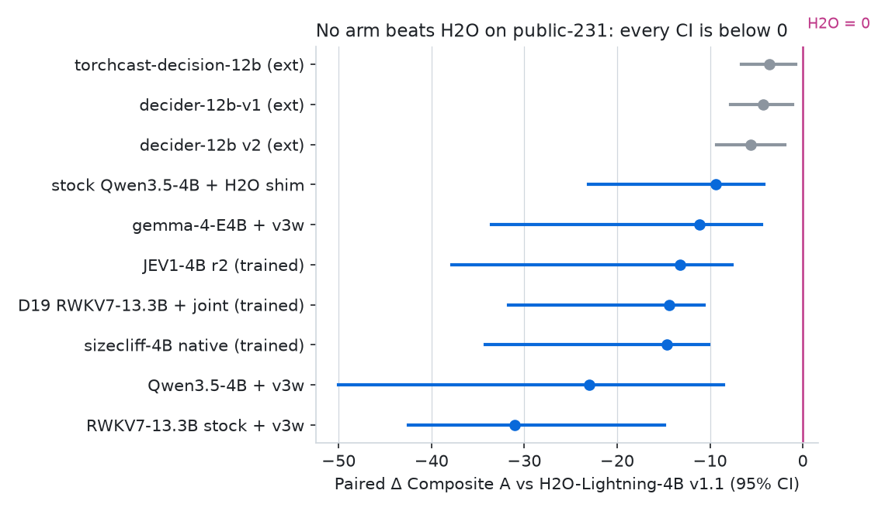
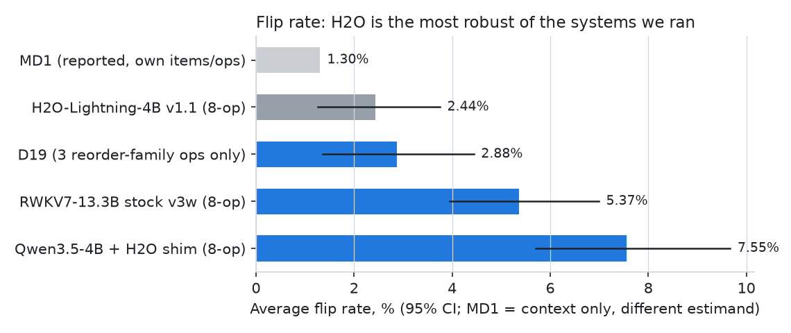
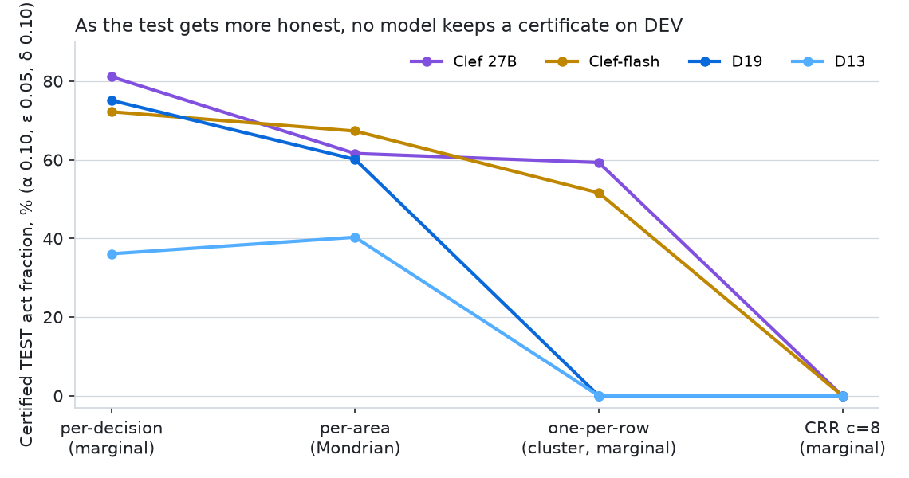

# EVIDENCE REPORT: where every target stands (evidence lane, 2026-10-11)

Consolidates the evidence lane's receipts as of origin/state `6af12234`. Every number below comes from a receipt file that was read for this report, not copied from a summary. Each cites branch@sha + file, the job id where one exists, and the governing prereg id (state `PREREG.md`). No new measurement was made. All branch tips were checked against `origin` on 2026-10-11 and all of them match the shas cited.

**Bottom line.** Kit parity is done, so our JevBench numbers count. But nothing we have trained or served beats any target:

- **Composite and Capability:** every arm sits significantly below H2O-Lightning-4B v1.1 on the public-231 items. The gap is Intelligence.
- **Clef:** D19, our best model, is 7.8 Index points behind Clef-flash and 12.4 behind Clef 27B on full DEV.
- **Guarantees:** the guarantee suite's proofs hold. The conformal "actionability" certificates do not: under a cluster-valid test, no model, Clef included, keeps a certificate on DEV at the pre-registered cap.
- **MD1:** only partly comparable. On flip rate H2O (2.44%) is closest to MD1's reported 1.3%. Our stock 4B + shim is at 7.55%.

---

## 1. Kit parity (EV-PREREG-KIT-PARITY)

**Takeaway.** Our scorer (jevkit) reproduces 3 published open-weights rows within the pre-registered tolerance, so our JevBench numbers count (AGENTS.md Done 0). The 4th row (torchcast) fails by 5 items, and the cause is identified. Local scores are on a different scale from the board: the board uses 300 open + 1,200 sealed items we cannot download. H2O scores I 77.6 locally against 60.0 on the board with the identical 205/231 card. So local numbers are only ever compared pairwise against H2O run by us (EV-PREREG-COMPOSITE-LOCAL), never against the board's 72.5.

Receipt: `claude/ev-kit-parity @5d674b2d`, `receipts/2026-10-10-ev-kit-parity/README.md`, `decision.json`, `torchcast_compare.json`. Job-r3uc4 (art-t4psd, $0.55); H2O anchor job-zbtbj. Rule: all 231 answered AND top-1 within 3 of the author-published public-231 count.

| Row (pinned weights) | Readout | Ours (easy/std/hard) | Published | Diff | Verdict |
|---|---|---|---|---|---|
| h2o-lightning-4b @193ad740 (job-zbtbj) | vendored shim | 205 (48/71/86) | 205 (48/71/86) | 0 | PASS |
| decider-12b v2 @8ac1efa7 | decider-ai 1.8.0 system_one | 197 (48/71/78) | 198 (48/71/79) | −1 | PASS |
| decider-12b-v1 @09e9e338 | same | 200 (48/71/81) | 200 (48/71/81) | 0 | PASS (exact per tier) |
| torchcast-decision-12b @49107b55 (double-bos arm) | vendored shim | 198 (46/68/84), 226/231 answered | 203 (48/70/85) | −5 | FAIL |

- **The torchcast gap is attributed.** On 5 items the option letter is missing from the raw top-20 logprobs. The author's vLLM run evidently took logprobs after the letter mask. Prompt tokens match on 226/226 answered items, and top-1 agrees on 224/231. Under the prereg this row stays FAIL: no re-run with an altered readout counts.
- **Local scale differs from board scale.** `decision.json` gives H2O's board I as 60.04. The scorecard gives local I as 77.6. That is the −17.6 open→board gap every later report carries as a caveat.

## 2. JevBench Composite and Capability, paired vs H2O-Lightning-4B v1.1 (public-231)

**Takeaway.** No arm beats H2O. Every one of our arms has a paired Composite-A CI entirely below 0, and so do the external 12B systems.
- **Best untrained arm:** stock Qwen3.5-4B served with H2O's shim, at −9.4.
- **Best trained cell:** D19, at −14.4. JEV1-4B r2, our Composite-aimed cell, lands at −13.2.
- **The gap is Intelligence, not speed or cost.** Holding S at H2O's value moves every Δ by less than 2 points. D19's I is 52.6 against H2O's 77.6.

Receipts:
- `claude/ev-scorecard @e2fcd82b`, `receipts/2026-10-10-ev-scorecard/SCORECARD.md` + `SCORECARD.json`. 28 arms, paired stratified bootstrap B=1000 seed 16, max |diff| vs every in-job report 0.0.
- JEV1-4B r2 row: `claude/ev-j1-rescore @a8ca3e7e`, `receipts/2026-10-10-ev-rescore-xt3ax/RESCORE_XT3AX.md` (job-xt3ax).
- Prereg: EV-PREREG-COMPOSITE-LOCAL. Baseline: H2O @193ad740, job-zbtbj (EV-PREREG-H2O-HOST amendment 1 pins this revision).

| Arm (job) | I | C | Composite A | **Δ Comp A vs H2O [95% CI]** | Δ Capability vs H2O [95% CI] |
|---|---|---|---|---|---|
| H2O-Lightning-4B v1.1 (zbtbj), baseline | 77.6 | 83.4 | 76.6 [72.8, 78.3] | — | — (Cap 80.5) |
| torchcast-decision-12b double-bos (r3uc4), external, parity FAIL | 76.4 | 82.6 | 73.1 | −3.6 [−6.6, −0.8] | −1.0 [−7.7, 5.2] (ns) |
| decider-12b-v1 (r3uc4), external | 72.5 | 80.9 | 72.4 | −4.3 [−7.8, −1.1] | −3.8 [−11.2, 3.0] (ns) |
| decider-12b v2 (r3uc4), external | 70.8 | 77.9 | 71.0 | −5.6 [−9.3, −1.9] | −6.1 [−14.1, 1.9] (ns) |
| **stock Qwen3.5-4B + H2O shim (zbtbj)**, best of ours | 56.3 | 69.3 | 67.3 | **−9.4 [−23.1, −4.2]** | −17.7 [−26.5, −8.2] |
| gemma-4-E4B + v3w (zbtbj) | 58.9 | 57.4 | 65.6 | −11.1 [−33.5, −4.4] | −22.3 [−33.6, −10.1] |
| **JEV1-4B r2 native (xt3ax)** | 51.18 | 64.69 | 63.43 | **−13.21 [−37.82, −7.59]** | −22.56 [−31.95, −12.40] |
| **D19 RWKV7-13.3B + joint (9j3uu)**, best trained | 52.6 | 74.0 | 62.3 | **−14.4 [−31.7, −10.6]** | **−17.2 [−26.6, −10.7]** (best ΔCap of ours) |
| sizecliff-4B native (27anq) | 51.0 | 59.6 | 62.1 | −14.6 [−34.2, −10.1] | −25.2 [−32.7, −17.4] |
| RWKV7-13.3B stock + v3w (zbtbj) | 43.4 | 82.0 | 45.6 | −31.0 [−42.5, −14.9] | −17.8 [−26.6, −12.4] |

The full 28-arm table is in SCORECARD.md.
- **Capability target.** Quyet-1.0-Large (81.7) is not downloadable, so the rule compares against the best downloadable Capability row, which is H2O at a local 80.5.
- **Noise floor.** RWKV7-13.3B stock was measured twice, giving S 86.1 vs 83.4. So S differences of about 3 points are cross-job noise.
- **Caveat (every number).** These are open public items only. The board's sealed split may rank differently (open→board I gap on H2O: −17.6).

## 3. JEV1-4B r2 (A-PREREG-JEV1-4B): FAIL

**Takeaway.**
- **The training made the Composite worse, not better.** The PRIMARY is Δ Composite A vs stock 4B + shim, and it fails: −4.07 [−25.64, +3.22]. The independent rescore agrees with the in-job `screen.json` on all 67 numbers (max |diff| 0.0).
- **The loss is in one family.** It comes from long_policy, which fell 31.6 pp.
- **Length is not the cause.** multi_hop is equally long and was not trained on, yet it rose 11.8 pp. What hurt is the jev1 draw's long_policy templates and label priors.
- **A second regression: noul hedging.** Training made yes/no (noul) answers hedge into p ∈ (0.2, 0.8), which jevkit scores as wrong. The trained arm did this on 10 of 74 noul items; stock did it on none.

Receipts:
- `claude/ev-j1-rescore @a8ca3e7e`, `receipts/2026-10-10-ev-rescore-xt3ax/RESCORE_XT3AX.md`, `rescore-xt3ax-full.json` and `length-xt3ax.json`. The primary was first committed at e2b336c6; a8ca3e7e adds the length split.
- Job-xt3ax, art-mv9cr (sha matches autor), checkpoint best@1000.
- Train-side audit: `claude/ev-jev1-audit @13c63fdc`, `JEV1_AUDIT.md`.

| Quantity | native (trained) | stock + shim | Δ [95% CI] |
|---|---|---|---|
| **Composite A (PRIMARY)** | 63.43 | 67.50 | **−4.07 [−25.64, +3.22]**, NOT SUCCESS |
| Intelligence | 51.18 | 57.05 | −5.87 [−15.81, +5.11] |
| Calibration | 64.69 | 70.21 | −5.52 [−17.62, +5.18] |
| Capability | 57.93 | 63.63 | −5.69 [−15.76, +4.22] |
| top-1 (jevkit correctness) | 166/231 | 173/231 | −7; McNemar p 0.38 |
| long_policy top-1 (19 items, all > 2,048 tok) | 21.1% | 52.6% | **−31.6 pp** [−58.0, 0.0]; NLL +0.712 |
| multi_hop > 2,048 tok (17 items, not trained on) | 12/17 | 10/17 | **+11.8 pp** [−11.8, +35.3]; NLL −0.051 |
| noul answers in the 0.2–0.8 band (scored wrong) | 10/74 | 0/74 | hedging |

- **Why the CI is so wide.** The lower bound −25.64 comes from the Composite's I < 50 floor: native I is 51.18, and it falls below 50 in 41.9% of resamples. With the floor term removed, the CI is still [−10.25, +1.92]. The verdict does not depend on the floor.
- **What the audit found** (JEV1_AUDIT.md):
  - jev1's long_policy is 3 synthetic generators with 11 instruction strings.
  - Its noul gold is 66% "false", and its noul criteria are empty on all 4,627 noul rows.
  - No row is longer than 1,975 tokens, while the public long_policy items are 2,350–3,952 tokens.
  - Its states are JSON dicts; the public states are prose.
- **A note on top-1 counts.** The audit counts top-1 by argmax (172 vs 173). The rescore uses jevkit's correctness rule (166 vs 173). They differ because jevkit scores the 10 noul abstentions as wrong. Both figures are consistent; quote the jevkit one, since it is what feeds the Composite.
- The lead's successor is A-PREREG-JEV2-4B (amendment 2: jev1 long_policy excluded, noul label smoothing 0, max_len 4,096, score rows about 25%).

## 4. MD1 (reported numbers only; never re-run)

**Takeaway.**
- **What we can compare.** Only robustness (flip rate) is measured comparably enough to show. Accuracy, calibration and latency are not on a shared item set: MD1's items are private.
- **H2O is the most robust system we ran.** Its 8-operator average is 2.44% [1.26, 3.75]. Our stock 4B + shim averages 7.55%, and stock RWKV7 averages 5.37%.
- **D19's reorder zeros are not learned robustness.** D19 gets 0 reverse and 0 shuffle flips by construction, because its readout sorts the options. Its relabel flip rate is 8.6%, which cuts stock RWKV7's 22.3% sharply.
- **MD1's 1.3% is context only.** It is a different estimand.

Receipts:
- `claude/ev-flip-rate @4a65dd18`, `receipts/2026-10-10-ev-flip-rate/FLIP_RATE.md`.
- Run 2 governs: `run2/flip_ci_8op.json` and `run2/flip_ci_3op_d19.json`, from job-z8jcd (claude/ev-flip-hs @a7c431b0) and job-andnb (claude/ev-flip-d19 @552f2143).
- Prereg: B-PREREG-FLIP + amendment 1. Run 1 is partly void: a `sort_keys=True` defect in `jevkit perturb make` turned reverse and shuffle into no-ops.

| System | state | instr | opt-para | reverse | shuffle | relabel | whitespace | markup | **avg [95% CI]** |
|---|---|---|---|---|---|---|---|---|---|
| MD1 (reported, own items/ops) | ? | ? | 0 | 0 | 0 | ? | ? | ? | 1.3% (context only) |
| H2O-Lightning-4B v1.1 | 1.0 | 0.9 | 1.3 | 2.8 | 2.3 | 4.3 | 3.0 | 3.9 | **2.44 [1.26, 3.75]** |
| Qwen3.5-4B + H2O shim | 2.9 | 3.5 | 6.9 | 12.2 | 9.4 | 8.6 | 8.2 | 8.7 | **7.55 [5.71, 9.67]** |
| RWKV7-G1k-13.3B stock (v3w) | 2.9 | 2.6 | 3.5 | 0.0* | 0.0* | 22.3 | 7.8 | 3.9* | **5.37 [3.95, 6.99]** |
| D19 (3 reorder-family ops only) | — | — | — | 0.0* | 0.0* | **8.6** | — | — | 3-op 2.88 [1.36, 4.44] |

\* Zero by construction: the Decider path sorts options by id, so these perturbations do not change its input. Paired deltas:
- H2O vs Qwen-shim: −5.11 pp [−7.27, −3.04] on the 8-op average.
- D19 vs stock RWKV7: −4.56 pp [−6.86, −2.49] on the 3 reorder ops. D19's relabel alone vs stock: −13.67 pp [−20.59, −7.48].

**Comparability caveats (MD1):**
1. MD1's operators are unpublished; ours are rule-based. Our state paraphrase is shallow (it changes 104 of 231 states), formatting noise counts as two operators, and there is no third reorder.
2. MD1's item set is private; ours is the 231 public JevBench items.
3. MD1 was not run.
4. Zeros by construction are a property of the readout, and MD1's 0 reorder flips may be the same kind of property.
5. One perturbation seed, so the CI covers item sampling only.

**Other MD1 axes.**
- **Calibration:** MD1 reports 92.2. Our jevkit C is 74.0 for D19 and 83.4 for H2O, but on different items and a different formula basis, so the numbers are not comparable.
- **Latency:** MD1 reports p50 85 ms (Foundry). Our local S comes from in-process H100 wall time with the self-hosted ×2 + 0.15 s adjustment, a different serving stack. It is not comparable as an absolute.
- **Accuracy:** MD1's 83.5% average is on its own private suite. There is no shared item set.

## 5. Decision Index vs Clef-flash and Clef 27B (full DEV, 12,104 rows)

**Takeaway.**
- **D19 is our best model, and both Clefs beat it.** It scores 49.49 on full DEV: 7.80 points below Clef-flash and 12.40 below Clef 27B, and both CIs exclude 0. B-PREREG-CLAIM fails in every view.
- **Calibrating D19 did not help.** The calibrated variant scores 49.44 and makes calibration worse.
- **Where D19 loses:** knowledge (−9.1 accuracy vs Clef-flash, with ECE 0.157 from overconfidence), arts (−3.9) and tools (−2.4). Against Clef 27B it also loses retrieval (−9.0).
- **The RAGTruth rephrase fix adds nothing to the Index.**

Receipts:

| System | Index [95% CI] | vs Clef-flash (57.29) | vs Clef 27B (61.89) | Receipt |
|---|---|---|---|---|
| **D19** untempered (primary), best step 2800 | **49.49 [47.77, 50.80]** | **−7.80 [−9.84, −6.18]** | **−12.40 [−14.29, −10.82]** | state ledger row 2026-10-10T12:08Z (job-y6ste + job-uq5p5, d098517, results b6bab803); reproduced exactly in job-zyp3h (`claude/ev-d19-cal-rescore @281a0bb9`, `RESCORE_D19_CAL.md`, `receipts/2026-10-10-ev-d19-cal-rescore/job-zyp3h/land_untempered.json`) |
| D19 calibrated (global T 0.806) | 49.44 [47.72, 50.77] | −7.85 [−9.91, −6.24] | −12.45 [−14.34, −10.87] | `claude/ev-d19-cal-rescore @281a0bb9`, job-zyp3h `land_calibrated.json` (prereg B-PREREG-D19-TEMP; secondary) |
| D13 | 43.21 [41.63, 44.26] | −14.08 [−16.05, −12.60] | −18.68 [−20.53, −17.21] | state ledger row 2026-10-10T04:45Z (job-3z2m7 + job-hc6wp, c089aaf, results 7b42f4c3) |
| Clef 27B / Clef-flash | 61.89 [60.28, 63.28] / 57.29 [55.88, 58.67] | | | job-zfexa / job-t5yg2 (as landed in job-zyp3h) |

- **Calibration.** Board ECE is 0.0705 for D19 untempered vs 0.1235 calibrated. The Clefs are at 0.0403 and 0.0314. D19's 10-bin ECE is 0.0406. The tempering's T < 1 sharpens the probabilities: that helps only the language area and hurts every lower-accuracy area. On jevkit, Calibration falls from 74.01 to 68.28 and Composite A from 62.25 to 61.27. Recorded in DEAD_ENDS.
- **Comparison detail.** `beats_both` is False on full and on full_excl51 (D19 49.70; −7.85 / −12.36).

**Per-area accuracy and ECE** (descriptive add-on). Receipt: `claude/ev-guar-area @ca32b61f`, `receipts/2026-10-10-ev-guar-area/GUARANTEES_AREA.md` §5 and `AREA_ACCURACY.json`. Case-cluster bootstrap B=2000 seed 0.

| Area (n decisions) | D19 acc / ECE | Clef-flash acc / ECE | Clef 27B acc / ECE | Δ acc D19 − Clef-flash |
|---|---|---|---|---|
| arts (2,434) | 61.3 / 0.074 | 65.3 / 0.029 | 66.4 / 0.053 | **−3.9 [−6.4, −1.5]** |
| knowledge (4,532) | 66.7 / **0.157** | 75.8 / 0.029 | 75.8 / 0.058 | **−9.1 [−10.6, −7.8]** |
| language (19,300) | 95.5 / 0.038 | 94.5 / 0.058 | 95.8 / 0.049 | +0.9 [−0.0, +1.7] (ns) |
| retrieval (3,883) | 72.5 / 0.104 | 73.4 / 0.071 | 81.5 / 0.047 | −0.9 [−3.5, +1.8] (ns); vs Clef 27B −9.0 [−11.7, −6.1] |
| tools (4,570) | 88.0 / 0.046 | 90.5 / 0.024 | 91.8 / 0.028 | **−2.4 [−3.4, −1.5]** |
| overall (34,719) | 85.8 / 0.062 | 87.1 / 0.023 | 89.0 / 0.011 | **−1.4 [−2.2, −0.6]** |

**RAGTruth rephrase (B-PREREG-RAGTRUTH-REPHRASE): negative.**
- Receipt: `claude/ev-ragtruth-rephrase @2007eded`, `receipts/2026-10-11-ev-ragtruth-rephrase-stage1/ragtruth_rephrase_result.json` and `-stage2/land_d13.json`, `land_d19.json`.
- **Stage 1 passed for both arms.** The RT1 wording un-inverts D13's RAGTruth ranking: TRAIN AUROC goes from 0.418 [0.353, 0.481] to 0.589 [0.521, 0.654], paired +0.171 [0.098, 0.244]. D19 was already at 0.912 and moved to 0.919, paired +0.007 [0.001, 0.014].
- **Stage 2 failed for both arms.** The Index delta on DEV minus proxy600 (11,460 rows) is D13 +0.000 [0.000, 0.000] and D19 +0.127 [0.000, 0.320]. Neither CI lower bound is above 0, so RT1 is retired for both arms (DEAD_ENDS).

## 6. Guarantee suite

**Takeaway.**
- **The structural guarantees hold.**
  - The reorder/relabel invariance proof holds, and its test harness has teeth.
  - The lead's sym-fork layout is independently CONFIRMED bitwise reorder- and relabel-invariant: 11/11 harness tests plus 74/74 adversarial tests at tolerance 0.
  - The injection-robust conformal construction is exact in its "matched" mode: 0.901 coverage under attack at α 0.10 in a synthetic test.
- **One real leak was found.** G15's trusted/untrusted separation fails under a real BPE tokenizer, because tokens merge across the segment boundary.
- **The conformal actionability certificates did not survive.** Each step made the test more honest:
  1. Per decision, D19 looked more actionable than Clef-flash.
  2. Per area, D19 fell behind.
  3. With one decision per row, D19 certified nothing.
  4. Under the pre-registered cluster-robust ratio test at cap 8 (CRR c=8), no model certifies anything on DEV.
- **What remains open:** a fixed-sequence CRR on an unseen split.

**Proofs, harness and checks:**

| Item | Verdict | Receipt |
|---|---|---|
| Reorder invariance proof + property tests | Proof sound after review. The fp tolerance was corrected from γ_{K+2} to γ_{2K}. Four vacuous or circular tests were fixed, including an LTT seed test that never certified. | `claude/ev-guarantee-proofs` @f7170cb8 (suite), @54701347 (`docs/guarantees/REVIEW.md`) |
| sym-fork (stack/qwen35/sym-invariant @42388c2c) reorder + relabel, bitwise | **CONFIRMED**: harness 11/11; 74/74 adversarial cases (K 2–10, 5 seeds; batch vs single; unicode, whitespace and id styles). Teeth: the `ordered` layout fails relabel with 7 flips. Empty descriptions break relabel, as declared. | `claude/ev-sym-check @1351ed9f`, `SYM_CHECK.md` |
| G16-sym (@2d913b3e) reorder/relabel, outward rounding, G15 on [lo, hi] with the byte encoder | **CONFIRMED** (43 passed, 1 strict xfail) | same |
| **G15 under a real BPE tokenizer** (Qwen) | **FAILS.** The trusted token list depends on untrusted text at segment boundaries: an undeclared description, or a raw-string state ending in "\n". The same leak is in sym-fork v2. Fix: encode the trusted and untrusted segments separately. | same, §5 |
| `perturb_eval` G1 gate | Partly vacuous if an operator yields no perturbation. Its 1e-3 gate is weaker than the bitwise claim. | same, §3 |
| Injection-robust conformal, matched mode (s_lo / s_lo) | Exact split conformal: synthetic coverage under attack 0.901, mean set size 2.30 (clean reference 0.897 / 2.08). The naive set covers only 0.559. Implemented as `--mode matched`. | `claude/ev-guarantee-proofs @1c7c7a70`, `docs/guarantees/INJECTION_ROBUST_CONFORMAL.md` |
| State-stability claims T1–T5 (adversarial review) | T1, T3 and T4 CONFIRMED. The universal ρ and T2(a) are overclaimed in floats: bf16 rounds RWKV-7's w to 1.0. F4 is wrong in scope. T5 applies to no model we currently run. JSR > 1 is confirmed at the parameter-box level. | `claude/ev-review-stability @e89b29cc`, `docs/REVIEW_STATE_STABILITY.md` |

**Conformal actionability progression** (TEST act fraction at α 0.10, ε 0.05, δ 0.10, primary run_id split):

| Model | Per-decision marginal (B-PREREG-GUAR-FULLDEV) | Per-area (B-PREREG-GUAR-AREA) | One-per-row cluster, marginal / per-area (B-PREREG-GUAR-CLUSTER) | **CRR c=8**, marginal / per-area (B-PREREG-GUAR-CRR) |
|---|---|---|---|---|
| Clef 27B | 81.1% | 61.6% | 59.3% / 7.9% | **0 / 0** |
| Clef-flash | 72.2% | 67.3% | 51.6% / 39.9% | **0 / 0** |
| D19 | 75.1% | 60.1% | **0 / 0** | **0 / 0** |
| D13 | 36.1% | 40.3% | 0 / 0 | 0 / 0 |

Receipts, by column:
1. `claude/ev-guar-area @ca32b61f`, `receipts/2026-10-10-B-guarantees-fulldev/` (originally claude/b-guarantees-fulldev @62028486).
2. Same branch, `receipts/2026-10-10-ev-guar-area/GUARANTEES_AREA.md`.
3. `claude/ev-guarantee-proofs @b4835e05`, `receipts/2026-10-10-ev-guar-cluster/GUARANTEES_CLUSTER.md`.
4. `claude/ev-guarantee-proofs @01738528`, `receipts/2026-10-10-ev-guar-crr/GUARANTEES_CRR.md`. All are $0 CPU reanalyses of the full-DEV predictions: D19 b6bab803, D13 7b42f4c3, Clef 27B f5ad788b, Clef-flash 2cb2e961.

**Why each step changed the verdict:**
- **Per-decision → per-area.** The marginal fit under-covered arts, knowledge and retrieval (coverage 0.69–0.84). With per-area coverage enforced, D19 − Clef-flash flips from +2.9 [+0.2, +5.1] to −7.2 [−9.6, −5.3]. No model certifies arts or retrieval, and only Clef-flash certifies knowledge.
- **Per-area → one-per-row.**
  - The per-decision binomial counts a row's correlated decisions as independent trials. The simulation shows this is anti-conservative: 16 of 120 seeds violate, above δ.
  - D19's confident decisions sit in few rows. At λ 0.95, 4,321 acted decisions come from only 307 rows.
  - Its p_max tops out near 0.96.
  - Its error on single-decision rows is 11.5%, against 1.7% in rows with 8+ decisions.
- **One-per-row → CRR c=8.** The quantity the cap-8 test certifies (R_8) really is above ε at the published λ: 8.7% for D19, 5.1% D13, 6.3% Clef-flash, 6.5% Clef 27B. At high λ, where R_8 is 1–2%, the betting test falls short of the 6.92 nats that the Bonferroni level needs: the Clefs reach about 6.5, D19 4.3. The c=1 secondary reproduces the Clef one-per-row certificates (0.490 / 0.559), which cross-checks the implementation.

**Open.** B-PREREG-GUAR-FSCRR is a fixed-sequence CRR on an unseen Index 0.2.1 pool sample. It needs 2.30 nats instead of 6.92, and diag_crr shows D19 and both Clefs exceed that at their top λ on DEV. It was registered at state b0bb96c0 before any prediction exists on that split, and it is in progress. DEV cannot be re-tested for this, because we have already looked at it.

## 7. Data: draws and leak audits

**Takeaway.**
- **The draws are clean, but jev1 was badly shaped.** No draw leaks eval text, yet jev1 is mis-shaped for the public items: lengths, formats, priors and empty noul criteria. That explains JEV1-4B r2's regressions.
- **jev2a and jev2c are cleared** after independent re-gates.
  - jev2a needs a 105-row conservative exclusion.
  - jev2c needs at least 3.4k tokens of training context, and its own shape_gate fails.
- **The score type matters more than its count.** Score items are only 7.8% of the public items but one third of Intelligence.
- **jev2b is pending** and has not been re-gated.

| Draw / question | Verdict | Key numbers | Receipt |
|---|---|---|---|
| jev1 (bschema-draw-jev1, 96,000 rows) audit | **Mis-shaped, not leaking** | long_policy: 3 generators, 11 instructions, noul 66.2% false, noul criteria empty on 4,627/4,627, max 1,262 tok vs public 2,350–3,952; every state is a JSON dict | `claude/ev-jev1-audit @13c63fdc`, `JEV1_AUDIT.md`, `receipts/2026-10-11-jev1-audit/` |
| jev2a (30,000 rows; pointer 53416094; claude/ev-jev2-draw @77065b1c) | **LEAK-FREE**, cleared | all gates re-run from agent-main code 0/0; own 13-gram matcher 0 hits vs public-231, GSM8K test and Index; **105-row exclusion** (97 glaive tool-catalog rows + 8 musique rows with a ≥6-word leaf equal to an eval leaf; ids sha aeb8027a…), leaving 29,895 rows; max 1,789 shim tok | `claude/ev-jev2a-regate @cad1506a`, `receipts/2026-10-10-jev2a-regate/REGATE_JEV2A.md`, `jev2a_exclude_ids.txt` |
| jev2c (1,500 long_policy rows; claude/ev-jev2-draw @12461fff) | **LEAK-FREE**, cleared with 2 caveats | 0 13-gram / 0 verbatim-leaf hits vs public-231, Index DEV/TEST/HELDOUT, proxy600 and GSM8K; exclusion list empty; **1,448/1,500 rows > 2,048 tok (max 3,347)**; builder's `shape_gate` FAILS (p90 3,158) despite `all_pass: true` at top level | same branch, `receipts/2026-10-10-jev2c-regate/REGATE_JEV2C.md` |
| Score-type finding | jevkit has 3 types (choice/noul/score), each 1/3 of I; score is 18/231 = 7.8% of public items (board draw: 25%); score is predicted as E[level] and scored by chance-corrected nMAE | jev1 has 19.1% score rows; jev2a only 3.67% | `claude/ev-jev-qa @b9ee6f2f`, `receipts/2026-10-11-ev-jev-qa/EV_JEV_QA.md` §4–5 |
| H2O licence | apache-2.0, LICENSE byte-identical to Qwen's; derivatives permitted | — | same, §1 (see the mismatch note on the revision) |
| jev2b (5 families) | **PENDING**: not yet built or re-gated; JEV2-4B launches only after jev2b and jev2c gate | — | A-PREREG-JEV2-4B amendment 2 |

## 8. Gap attribution per target

| Target | Proven | Falsified | Remains | Next experiment |
|---|---|---|---|---|
| **Kit parity** | jevkit reproduces H2O (205), decider-12b (197 vs 198) and decider-12b-v1 (200) | — | torchcast −5 = raw vs masked logprobs (5 items) | none needed (done); a future torchcast row would restrict top-k to the letter tokens, as a new prereg |
| **Composite** (vs H2O local 76.6) | Gap is I: about +21–25 I needed at H2O's price and speed; S/K move Δ < 2 | JEV1-4B r2 raises Composite (−4.07 [−25.6, +3.2]); D19 global T (Comp A 62.25 → 61.27) | No arm CI > 0; best of ours −9.4 (untrained stock + shim) | EV-PREREG-H2O-HOST eval-only arms on @193ad740 (job submitted, state 6af12234), then JEV2-4B once jev2b and jev2c gate |
| **Capability** (Quyet 81.7, not downloadable → H2O local 80.5) | Same I gap; best ours D19 −17.2 [−26.6, −10.7] | — | external torchcast −1.0 (ns) shows the 12B class is close | same as Composite |
| **MD1** | Flip rate measured on 8 jevkit ops: H2O 2.44, Qwen-shim 7.55, RWKV7 5.37; D19 relabel 8.6; sym-fork gives 0 reorder AND relabel flips by construction (CONFIRMED on CPU) | — | Only flip rate is comparable; accuracy, calibration and latency have no shared items or stack. Paraphrase and noise robustness (Qwen-shim 6.9/8.2/8.7 vs H2O 1.3/3.0/3.9) is not targeted | JEV2-4B G1 gate (0 flips on ops 4–6) on these exact files and this script, plus the G1-vacuity fix |
| **Clef (Index)** | D19 49.49 is −7.80 / −12.40; the loss is knowledge (−9.1, overconfident), arts and tools | D19 global T; RAGTruth RT1 (D13 +0.000, D19 +0.127 [0, 0.320]) | ~8 pts to Clef-flash: knowledge accuracy + calibration, retrieval vs Clef 27B | per-area T on train-side rows (EV-PREREG-AREA-TEMP); model-side knowledge data (lead) |
| **Guarantees** | Invariance (sym-fork, G16-sym) bitwise; matched injection-robust conformal exact; per-area coverage restored to about 1 − α | "D19 more actionable than Clef-flash" (withdrawn); per-decision LTT is anti-conservative on clustered rows | No model certifies under CRR c=8; G15 BPE leak; G1 partial vacuity; `select_actions` tie-break leak | B-PREREG-GUAR-FSCRR (fixed-sequence CRR, unseen split, in progress); segment-wise encoding for G15; model side: calibrated confidence above 0.97 on easy rows and lower single-row error |

## Number mismatches and notes found while verifying

1. **The H2O revision in EV_JEV_QA is not the scoring revision.** `claude/ev-jev-qa @b9ee6f2f` EV_JEV_QA.md §1 recommends pinning `0940cbd7` for parity and derivative work. State PREREG EV-PREREG-H2O-HOST amendment 1 (857592e9) later found that 0940cbd7 is a different, newer model. Every target here was measured on **193ad740**. The licence verdict (apache-2.0) is unaffected, but the pin advice in EV_JEV_QA.md is superseded.
2. **Two JEV1-4B r2 top-1 counts.** JEV1_AUDIT.md gives 172 vs 173 (argmax); RESCORE_XT3AX.md gives 166 vs 173 (jevkit correctness). These are different definitions, not a data mismatch: jevkit counts the 10 noul abstentions as wrong.
3. **"D19 ECE 0.041" on BOARD is the 10-bin ECE** (0.0406). The harness board ECE is 0.0705 (RESCORE_D19_CAL.md). Quote both.
4. **Flip rate "D19 8.6" is D19's relabel rate, not an average.** D19 was measured on 3 operators only. Its 3-op average is 2.88 [1.36, 4.44] and is never an 8-op number. Qwen-shim's relabel is also 8.6, which is a coincidence.
5. **The kit-parity H2O board I is 60.04**, from `decision.json` (60.0 rounded). This matches the prompt and the PREREG.
6. **The guarantee-proofs range** f7170cb8..01738528 also contains 54701347 (review), 1c7c7a70 (matched injection mode) and b4835e05 (cluster LTT). Each is cited above by the sha that introduced it.

No other mismatches were found. Every sha the brief named is the current tip of its branch, and every number checked against its receipt matched.

## Files

- Charts are in `docs/evidence_report/`: `composite_delta_vs_h2o.png`, `flip_rate.png`, `guarantee_act_fraction.png`.
- They are generated by `docs/evidence_report/charts.py` (matplotlib), using numbers transcribed from the receipts above.
