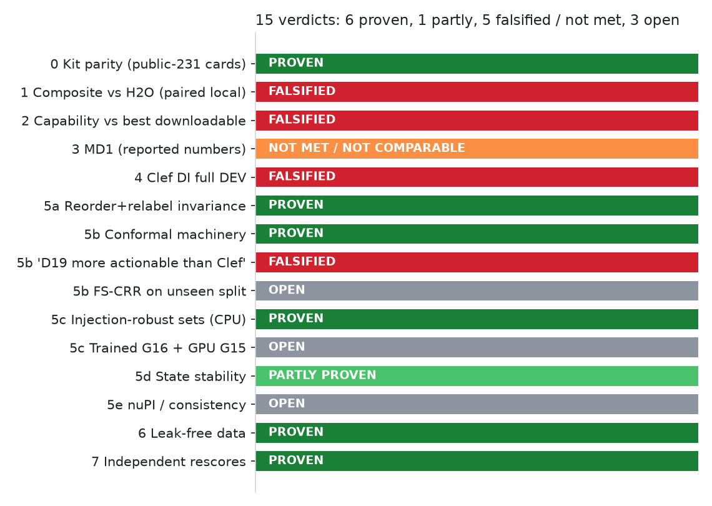
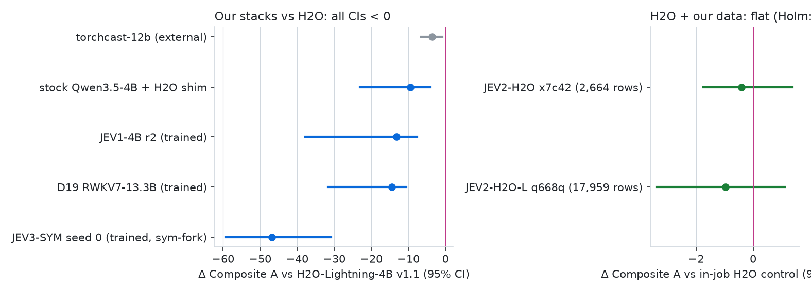
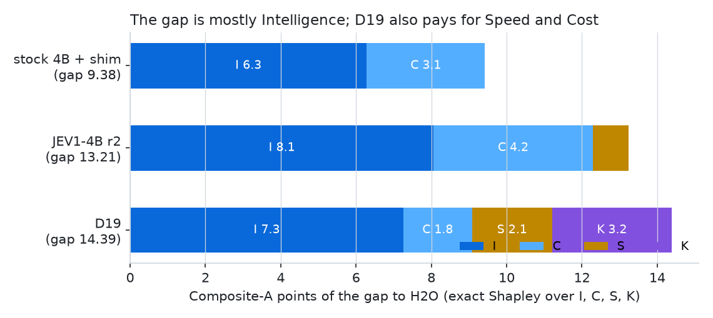
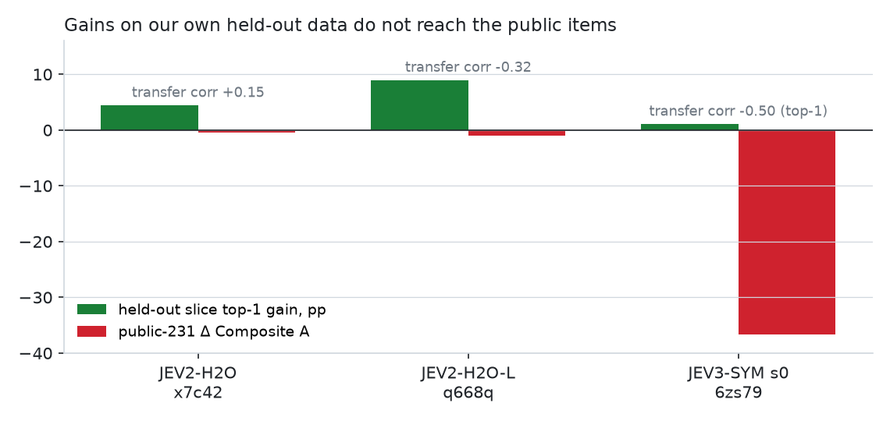
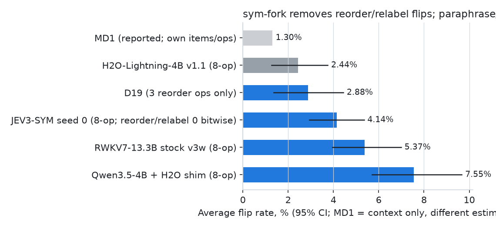
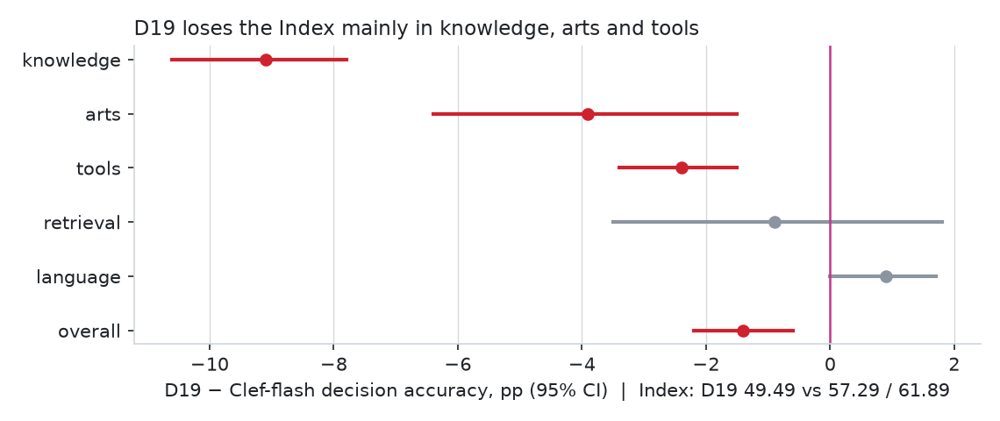
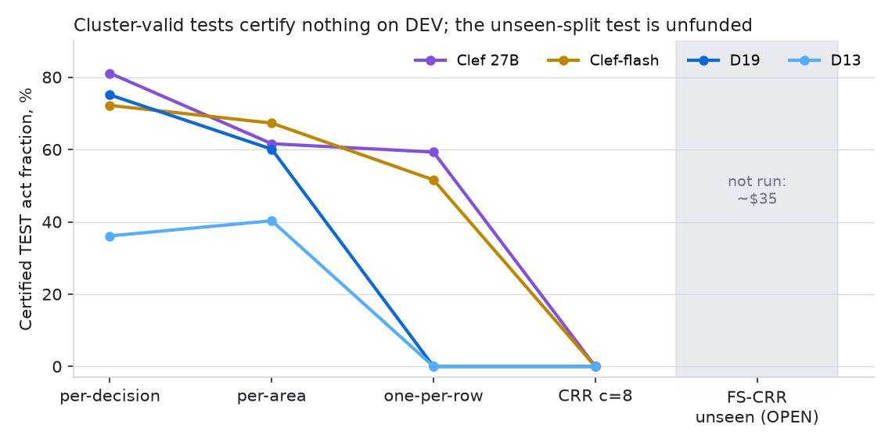
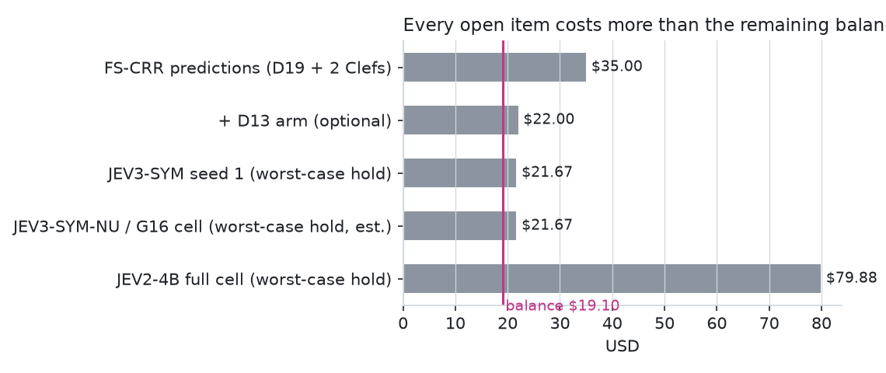

# EVIDENCE REPORT v2: target-by-target final status (evidence lane, 2026-10-12)

Supersedes `docs/EVIDENCE_REPORT.md` (claude/ev-evidence-report @ae7575f7). State basis: origin/state @c783be49 (BOARD, PREREG, DEAD_ENDS, PROGRESS, `results/ledger.tsv`).

Every target gets exactly one verdict:
- **PROVEN**, with receipts;
- **FALSIFIED**, with a gap attribution and receipts;
- **NOT MET / NOT COMPARABLE**, for MD1 only, with each caveat;
- **OPEN**, with the exact missing resource and its cost.

Every number was re-read for this report from the receipt file named next to it. Numbers carried over from v1 were checked again against SCORECARD.md, the kit-parity README, GUARANTEES_AREA.md, GUARANTEES_CRR.md, FLIP_RATE.md and REVIEW_STATE_STABILITY.md. The mismatches found are listed in §9. No new measurement was made, and no GPU or money was spent.

**Caveat on every JevBench number.** These are the 231 open public items only. The board's sealed split may rank systems differently: the open→board I gap measured on H2O is −17.6. No local number is ever compared with the board's 72.5.

## Summary: per-target status

| # | Target | Verdict | Key receipt | If OPEN: missing resource and cost |
|---|---|---|---|---|
| 0 | Kit parity | **PROVEN** for 3 systems on the public-231 cards (H2O 205/205, decider-12b-v1 200/200, decider-12b v2 197/198). torchcast FAIL is explained. Parity at board scale is **impossible locally**: it needs the sealed 1,200-item split. | claude/ev-kit-parity @5d674b2d | Board scale needs a board submission, which needs operator approval ($0). |
| 1 | Composite vs H2O, paired local | **FALSIFIED** for every arm. Best of ours is −9.4 [−23.1, −4.2]. Our newest stack (JEV3-SYM) is −46.80 vs H2O. | ev-scorecard @e2fcd82b; ev-j1-rescore @a8ca3e7e; ev-x7c42-rescore @bf706854; ev-q668q-rescore @a100c3b9; ev-6zs79-rescore @f93eccfe | — (levers and their costs in §1.4) |
| 2 | Capability vs best downloadable (H2O, local 80.5) | **FALSIFIED.** Every one of our own stacks has CI < 0. The two H2O + our-data arms are flat. | same | — |
| 3 | MD1 (reported numbers) | **NOT MET where comparable** (flip rate: best of ours 4.14% vs MD1's 1.3%, and H2O is at 2.44%). **NOT COMPARABLE** on accuracy, calibration and latency. | ev-flip-rate @4a65dd18; ev-6zs79-rescore @f93eccfe | — |
| 4 | Clef, full DEV Decision Index | **FALSIFIED.** D19 is 49.49: −7.80 vs Clef-flash and −12.40 vs Clef 27B. | state ledger rows; ev-d19-cal-rescore @281a0bb9; ev-guar-area @ca32b61f | — |
| 5a | Exact reorder + relabel invariance | **PROVEN:** proof, tests, independent CPU check, and a trained GPU model (JEV3-SYM: 0/565 flips, max\|dp\| 0; the control fails 28/21/12). The guarantee comes at a Composite cost. | ev-guarantee-proofs; ev-sym-check @2e465827; ev-6zs79-rescore @f93eccfe | — |
| 5b | Conformal coverage + abstention | Machinery **PROVEN** (proofs, tests, review fixes). The claim "D19 more actionable than Clef" is **FALSIFIED**. **OPEN:** FS-CRR on an unseen split. | ev-guarantee-proofs @01738528; ev-guar-area @ca32b61f; ev-guar-fscrr @4a5046c0 | Predictions on the 10,365-row pool sample for D19 + both Clefs, **~$35** (+ D13, optional, ~$22) |
| 5c | Injection-robust conformal sets | Mechanism **PROVEN on CPU**, including G15 under the real Qwen BPE tokenizer (1000/1000). **OPEN:** a trained G16 head and the G15 check on a serving GPU. | ev-guarantee-proofs @1c7c7a70; ev-sym-check @2e465827 | One G16 cell on the 4B. Not packaged; estimated at **~$6 expected / $21.67 worst-case hold**, by analogy with the JEV3-SYM cell |
| 5d | State stability | **PARTLY PROVEN:** GDN T1 is CONFIRMED. The RWKV-7 certificate does **not** hold in floats for the shipped model. | ev-review-stability @e89b29cc | Scalar-a RWKV-7 (D21) is built but untrained; it sits behind D20, which is parked at ~$113 of holds |
| 5e | νPI / consistency control | **OPEN:** built and CPU-tested, never trained with its controller. JEV3-SYM used fixed λ and no off-arm. | ledger job-xejp8, job-urjpw; stack/qwen35/jev3-sym-nu @a5b07b57 (WIP, HELD) | ON + OFF arms (the Done rule needs a paired ablation): **~$12 expected / $43.34 worst-case hold** |
| 6 | Data: leak-free draws | **PROVEN** leak-free, with independent re-gates and exclusion lists. Aiming them at the measured gap did **not** transfer to public. | ev-jev2a-regate @688e8d7c | — |
| 7 | Independent rescores | **PROVEN:** every lead claim was rescored (§7). All agree numerically. Two interpretive claims were corrected. | §7 | — |
| 8 | Budget | $785 granted; **$19.10 left** (ledger, after job-6zs79). | ledger | Every OPEN item but one costs more than the balance (§8) |

---

## 0. Kit parity: PROVEN (public-231 card scale); board scale impossible locally

**Takeaway.**
- **Parity holds on the public-231 cards.** jevkit reproduces three published open-weights systems on their author-published public-231 cards, within the pre-registered tolerance of 3 items. So our local JevBench numbers count (AGENTS.md Done 0).
- **Parity at board scale cannot be shown locally.** The board's cells use 300 open items plus 1,200 sealed items that cannot be downloaded. H2O scores I 77.6 locally against 60.0 on the board, with an identical 205/231 card.
- **The only route to a board-scale number is a board submission,** and that needs operator approval.

Prereg: EV-PREREG-KIT-PARITY, then EV-PREREG-COMPOSITE-LOCAL for everything downstream. Receipt: claude/ev-kit-parity @5d674b2d, `receipts/2026-10-10-ev-kit-parity/README.md`. Jobs: job-r3uc4 for the three 12B rows, and job-zbtbj for the H2O anchor.

| Row (pinned weights) | Ours (easy/std/hard) | Published | Diff | Verdict |
|---|---|---|---|---|
| h2o-lightning-4b @193ad740 | 205 (48/71/86) | 205 (48/71/86) | 0 | **PASS** |
| decider-12b v2 @8ac1efa7 | 197 (48/71/78) | 198 (48/71/79) | −1 | **PASS** |
| decider-12b-v1 @09e9e338 | 200 (48/71/81) | 200 (48/71/81) | 0 | **PASS** (exact per tier) |
| torchcast-decision-12b @49107b55 | 198 (46/68/84), 226/231 answered | 203 (48/70/85) | −5 | **FAIL, explained:** on 5 items the option letter is absent from the raw top-20 logprobs (raw vs letter-masked readout). Under the prereg the row stays FAIL. |

---

## 1. Composite vs H2O-Lightning-4B v1.1 (paired, local): FALSIFIED for every arm

**Takeaway.** Nothing we trained or served beats H2O on the paired local Composite A, and nothing comes close.

| Arm | Gap to H2O on Composite A | What it shows |
|---|---|---|
| Stock Qwen3.5-4B + H2O's shim (untrained) | −9.4 | best of ours |
| JEV3-SYM seed 0 (newest stack: sym-fork + consistency views) | −46.80 | far worse than the stock model it was trained from |
| JEV2-H2O and JEV2-H2O-L (H2O itself + our data) | −0.41 and −0.97, both flat | Holm claims neither |

- **Where the gap comes from:**
  - It is mostly **Intelligence**, which is 50–67% of the gap by exact Shapley.
  - Calibration comes next for the 4B line. Speed and Cost come next for D19.
  - Within Intelligence, the biggest hole is the **yes/no (noul)** type.
  - Measured causes: data distribution, noul hedging, readout speed and under-training.
- **Our data does not transfer.** Adding our held-out-validated data raises in-distribution accuracy but does not move, or lowers, public accuracy. The transfer correlations are +0.15, −0.32 and −0.50.

### 1.1 Every arm

Receipts:
- Scorecard: claude/ev-scorecard @e2fcd82b `SCORECARD.md`. Paired stratified bootstrap, B 1000, seed 16. 28 arms; max |diff| vs the in-job reports is 0.0.
- JEV1: claude/ev-j1-rescore @a8ca3e7e `RESCORE_XT3AX.md`.
- x7c42: claude/ev-x7c42-rescore @bf706854 `RESCORE_X7C42.md`.
- q668q: claude/ev-q668q-rescore @a100c3b9 `RESCORE_Q668Q.md`.
- JEV3-SYM: claude/ev-6zs79-rescore @f93eccfe `RESCORE_6ZS79.md`.

| Arm (job) | Comparison | Δ Composite A [95% CI] | Verdict |
|---|---|---|---|
| stock Qwen3.5-4B + H2O shim (zbtbj) | vs H2O | **−9.4 [−23.1, −4.2]** | CI < 0 (best of ours) |
| JEV1-4B r2 native (xt3ax) | vs H2O | −13.21 [−37.82, −7.59] | CI < 0. Its own PRIMARY vs stock: −4.07 [−25.64, +3.22], NOT SUCCESS |
| D19 RWKV7-13.3B + joint (9j3uu) | vs H2O | −14.4 [−31.7, −10.6] | CI < 0 (best trained cell, attention-free) |
| JEV3-SYM seed 0 (6zs79, ckpt 5cb7da42) | vs in-job stock + shim (PRIMARY) | **−36.66 [−47.97, −19.19]**, p 1.000 | NEGATIVE; single seed, seed 1 unfunded |
| JEV3-SYM seed 0 | vs H2O preds e00d5ac7 (secondary) | −46.80 [−59.36, −30.87] | CI < 0 |
| JEV2-H2O (x7c42), H2O + jev2 data, 2,664 rows | vs in-job H2O control | −0.41 [−1.75, +1.39]; 97.5% [−2.06, +1.58]; p 0.565 | FLAT |
| JEV2-H2O-L (q668q), 17,959 rows | vs in-job H2O control | −0.97 [−3.38, +1.12]; 97.5% [−3.73, +1.41]; p 0.810 | FLAT. Holm stops at the first test, so **NOT CLAIMED** for either arm |
| external torchcast-12b / decider-12b-v1 / v2 | vs H2O | −3.6 / −4.3 / −5.6, all CI < 0 | displayed only (operator directive 2026-10-11) |

### 1.2 Gap attribution

Lead analysis: claude/lead-gap-attribution `docs/GAP_ATTRIBUTION_COMPOSITE.md`.
- **2d2f346f** is the version the brief names. The branch tip is now **1edcd524**, which adds the review edits and the x7c42/q668q sections.
- Evidence's review is claude/ev-review-gap-attr @f2a04059 `docs/REVIEW_GAP_ATTRIBUTION.md` with `receipts/2026-10-11-ev-review-gap-attr/`. The rerun of the lead's script is byte-identical to the committed `gap_attribution.json` (sha 311ebdab…).

**(a) Axis split (exact Shapley over I/C/S/K; `shap_rank.out`).**

| Candidate | Gap | I | C | S | K | P(I is the largest axis) | P(I and C at H2O's values close the gap) |
|---|---|---|---|---|---|---|---|
| stock 4B + shim | 9.38 | **6.28** (67%) | 3.14 | −0.04 | 0.00 | 0.979 | 1.00 |
| JEV1-4B r2 | 13.21 | **8.06** (61%) | 4.23 | 0.95 | −0.03 | 0.983 | **0.00** (the native readout's Speed costs 1.09) |
| D19 | 14.39 | **7.26** (50%) | 1.83 | 2.12 | 3.18 | 0.984 | **0.00** (13.3B price and 0.50 s readout cost 5.3) |

**(b) By question type** (`type_boot.out`). Each type weighs 1/3 of I.

| Candidate | choice | **noul** | score | P(noul is the largest type) |
|---|---|---|---|---|
| stock 4B + shim | 6.70 [3.04, 10.13] | **12.20 [5.97, 19.38]** | 2.40 [−7.44, 10.77] | 0.895 |
| D19 | 5.32 [2.28, 8.50] | **13.41 [6.39, 20.22]** | 6.20 [−1.69, 12.33] | 0.925 |
| JEV1-4B r2 | 7.63 [4.41, 11.26] | **16.21 [9.61, 22.81]** | 2.55 [−8.36, 10.37] | 0.986 |

**(c) The hard-score weight.** I points lost per full miss (`type_boot.out`):

| Tier | choice | noul | score |
|---|---|---|---|
| easy | 0.168 | 0.794 | — |
| standard | 0.333 | 0.794 | 2.222 |
| hard | 0.38 | 1.003 | **10.417** |

So **one hard score item is worth about 10.4 I points**, and the 6 hard score items carry about 22% of all I weight. This weighting is an a-priori fact of the scorer. It is the justification for jev2/jev3's ~25% score rows. Using x7c42's public per-type result for that purpose would have been adaptive selection on the test items.

**(d) By family** (`fam_boot.out`, paired B 1000). Only **probability** excludes 0 for all three candidates: stock 3.52 [0.76, 6.91], D19 4.91 [1.52, 8.67], JEV1 3.15 [0.75, 6.46].
- **temporal_numeric** excludes 0 for stock (4.05 [0.38, 9.81]) and for JEV1 (4.72 [1.00, 9.50]).
- **ordinal** is D19's surest family loss: 4.06 [3.25, 4.71].
- The lead's original claim, "six families hold 66–81%", is **retracted**. It was a post-hoc union of families. The fair null is the six families' 45% share of I weight. Split-half validation shrinks the share to 30% / 45% / 54%.

**(e) The H2O-host transfer finding** (lead §5–5c; rescores bf706854 and a100c3b9 §6–7; 6zs79 §Other).

| Run | Held-out slice gain (top-1) | Public Δ Composite A | Slice→public transfer correlation (per family) |
|---|---|---|---|
| x7c42 | +4.44 pp [+3.47, +5.31] | −0.41 (flat) | **+0.15** |
| q668q | +8.97 pp [+7.61, +10.19] | −0.97 (flat) | **−0.32** |
| JEV3-SYM 6zs79 | +1.08 pp (McNemar 0.53; not beaten) | −36.66 | **−0.50** (top-1) |

- **Where the slice gains land.** They fall in families that are already saturated on public (H2O's control is at 83–100% there).
- **Where public errors are.** 23 of the 26 public errors sit in temporal_numeric, judge_hard, long_policy and multi_hop. On the slice those families show no significant gain.
- **Scale does not help.** Seven times more data doubled the slice gain and made the public result worse.

**(f) Noul hedging is a readout effect, not a ranking effect** (6zs79 §4).
- **The hedging.** JEV3-SYM puts **64.9% (48/74)** of public yes/no answers in the 0.2–0.8 band, which jevkit scores as wrong. Stock, the shimcal readout and H2O put 0/74 there.
- **The ranking is intact.** noul top-1 *rises* +5.4 pp. Read through shimcal, the noul cc is +10.78.
- **Ranking losses are real elsewhere:**
  - score: cc −16.18, top-1 −33.3 pp (0/6, p 0.031);
  - routing: −58.3 pp (0/7);
  - ordinal: −50 pp (0/6).
- **shimcal does not fix it.** With shimcal, ΔI is still −3.36 and ΔComp A is −1.07 [−22.47, +7.47]. That is a SECONDARY readout chosen after seeing the public results, so it is not claimable.

**(g) Measured causes (lead C1–C5; each has a receipt in GAP_ATTRIBUTION §3):**

| Cause | Measurement |
|---|---|
| C1: data shape and conventions | jev1 audit, plus the transfer finding above |
| C2: noul indecision | jev1 10/74, D19 12/74, JEV3-SYM 48/74 |
| C3: readout speed | native 0.197 s vs shim 0.067 s |
| C4: under-training | 0.093 epoch. Disfavoured as the cause by q668q |
| C5: post-hoc calibration | worth at most +0.5 Composite, at H2O's level |

### 1.3 Evidence's adversarial note on the lead's conclusion

The lead concludes "not capacity, not readout: the training-data distribution". That holds for the **H2O-host shim arms** (x7c42, q668q), where the noul band is 0/74 and S and K are within 0.6.

It does **not** generalise to our own stack. On JEV3-SYM the readout (noul band 64.9%) accounts for most of the −36.66 Composite loss. Which of headroom, gold conventions or shape dominates the data effect is **untested**.

### 1.4 Remaining levers for the Composite

The gap is ≥ 9.4 points even for the untrained stock + shim.

| Lever | Status | Cost | Expected effect, with reason |
|---|---|---|---|
| Sym-fork noul-band readout fix, pre-registered and selected on the jev3 slice | not registered | about $0 CPU if 6zs79's slice probabilities suffice; otherwise one eval job (~$2–11) | bounded by shimcal's −1.07 on the same weights. **Cannot reach CI > 0 vs stock, let alone vs H2O.** |
| JEV3-SYM seed 1 (pre-registered replication) | unfunded | worst hold **$21.67** > balance; expected ~$6 | It replicates a negative, so its value is low. |
| JEV2-4B full cell (sym-fork, jev1 + jev2 mix, 1,281 steps) | pre-registered, CPU-tested | worst hold **$79.88** | Targets C1 + C4. But q668q showed more data does not transfer. |
| jev3 human-rubric data | **tried** in JEV3-SYM (HelpSteer3/Aegis/PRM800K rows) | — | no transfer (−0.50) |
| D20 links 2–3 (RWKV7 chain) | PARKED | **~$113 of holds** | The 13.3B line also carries the S + K penalty of 5.3 points. |
| Board submission (sealed scale) | needs operator approval | $0 | Measurement only. It moves no score. |

---

## 2. Capability vs Quyet / best downloadable (H2O, local 80.5): FALSIFIED

**Takeaway.**
- Quyet-1.0-Large (81.7) is not downloadable. Under EV-PREREG-COMPOSITE-LOCAL the target is therefore the best downloadable Capability row: H2O at a local 80.5 [72.6, 84.1].
- Every stack of ours sits significantly below it.
- The two H2O + our-data arms are flat against their own H2O control, not above it.
- The attribution is the same as §1: Capability is I and C, and those carry the Composite gap.

| Arm | Δ Capability [95% CI] | Receipt |
|---|---|---|
| D19 (best of ours) | −17.2 [−26.6, −10.7] | SC |
| stock 4B + shim | −17.7 [−26.5, −8.2] | SC |
| JEV1-4B r2 | −22.56 [−31.95, −12.40] | J1 |
| JEV2-H2O x7c42 (vs in-job H2O) | −0.74 [−3.60, +3.33] (flat) | XR |
| JEV2-H2O-L q668q (vs in-job H2O) | −1.79 (flat) | QR |
| torchcast-12b (external) | −1.0 [−7.7, +5.2] (ns) | SC |

---

## 3. MD1 (reported numbers only): NOT MET where comparable, NOT COMPARABLE elsewhere

**Takeaway.**
- **Flip rate is the only axis we can put next to MD1**, and even that is not the same estimand. Our best measured stack averages 4.14%, against MD1's reported 1.3%.
- **H2O beats us on our own operators,** at 2.44%.
- **Our reorder and relabel flips are 0 bitwise,** matching MD1's reported "0 reorder flips". Ours are 0 by construction: the guarantee in §5a.
- **The remaining flips come from paraphrase and formatting noise,** which the sym-fork guarantee does not cover.
- **Accuracy, calibration and latency are not comparable** (caveats below).

| System | 8-op average flip % [95% CI] | Reorder / shuffle / relabel | Receipt |
|---|---|---|---|
| MD1 (reported; own items and operators) | 1.3 | 0 / 0 / ? | context only |
| H2O-Lightning-4B v1.1 | 2.44 [1.26, 3.75] | 2.8 / 2.3 / 4.3 | ev-flip-rate @4a65dd18 run 2 |
| **JEV3-SYM seed 0** | **4.14 [2.94, 5.35]** | **0 / 0 / 0, bitwise** | ev-6zs79-rescore @f93eccfe. Per op: whitespace 10.39, opt-para 8.66, markup 6.93, instr 5.19, state 1.92 |
| RWKV7-13.3B stock | 5.37 [3.95, 6.99] | 0* / 0* / 22.3 | FLIP_RATE run 2 |
| Qwen3.5-4B + shim | 7.55 [5.71, 9.67] | 12.2 / 9.4 / 8.6 | FLIP_RATE run 2 |
| D19 (3 reorder ops only) | 3-op 2.88 [1.36, 4.44] (never an 8-op number) | 0* / 0* / **8.6** | FLIP_RATE run 2 |

\* zero because the Decider readout sorts the options by id. That is a readout property, not robustness.

The JEV3-SYM vs stock-shim comparison is **not paired**: the baseline 7.55 comes from another job.

| MD1 axis | MD1 reported | Ours | Comparable? |
|---|---|---|---|
| Accuracy | 83.5% avg | — | **No.** MD1's suite is private; there is no shared item set. |
| Calibration | 92.2 | jevkit C: D19 74.0, H2O 83.4 | **No.** Different items and a different formula. |
| Latency p50 | 85 ms (Foundry) | in-process H100: D19 0.50 s raw (DI p50 569 ms); JEV3-SYM S 85.00 | **No.** Different serving stack. |
| Flip rate | 1.3% | best 4.14% (8 jevkit ops) | **Partly.** Our operators are rule-based, and ours ≠ MD1's unpublished ones. One perturbation seed. MD1 was not run. |

**Verdict: NOT MET** on flip rate, the one partly comparable axis. **NOT COMPARABLE** on the other three. No "beats MD1" statement is possible.

---

## 4. Clef: Decision Index on full DEV: FALSIFIED

**Takeaway.**
- **D19, our best attention-free model, loses to both Clefs on full DEV,** and both CIs exclude 0 against it. B-PREREG-CLAIM fails in every view, including full_excl51.
- **Where it loses:**
  - knowledge: −9.1 accuracy, plus overconfidence (ECE 0.157);
  - arts: −3.9;
  - tools: −2.4;
  - retrieval: −9.0, against Clef 27B only.
- **Two fixes were tested and failed:**
  - calibration (D19-cal) makes things worse;
  - the RAGTruth rephrase adds nothing.

| System | Index [95% CI] | vs Clef-flash 57.29 | vs Clef 27B 61.89 | Receipt |
|---|---|---|---|---|
| **D19** | **49.49 [47.77, 50.80]** | **−7.80 [−9.84, −6.18]** | **−12.40 [−14.29, −10.82]** | ledger 2026-10-10T12:08Z (job-y6ste + uq5p5). Reproduced exactly in job-zyp3h (ev-d19-cal-rescore @281a0bb9) |
| D19-cal (global T 0.806) | 49.44 [47.72, 50.77] | −7.85 | −12.45 | same; B-PREREG-D19-TEMP; DEAD_ENDS |
| D13 | 43.21 [41.63, 44.26] | −14.08 | −18.68 | ledger 2026-10-10T04:45Z |

**Per-area attribution.** D19 minus Clef-flash decision accuracy, from ev-guar-area @ca32b61f `AREA_ACCURACY.json`; case-cluster bootstrap B 2000.

| Area | Δ accuracy [95% CI] |
|---|---|
| knowledge | **−9.1 [−10.6, −7.8]** (D19's ECE 0.157 vs 0.029) |
| arts | **−3.9 [−6.4, −1.5]** |
| tools | **−2.4 [−3.4, −1.5]** |
| retrieval | −0.9 (ns), but −9.0 [−11.7, −6.1] vs Clef 27B |
| language | +0.9 (ns) |

**RAGTruth RT1: negative.** D13 +0.000 [0, 0]; D19 +0.127 [0.000, 0.320] (ev-ragtruth-rephrase @2007eded; DEAD_ENDS).

**Remaining levers:**
- Per-area T (EV-PREREG-AREA-TEMP): registered, never fitted, $0 CPU. It cannot change accuracy.
- Model-side knowledge accuracy: D20 links 2–3, parked at ~$113 of holds.

Under the operator directive of 2026-10-11, no new Clef-side runs are made except those already in progress.

---

## 5. Guarantee suite

### 5a. Exact reorder + relabel invariance: PROVEN (scoped)

**Takeaway.** The invariance is now shown in four independent ways, from the proof to a trained GPU model:

| Evidence | Result |
|---|---|
| Proof (reviewed) | fp tolerance corrected to γ_{2K} |
| Property tests | have teeth |
| Independent CPU check, 3 rounds | sym-fork harness 11/11; 74/74 adversarial cases at tol 0. G16-sym 90 passed after the duplicate-leak fix (round 3). |
| Trained GPU model (JEV3-SYM seed 0, real perturbation files) | **0 flips on 565 pairs (213 reverse / 213 shuffle / 139 relabel), 0 invalid, max\|dp\| 0, rows bit-identical** |

On the same files, the stock-shim control **fails** G1 with 28 / 21 / 12 flips (max\|dp\| 0.84). So the test has teeth on GPU too.

**Scope.**
- The sym-fork layout (stack/qwen35/sym-invariant lineage), on the served path, with non-empty option descriptions. Empty descriptions break relabel, as declared.
- A 2.86e-8 batch-vs-single residual (A5) can flip a decision only at near-exact ties.

**Cost.** The guarantee holds on a model whose Composite is −36.66 vs its own stock control (§1). So it is shipped **at a Composite cost** in its first trained instance.

Receipts:
- claude/ev-guarantee-proofs `docs/guarantees/REORDER_INVARIANCE.md` + REVIEW.md (@54701347)
- claude/ev-sym-check @2e465827 `SYM_CHECK.md`, rounds 1–3
- claude/ev-6zs79-rescore @f93eccfe §3

### 5b. Conformal coverage + abstention: machinery PROVEN; "D19 more actionable than Clef" FALSIFIED; FS-CRR OPEN

**Takeaway.**
- **The machinery is proven.** That covers split conformal, Mondrian per area, cluster LTT, and CRR betting: proofs in CONFORMAL.md, plus tests and simulations (CRR 0/120 violations, against 16/120 for the naive per-decision binomial).
- **The empirical claim is falsified.** As the test was made cluster-valid, every certificate on DEV vanished, the Clefs' included.
- **What would decide it** is a fixed-sequence CRR on an unseen split. It is pre-registered, its sample is built, and it is unfunded.

| Model | Per-decision | Per-area | One-per-row | **CRR c=8** |
|---|---|---|---|---|
| Clef 27B | 81.1% | 61.6% | 59.3% | **0** |
| Clef-flash | 72.2% | 67.3% | 51.6% | **0** |
| D19 | 75.1% | 60.1% | **0** | **0** |
| D13 | 36.1% | 40.3% | 0 | 0 |

Receipts, by column:
1. claude/ev-guar-area @ca32b61f `receipts/2026-10-10-B-guarantees-fulldev/`
2. same branch, GUARANTEES_AREA.md
3. ev-guarantee-proofs @b4835e05 GUARANTEES_CLUSTER.md
4. @01738528 GUARANTEES_CRR.md

**Gap attribution (why the certificates vanish).**
1. **Row-weighted risk really is above ε at the published λ.** The TEST R_8 is 8.7% for D19, 5.1% for D13, 6.3% for Clef-flash and 6.5% for Clef 27B, all against ε = 5%. The big rows are the easy ones.
2. **At high λ the test lacks power.** R_8 is 1–2% there, but Bonferroni over 101 λ needs 6.92 nats. The Clefs reach about 6.5 and D19 reaches 4.3.
3. **D19-specific causes:**
   - its p_max tops out near 0.96;
   - its error on single-decision rows is 11.5%, against 1.7% in rows with 8+ decisions;
   - at λ 0.95, its 4,321 acted decisions come from only 307 rows.

**OPEN: B-PREREG-GUAR-FSCRR.**
- **What is ready.** Fixed sequence from λ 0.95 at full δ, which needs 2.30 nats. The sample is pinned: Index 0.2.1 pool, 10,365 rows / 6,780 cases, ids 990b5911, 0 DEV/TEST overlap (job-9na9j, $0.06; ev-guar-fscrr @4a5046c0).
- **What is missing.** Predictions for D19 + Clef 27B + Clef-flash on those rows: **~$35** (D13 optional, ~$22).
- **A conflict to resolve first.** The Clef arms are new runs of existing models. The operator directive of 2026-10-11 (~19:00Z) allows those only "unless in progress". FS-CRR was registered and its sample built at 07:13Z, before the directive. Lead or operator should confirm before any spend.

### 5c. Injection-robust conformal sets: mechanism PROVEN on CPU; trained G16 + serving-GPU G15 OPEN

**Takeaway.**
- **The construction is exact.** The matched-calibration conformal set gives synthetic coverage under attack of **0.901**, against **0.559** for the naive set (clean reference 0.897).
- **G15 holds on CPU.** The trusted-interval invariance [lo, hi] is CONFIRMED with the byte encoder **and with the real Qwen3.5-4B BPE tokenizer: 1000/1000 fuzz cases, 0 mismatches.** The round-1 BPE leak was fixed in sym-fork v3 / G16-sym. G16-sym's duplicate leak is fixed too (round 3, 9bc4845b).
- **What is missing:** a trained G16 head, and a G15 check on a serving GPU.

Receipts: ev-guarantee-proofs @1c7c7a70 `INJECTION_ROBUST_CONFORMAL.md`; ev-sym-check @2e465827 rounds 2–3.

**OPEN, two parts:**
1. **No trained G16 head exists.** None of the trained cells exports [lo, hi]. Cost: one G16 cell on the Qwen3.5-4B host. It is not packaged. By analogy with the JEV3-SYM cell (same host, 35-min clock), that is **~$6 expected / $21.67 worst-case hold**, which exceeds the balance.
2. **The serving-GPU G15 check has not been run.** Round 3 notes that G15 then relies on the batched P-stream being invariant to batch size and row position. That holds bitwise on CPU. The lead's `p_stream_per_row` default (84aa0910, job-r2y6v CPU-tested) removes the dependence by construction. The check itself would run inside the same G16 cell's screen, at no extra cost.

### 5d. State stability: PARTLY PROVEN

| Claim | Verdict | Receipt |
|---|---|---|
| GDN T1 (‖A_t‖₂ = α_t < 1 on every executed path) | **CONFIRMED** (wording fix) | ev-review-stability @e89b29cc |
| T2(a) RWKV-7 spectrum in (−0.455, 1) | exact arithmetic: CONFIRMED. **In floats: NEGATIVE.** exp(w_log) in bf16 rounds w to 1.0, so ρ can be 1. | same |
| T2(b) per-step certificate | CONFIRMED | same |
| T5 cascade | applies to **no model we currently run** | same |

In the RWKV-7 CPU tests (job-9atmw / job-ki6vi), per-channel *a* exceeds 1 on real steps, while the scalar-a variant stays ≤ w_max < 1.

**OPEN.** The scalar-a RWKV-7 (D21, stack/rwkv7/sym-contractive) is built and CPU-tested (144 pass) but untrained. It is queued behind the D20 chain, which is parked at ~$113 of holds.

### 5e. νPI / consistency control: OPEN

**What exists.**
- νPI controller: stack/qwen35/nupi, CPU 13/13, OFF golden reproduced (job-jxawy / job-urjpw).
- Consistency-view training: stack/qwen35/consistency @d517df9c, 13/13, OFF bit-identical (job-xejp8).

**What JEV3-SYM did and did not test.** It trained with consistency views at a **fixed λ 0.5**: no νPI controller and **no off-arm**. So the JEV3-SYM result cannot be attributed to the consistency mechanism in either direction.

**The planned run.** JEV3-SYM-NU (stack/qwen35/jev3-sym-nu @a5b07b57) is "WIP, HELD by lead: untested, no params/tests yet". It has **no PREREG entry** on state c783be49.

**Missing resource.** The Done rule needs a paired ON/OFF ablation, which means 2 cells. That is **~$12 expected / $43.34 worst-case hold** at the JEV3-SYM rate, plus a prereg first.

---

## 6. Data: leak-free draws with independent re-gates: PROVEN (but no transfer)

**Takeaway.**
- **Every draw used for training was independently re-gated and is leak-free.** Each has a sha-pinned exclusion list.
- **The draws were aimed at the measured gap:** ~25% score rows, long_policy at eval length, prose states and the 10 missing families.
- **Aiming them did not make the gains transfer to public** (§1.2e).

Receipts: claude/ev-jev2a-regate @688e8d7c, unless noted.

| Draw | Verdict | Key numbers | Receipt file |
|---|---|---|---|
| jev1 (96,000) | mis-shaped, not leaking | long_policy: 3 generators, 11 instruction strings, noul 66% false, empty noul criteria, JSON states | ev-jev1-audit @13c63fdc |
| jev2a (30,000) | LEAK-FREE after a 105-row exclusion (aeb8027a) | 29,895 rows | `receipts/2026-10-10-jev2a-regate/REGATE_JEV2A.md` |
| jev2a-v2 (7,500) | LEAK-FREE after a 23-row exclusion (c0c175f5) | 104 MuSiQue rows have unverifiable provenance (the train file is gone), so they are excluded from the H2O mix (5cebf60b) | `REGATE_JEV2A_V2.md` |
| jev2b (7,500) | LEAK-FREE, empty list (01ba4719) | prob_indep dropped (constant gold "same" in 124 rows) | @7a742d6a (PREREG JEV2-4B am. 2 addendum) |
| jev2c / jev2c-v2 (1,500) | LEAK-FREE, empty list | 2,007–3,981 tokens (v2) | `REGATE_JEV2C*.md` |
| jev1 + jev2 mix (71b503eb) | verified: all shas, 0 cross-draw duplicates | 18 families | @91b66644 |
| jev3 (5,960 train + 1,200 slice) | LEAK-FREE, empty list (01ba4719); **provenance verified on all 7,160 rows** (re-fetched official train files at logged revisions; PRM800K 0 in MATH test / MATH-500) | 2 label shortcuts listed; aegis_reply and hs2_bar_coherence dropped by the sampler (e998376e) | `receipts/2026-10-11-jev3-regate/REGATE_JEV3.md` |

**One leftover.** The q668q rescore flagged 49 slice rows whose state equals a training state (glaive_fc 24, prob_dice 12). Content overlap is 0. The floor result barely moves without them: +9.01 pp. A state-level dedupe in the generator is a lead item.

---

## 7. Independent rescores: every lead claim

| Lead claim (job) | Rescore branch @sha | Numeric verdict | Interpretive verdict |
|---|---|---|---|
| JEV1-4B r2 (xt3ax): PRIMARY −4.07, not success | ev-j1-rescore @a8ca3e7e | **AGREES**, max\|diff\| 0.0 | adds the length split: the cause is jev1 long_policy priors, not length |
| H2O-host eval-only (4g6m8): no contender CI > 0 | ev-h2o-eval-rescore @536fae54 | **AGREES** on 235 numbers (max\|d\| 7e-15) | T-fit was slice-only (compliant); G1 recomputed |
| JEV2-H2O (x7c42): −0.41, flat | ev-x7c42-rescore @bf706854 | **AGREES**, 95 fields, max\|d\| 0 | Minor CI differences on the floor and per-type numbers (§9). Training is nondeterministic run to run. |
| JEV2-H2O-L (q668q): −0.97, flat; Holm | ev-q668q-rescore @a100c3b9 | **AGREES**, max\|d\| 1.4e-14 | Holm NOT CLAIMED. x7c42's control drifted at float level. |
| JEV3-SYM seed 0 (6zs79): −36.66; G1 PASS; flips 4.14% | ev-6zs79-rescore @f93eccfe | **AGREES**, 97 fields, max\|d\| 0; lineage PASS | The lead's floor CI is not reproduced (≤ 0.25 pt). **Corrects the lead's "loss is yes/no calibration":** score/routing/ordinal top-1 losses are real, and shimcal is a secondary chosen post hoc. |
| D19 full DEV 49.49 | ev-d19-cal-rescore @281a0bb9 (job-zyp3h) | **reproduced exactly** | — |
| D19 global T as a calibrated variant | same | rescored: **negative** | DEAD_ENDS |
| Composite gap attribution (2d2f346f) | ev-review-gap-attr @f2a04059 | reproduction **byte-identical**; Shapley **CONFIRMED** | "C second for D19" WRONG; "I+C close the gap" WRONG for JEV1 and D19; "six families" OVERCLAIMED. All applied by the lead at c63b4c79. |
| sym-fork / G16-sym invariance + G15 | ev-sym-check @1351ed9f → 6ed476e1 → 2e465827 | **CONFIRMED** after 2 lead fixes | Round 1: G15 BPE leak (fixed). Round 2: G16 duplicate leak (fixed). jevkit CLI sort_keys bug (fixed in PR #245). |
| State stability T1–T5 | ev-review-stability @e89b29cc | T1/T3/T4 CONFIRMED | T2(a) in floats and T5 scope OVERCLAIMED |

---

## 8. Budget: $785 granted, $19.10 left

The live balance is $19.10. Ledger row 2026-10-12T09:30Z, job-6zs79: "balance 19.10".

| OPEN item | Expected cost | Worst-case hold | Fits in $19.10? |
|---|---|---|---|
| FS-CRR predictions, D19 + Clef 27B + Clef-flash (5b) | **~$35** (ledger; the prereg text says ~$30) | ~$35 + build | **No** |
| + D13 arm (optional) | ~$22 | — | No |
| Trained G16 cell + GPU G15 check (5c), estimate | ~$6 | $21.67 | expected yes; **hold no** |
| νPI ON/OFF pair, JEV3-SYM-NU (5e) | ~$12 | $43.34 | **No** |
| JEV3-SYM seed 1 (replication of a negative) | ~$6 | $21.67 | hold no |
| JEV2-4B full cell | ~$28.7 | $79.88 | **No** |
| D20 links 2–3 (needed for D21 scalar-a and Clef knowledge) | — | ~$113 | **No** |
| Board submission (sealed-scale Composite) | $0 | — | needs **operator approval**, not money |

A worst-case hold above the balance blocks submission, even when the expected cost fits. Shortening max_duration would lower the hold, but it changes the pre-registered package, so it needs a prereg amendment.

**Funding ask** (per AGENTS.md "if the budget runs out first"):
- **Minimum, ~$57:** FS-CRR (~$35) plus the G16 cell's hold ($21.67). This settles the OPEN conformal and injection-robust items.
- **About $43 more:** the worst-case hold for the νPI ON/OFF pair.

None of these is expected to close the Composite or Clef gaps. §1.4 explains why.

---

## 9. Number mismatches and notes found while verifying

1. **Gap-attribution sha.** The brief cites claude/lead-gap-attribution @2d2f346f. The branch tip is **1edcd524**: c63b4c79 applied the review, then 7a5faacf and 1edcd524 added the x7c42 and q668q sections. Numbers here come from 1edcd524. Where 2d2f346f differs (the "six families" claim, "C second", "I+C close the gap"), the review's corrections govern.
2. **x7c42 slice levels and CI.** The lead gives 0.850 vs 0.800, +4.44 [+3.44, +5.39]. The rescore gives **84.61% vs 80.17%, +4.44 [+3.47, +5.31]**. Rounding, plus a different bootstrap.
3. **x7c42 per-type ΔI CIs.** The lead (GAP_ATTRIBUTION §5) gives choice [−5.68, +2.29] and score [+0.09, +10.74]. The rescore gives **choice [−4.66, +2.28], score [+0.15, +10.51]**. noul agrees. Points agree; the bootstrap scheme differs.
4. **q668q floor CI.** The lead gives [+7.69, +10.22]; the rescore gives **[+7.61, +10.19]**. The point estimate +8.97 agrees.
5. **6zs79 floor CI.** The lead gives [−2.08, +4.25]; the rescore gives iid **[−1.83, +4.09]** and stratified [−2.00, +4.00]. Both span 0. screen.json labels its rule "A-PREREG-JEV1-4B" (cosmetic).
6. **FS-CRR cost.** The PREREG text says "~$50 with D13, ~$30 without". The ledger (job-9na9j row) says "~$35 (+D13 ~$22)". This report quotes the ledger figure, which is the later one.
7. **v1 G15 verdict is superseded.** EVIDENCE_REPORT v1 says "G15 FAILS under a real BPE tokenizer" (round 1). Rounds 2–3 (@6ed476e1, @2e465827) CONFIRM G15 under the real Qwen BPE: 1000/1000 cases after the lead's fixes.
8. **The BOARD on state c783be49 is stale on three rows:**
   - "MD1 reported … our best: not measured yet". The flip rate has been measured since run 2.
   - The guarantee row cites the one-per-row test. The CRR c=8 result is 0 for every model, the Clefs included.
   - "D19 ECE 0.041" is the 10-bin ECE. The harness board ECE is 0.0705.
9. **PREREG "EV-PREREG-H2O-HOST ACTIVATED" pins 0940cbd7.** This is superseded by amendment 1 (193ad740). Every number here is on 193ad740.
10. **D19 "8.6" is its relabel rate,** not an average. Its 3-op average is 2.88.
11. **JEV3-SYM flips (4.14%) vs stock-shim (7.55%) are not paired.** They come from different jobs.

No other mismatches were found. All other cited shas are the current branch tips (checked 2026-10-12): 5d674b2d, e2fcd82b, a8ca3e7e, a100c3b9, f93eccfe, f2a04059, ca32b61f, 01738528, 2e465827, e89b29cc, 688e8d7c, 4a65dd18, 281a0bb9. bf706854 is the x7c42 rescore commit, an ancestor of a100c3b9.

## Files
- Charts: `docs/evidence_report_v2/*.png`, regenerated by `python docs/evidence_report_v2/charts_v2.py docs/evidence_report_v2` (matplotlib). Its numbers are transcribed from the receipts above.
- v1 (`docs/EVIDENCE_REPORT.md`, `docs/evidence_report/`) is kept unchanged for history.

## Addendum (2026-10-12, after v2): the last funded cells, and where GPU work stopped

**Takeaway:** the leaders' recipe on our GDN-hybrid host (JEV3-LM: train == score at the answer slot, human-labelled jev3 data, canonical-order inference) was pre-registered and launched twice. Both attempts failed for INFRASTRUCTURE reasons, so it produced **no result and no claim**. The hypothesis is untested, not falsified. GPU work stopped at ~$14.5 of credit.

| Item | Status | Receipt |
|---|---|---|
| JEV3-SYM seed 0 (sym-fork, 200 steps) | FALSIFIED: Δ Comp A −36.66 [−47.97, −19.19]; G1 bitwise PASS on choice + yes/no items; flips 4.14% | claude/ev-6zs79-rescore @f93eccfe |
| JEV3-TYPED (typed sym-fork) | PRE-REGISTERED, PARKED (not run); its pre-registered readout's ceiling (65.57) < stock (66.64) | stack/qwen35/jev3-typed @a21049a9 |
| JEV3-LM | NO RESULT: job-79fki exit 25 (truncation assert; fixed); job-wm8b5 exit 7 timeout at step 497/729, no weights exported | A-PREREG-JEV3-LM (state 14cb45ce + 93f0e4b2); ledger 520c0a33 |
| Canonical-order shortcut check (pre-run) | DONE: canonical order creates a train A-prior (choice 35.0% vs 28.0%, driven by `ambiguous`); public has none; mitigated by shuffled-order training | claude/ev-canonical-prior @1ccdc676 |
| Typed reorder-invariance theorem | PROVEN (doc + tests); scope: jevkit's G1 never perturbs score items | claude/ev-guarantee-proofs @a06343b6 |
| Score-item invariance op | BUILT + TESTED (gate-ready) | claude/ev-score-inv @c47c0a46 |

**Runner bugs found by JEV3-LM** (being fixed at CPU cost): the time cap ignored ~11.6 min of pre-train overhead; the collapse guard's threshold (0.8 × uniform loss) sits at the lm_label head's starting loss, so it misfired 3× and halved the LR each time; weights are only exported after a successful cell, so a timeout loses the best checkpoint.

**What re-opening needs:** JEV3-LM ≈ $10–18 (one run with the fixed runner); JEV3-SYM seed 1 ≤ $21.67; a trained G16 head + GPU G15 ≤ $21.67; νPI on/off ≤ $43.34; FSCRR on the unseen split ~$35 (also needs new Clef predictions, so check the operator directive first). Board-scale parity: the operator declined a board submission.

## Closing entry (2026-10-12/13): JEV3-LM-S, conformal on our stack, and what remains at $0

**Takeaway:** the last funded cell, JEV3-LM-S (stock Qwen3.5-4B GDN-hybrid + an answer-slot readout trained on human-labelled jev3 data, with content-canonical inference), is our first model with **exact reorder + relabel invariance** at a Composite **statistically indistinguishable from stock** and **half the flip rate**. No Composite gain is claimed. GPU work stopped at $11.67.

| Item | Result | Receipt |
|---|---|---|
| JEV3-LM-S primary (native_tfit − non-canonical stock+shim) | −0.78 [−16.36, +3.47], p 0.736, NOT CLAIMED | claude/ev-zbmhc-rescore @e03b1d42 (independent rescore agrees on every number) |
| KEEP gate 1, G1 (choice relabel + choice/yes-no reorder) | PASS bitwise, 565 pairs; the stock control fails 27/21/13 | same |
| KEEP gate 2, score-item invariance (18/54/18/18) | PASS bitwise; stock fails 2/8/3/4 | claude/ev-score-inv @c47c0a46 |
| Flip rate, 8 jevkit ops | 3.64% (vs stock 7.55%, unpaired) | same |
| Letter shortcut (A-share) | none (slice −4.09pp, public −0.72pp) | claude/ev-canonical-prior @1ccdc676 |
| Secondary: native_shimcal | +3.48 [−1.09, +12.56] (n.s.) | same |
| T_noul attribution | the fallback T 0.26 ADDED +29.36 [+12.27, +38.76] vs T=1 (diagnostic); the residual gap is in score items (−13.5) and routing; the band rule was infeasible by construction (the stock shim floor) and its fallback was pre-specified in code, not prose | same |
| Conformal on our stack (B-PREREG-GUAR-JEV3, jev3 slice) | COVERAGE PROVEN (JEV3-SYM 0.888; JEV3-LM-S 0.916 at α 0.10); ABSTENTION FALSIFIED for every arm: tfit's confident answers err 10%; raw/shimcal reach ~75 acts with 1 error vs the ~135 error-free acts the test needs | claude/ev-guar-jev3 @77b8be9c, @36141c14 |
| Slice readout diagnostic (non-public) | shimcal beats tfit on NLL (−0.281 [−0.352, −0.213]) with band 0; Composite-like proxy +4.83 [−0.76, +11.82] → a future cell should pre-register shimcal as primary | @36141c14 |

**Why nothing more is claimable now:** a single seed on n = 231 public items has a ~±8 CI half-width on Comp A, larger than every effect left to test; every remaining item needs GPU credit ($11.67 left).

**What CAN be done at $0** (no cluster jobs; the laptop is RAM-limited):
1. **jev-heldout** (in progress): a sealed ~2,000-item JevBench-shaped confirmation set with human-labelled gold from public validation/test splits, disjoint from all training draws, the public items and the Decision Index; pre-registered as a secondary confirmation set only; projected CI half-width ≈ ±2.7. This is the single biggest lever for power in future cells.
2. Re-analysis of landed predictions only (slice-level diagnostics, conformal variants, gap attribution), always pre-registered before reading.
3. Proofs, tests and runner fixes on CPU (typed invariance theorem done; runner bugs fixed by the lead).
4. Packaging + pre-registering the next cells so they run first time when credit returns: JEV3-LM (full epoch, shimcal primary), JEV3-TYPED, JEV3-SYM seed 1, a trained G16 head + GPU G15, νPI on/off, FSCRR (needs new Clef runs, so check the operator directive).

**Budget needed to close the open items:** JEV3-LM full ≈ $17 hold; G16 ≈ $22; νPI pair ≈ $43; seed 1 ≈ $22; FSCRR ≈ $35.
