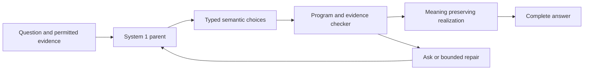

# Language grown from the System 1 decision model

6 October 2026. Owner: Codex, at the user's request. Dependency: the System 1 parent developed by Claude, through a jointly reviewed adapter. Current status: design and executable-work specification; no learned model, checker implementation or paid run is claimed complete.

## Objective

Grow useful language capability by extending what the decision model can represent, decide and justify. The first deliverable is a small but real semantic-program learner: given a natural-language question and evidence, it selects facts, makes a comparison or a scoped inference, and expresses the result faithfully. Subsequent modules add composition and discourse without opening a route around the checked meaning.

The wider target remains a capable, controlled and interpretable language model. A model that emits safe templates while failing the user's task is not a successful endpoint. A fluent parent with a post-hoc explanation head is not a fully interpreted model either. We will measure useful completion, semantic faithfulness and internal interpretation separately, and improve the weakest component.

## How the language module grows from the parent

The initial planner repeatedly uses the parent's typed-choice interface. It chooses the next semantic operation and its references, subject to the declared grammar and budget. The same parent checkpoint supplies these decisions; a separate general-purpose LLM is not secretly the planner. Frozen-parent probing comes first, followed by supervised adaptation of the parent's existing head/adapters if needed.

The first version may require several inference calls per answer. Report that cost honestly. Once it works, compare parallel prediction of bounded program slots against sequential choices, preserving consistency checks. Do not claim the whole language response has the single-pass latency of the original decision API.

The core may be Q9-AF, RWKV, Mamba-3 or another qualified recurrent parent. The checker never assumes its latent dimension or architecture. An inherited parent can validate this interface and modular growth; it does not retroactively satisfy the separate goal of interpretable learning from initialization. Keep its known and unknown mechanisms visible in the report.

## Initial language domain

Use a compact product/policy catalog with typed records, units, versions and conflicting/absent facts. Questions ask for a supported field, compare two quantities, request an explanation of a checked comparison, or ask what information is missing. Include independently authored natural language, corrections and unfamiliar entities. Exact task labels and semantic programs come from an independent evaluator, not from the model under test.

The controlled evidence setting makes relation-level soundness testable. A second stratum uses natural-language source material requiring learned extraction; its outputs remain beliefs/attributed evidence until justified. Do not conflate extraction accuracy with trusted KB truth. Complete question understanding and relevance remain learned capabilities even with a perfect KB.

Avoid a task solved by keyword order or by always asking for clarification. Pair necessary-fact changes with nuisance paraphrases and malicious directives. Distinguish source changes that should alter the answer from instructions that should not alter authority. Check all currency/unit/time and open-world negation assumptions.

## Modules and proof obligations

| Module | Learned component | Checked obligation | Main remaining uncertainty |
| --- | --- | --- | --- |
| Evidence selection | Parent chooses records and relevant fields | References exist, are current and permitted | Selection is sufficient and relevant to the question |
| Typed operations | Parent chooses read/compare/compose operations | Types, units, rules and dependencies are valid | Correct operation and complete task interpretation |
| Semantic program | Parent binds operations into a graph | Acyclic bounded graph; every assertion has a checked derivation | Discovery of a useful complete program |
| Realization | Initially fixed; later learned production choices | Surface meaning preserves the checked program | Fluency, pragmatics and suitable emphasis |
| Correction | Parent revises beliefs/program after a change | Old versions invalidated; authority maintained | Correct and timely propagation through the answer |
| Explanation | Trace selected for the answer | Exposes the actual checked derivation | Whether that trace explains neural selection rather than only program execution |

The initial operations and wire examples are in [DECISION_LANGUAGE_V0.md](../../interfaces/DECISION_LANGUAGE_V0.md). Arbitrary free strings, unrestricted implication, generic negation and real external actions are outside version zero. They can be added through explicit semantics and evaluation, not by trusting a label such as non-assertive connective text.

## Experiments in order

### L0 Boundary and oracle feasibility

Implement the minimal types, interpreter and deterministic renderer with standard Python. Add a replay/oracle adapter for the shared decision request. Run the agreed positive/negative fixtures and independently inspect sampled outputs. Check record-splicing, negation, stale facts, unit mismatches and wrong-question answers.

This local CPU work establishes that the target answer can be represented and checked. It is not a language-intelligence result. If the oracle program cannot express an answer, expand the semantic language before training. If the checker supplies the selected answer itself, the task has been bypassed and must be redesigned.

### L1 Frozen parent as semantic planner

Use the actual frozen System 1 parent on 300–500 development cases. Initially allow ReadFact, Compare, Assert and Ask; at most eight program nodes and four decision calls, with a clearly separate one-repair diagnostic. Record raw decisions and end-to-end answers.

Compare direct parent answers, parent-to-program answers, oracle programs and a rule baseline. Give every deployable condition the same permitted evidence and action support. If the parent fails even direct answers, repair or change the parent; if only program choices fail, adaptation of the interface is justified. If only realization fails, do not pay for model training to fix a grammar bug.

First paid language probe: proposed cap $20 from the shared language envelope, not additional money. Start only after measured parent memory/runtime and a shared spend reservation. With no parent yet, L0 continues locally and the learned gate remains pending.

### L2 Train semantic choices and causal edits

Construct a modest supervised program corpus, initially 5,000–20,000 independently validated examples, rather than buying a new pretraining campaign. Train the same parent's program choices using its supported head/adapters. Preserve an unmodified checkpoint and optimizer/config identity. Include the parent's original decision data or a fixed retention sample during adaptation where permitted; evaluate retention on separate held-out examples.

Use unsmoothed likelihood as the baseline. Test Brier/ordinal terms only where the target distribution is meaningful. The desired program can have multiple equivalent realizations, so a single canonical program label is not automatically the only correct answer. Score semantic equivalence and complete task outcomes in addition to token/choice loss.

Train on the model's own partial programs and histories. Provide typed failures on training examples for bounded repair. Teach evidence correction, conflict and question clarification without training it to maximize checker acceptance by saying nothing. A short false statement rejected by the checker still counts as a planning error.

The main ablation is ordinary program supervision versus the same supervision plus causal edit pairs. Keep the same examples, token/call budgets and useful capacity. An edit pair specifies how changing one fact or register should change the program and answer, and which unrelated conclusions should remain stable. It should not smuggle audit-set labels into training.

### L3 Add one composition operation

Choose either conjunction of supported facts or comparison plus derivation explanation according to the L2 error profile. Add the operation registry entry, checker rule, training examples and a new compositional holdout. Confirm old decision and language tasks still work. Keep optional plain-language glosses outside any claim of explaining the parent's internal neural mechanism unless causal tests support that interpretation.

### L4 Learn richer faithful realization

After semantic planning is useful, let the parent choose among licensed templates/grammar productions for style and discourse. Add pronoun/coreference, time and quantifier rules one at a time, with counterexamples and denotation checks. Begin with whole-production choices; optimize token-level constrained decoding only if rendering cost or expressivity demands it.

A fallible paraphrase judge may be used as an empirical comparator. It cannot authorize unconstrained prose while retaining the exact meaning claim. General language expansion remains an open sequence of semantic modules, rather than a final switch to the generic LM head.

## Evaluation and promotion

Freeze an audit set independent of the development examples: proposed first size 1,000–2,000 cases, grouped by underlying evidence world, with new compositions/entities and separately reported adversarial cases. Human or independently authored label review matters more than maximizing generated case count. Multiple paraphrases of one world are not independent observations.

Required outcomes:

- complete useful answer accuracy, plus both members of necessary-fact pairs correct;
- evidence selection/recall and program correctness before checking;
- answer relevance, missing required content and misleading framing;
- unsupported assertion rate, source/authority violations and stale-context rejection;
- corrected-memory and counterfactual-edit success, with collateral effects;
- answer coverage and avoidable asks/refusals;
- parent decision-retention results, NLL/Brier where applicable, and selected risk with its denominator;
- number of parent calls, total tokens, p50/p95 answer latency, memory and cost.

Reject a language extension that improves correctness only by collapsing useful coverage, or appears fluent while changing the program's meaning. Capability preservation is a joint gate. Report paired uncertainty and seed variation; an interval crossing a prespecified material-regression threshold is unresolved. Any screening tolerance is an engineering choice, not proof that the user accepted an intelligence tradeoff.

Use three oracle interventions to locate failure: oracle evidence, oracle program, and oracle realization. For learned causal interpretation, also clamp/edit live semantic state and predict the downstream effect before observing it. Tests on the deterministic renderer alone demonstrate renderer controllability, not control over hidden model cognition.

## Interpretation claims

Keep distinct levels of evidence:

1. Structural transparency: code and allowed dependency paths are known.
2. Arithmetic attribution: a score is exactly decomposed into terms.
3. Semantic traceability: a checked program exposes the premises of its assertions.
4. Causal semantic fidelity: interventions predict and control the learned model's behavior on held-out cases.
5. Broad internal explanatory coverage: the mechanisms supporting general capability are understood across a declared domain.

Passing one level does not establish the next. A pretrained backbone may initially support only the first three for the language interface. Fully interpretable intelligence remains an objective requiring the fourth/fifth levels, including failures, latent bypass checks and concept sufficiency. The language contract provides a place to measure that progress; it is not proof that the latent representation is already explained.

## Implementation and ownership

Proposed files in the Codex lane, to implement after interface review:

| File | Purpose |
| --- | --- |
| language_growth/types.py | Typed evidence references, values and program nodes |
| language_growth/kernel.py | Small operation registry and checked interpretation |
| language_growth/realize.py | Deterministic semantic-preserving productions |
| language_growth/planner.py | Bounded parent choice calls, abstention and repair |
| language_growth/adapters/ | Replay/oracle adapter and Claude-provided parent bridge |
| language_growth/eval.py | Program, answer, retention and intervention measurements |
| tests/language_growth/ | Contract counterexamples and semantic fixtures |

No general orchestration framework, new model server, theorem prover or GPU kernel is needed for L0. Keep model-specific loading and optimization in Claude's parent lane. The language lane can specify the necessary data/API changes without editing the other lane's running trainer.

## Spend and parent handoff

The proposed shared division gives language at most $100 of the existing $525, including a first $20 probe. It is not yet a paid reservation. See [the handoff](../../coordination/CODEX_LANGUAGE_HANDOFF.md). API fees for closed models are not SF credits. No new model rental or local weight load is needed to write and validate the CPU boundary.

The parent handoff requires a model/config/tokenizer identity, tested decision adapter, context and cardinality limits, state reset contract, small prediction fixture and the baseline decision-retention set. It does not require the parent to have already beaten every competitor. It must be useful enough on the chosen language task for interface failures to be distinguishable from basic comprehension failures.

A successful first result is a useful answer module whose decisions demonstrably come from the shared System 1 parent, whose assertions have scoped checked support, and whose additions preserve the parent's measured capability. Broader knowledge, reasoning and discourse then grow through the same lineage and contracts.
