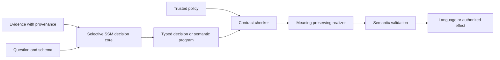

# Decision first SSM models and verified language growth

Prepared for Apuroop Mutyala on 5 October 2026. Status: architecture and research plan; no new model has been trained or benchmarked by this review. This revision follows the user's clarified scope: first a capable controlled System 1 model, then increasingly general language grown from its semantic decision machinery.

Build **SSM Decision**, a state-space System 1 model targeting Clef, Clef-flash, Jev, Astra, and Fable on decision tasks. Grow **SSM Language** from that model by expanding typed decisions into compositional semantic programs and then into verified language. Language capability comes from learning more expressive meanings, reasoning operations, and faithful realizations of those meanings. All output continues through the semantic contract; there is no unrestricted text bypass.

Authority boundaries, source permissions, editable semantic interfaces, and interpretation objectives are present before training. The target is simultaneous improvement in intelligence, control, and interpretability. A narrower benchmark or a readable head on an opaque model does not complete it. Whether an extensible semantic interface can retain the required intelligence is the central unresolved hypothesis. The plan defines experiments to answer it without assuming either an inevitable tradeoff or a guaranteed victory.

Read the [Astra critique](ASTRA_REVIEW.md) for corrections to the pasted mathematics and the [evidence record](EVIDENCE.md) for primary sources and the local Codex logs used here.

## Acceptance criteria

Separate three claims instead of treating a single leaderboard number as success.

| Claim | Required evidence |
| --- | --- |
| Better decision capability | A frozen full-suite comparison against pinned Clef, Clef-flash, a dated Jev endpoint, and pinned Astra/Fable configurations, plus independently labelled workflows; retain difficult knowledge, reasoning, retrieval, and long-input tasks |
| Better efficiency without losing capability | Accuracy and calibration preserved on the same requests while reducing measured latency, memory, or total cost; include the complete serving and checking path |
| Better control and interpretation without losing capability | A matched controlled-versus-unrestricted comparison with no demonstrated capability loss, fewer wrong permitted actions, useful intervention effects, and explicit coverage of the mechanisms actually explained |

For the final superiority claim, use paired confidence intervals for candidate-minus-baseline capability and resource differences. Require positive full-index improvement over every comparator, no unresolved material domain regression, and the declared control requirements. A mean improvement with an interval crossing zero is inconclusive. Prespecify any practically negligible screening margin; it is not permission to rebrand a measured regression as success. A small pilot cannot prove exact equality across all possible inputs.

Freeze the released model family and endpoint versions at evaluation time. For Astra/Fable, compare the same fixed workflow and schema through a compatible adapter, and also include a strong native structured-answer/reasoning configuration. A win against a wrapper burdened by probability generation is not automatically a reasoning-capability win. Never infer victory from agreement with a teacher's answers. New releases require another comparison. Text-only wins do not establish superiority over Clef's image/video support; multimodal capability is a later, explicit gate. Human values, factual truth, authorization, numerical stability, and interpretability remain distinct evaluation targets.

## How the local research informs this design

The original pasted proposal supplies the project direction: typed probabilistic decisions, state-space dynamics, explicit semantic state, and verified emission. Local experiments supply implementation lessons and failure cases. They do not replace that direction. In particular, the October 1 study found a 12.24-point trajectory deficit from one source-separated design, and the separate data intervention changed loss without improving decisions. This motivates capacity-matched comparisons and useful-behavior endpoints, rather than concluding that control inherently costs intelligence. See [latest results](../../overnight/LATEST_PILOT_RESULTS_20261001.md).

Reuse the authority interfaces and register transitions in [native_agency.py](../../chl-structured-models/core/native_agency.py), [native_register_dialogue.py](../../chl-structured-models/core/native_register_dialogue.py), and the existing finite workflow tests. Their guarantees are scoped to their contracts. Extend their semantics only after updating the argument: the old tests do not cover arbitrary prose, dynamic declassification, mixed-source training, or real connectors.

The supported-grammar symbolic baseline already solved the small workflow perfectly. Preserve that task for contract regression checks, but measure useful language learning on independent natural language where a fixed parser fails. Do not spend the first month reproducing another successful allow-list mask.

## Shared model core

### Selective recurrence from the start

Use pure Mamba-3 as the first new-backbone candidate, with Mamba-2 as a mature implementation comparator and the existing GDN2 prototype as a continuity baseline. Select SISO or MIMO using measured **prefill and training** cost at matched capability. Mamba-3's reported state-tracking improvements motivate this choice; they do not establish decision-model superiority. Its code is available, while the official repository's enumerated pretrained checkpoints are principally Mamba-1/2. Do not assume an unverified pretrained Mamba-3 checkpoint exists. [Mamba-3](https://arxiv.org/html/2603.15569v1), [official implementation](https://github.com/state-spaces/mamba).

The deployment definition of attention-free is no token-to-token softmax attention layer and no growing transformer KV cache. Parallel scan implementations are allowed. Mathematical duality to forms of linear attention does not disqualify an SSM: Mamba-3 also has a structured state-space dual form. Document the exact blocks, including any vision encoder. Keep attention-based teachers and comparators outside the candidate inference path.

Maintain two memory systems with different purposes:

1. A high-capacity selective recurrent representation for language, relational evidence, and unresolved information.
2. Explicit semantic records for entity, relation, value, negation, time interval, provenance, uncertainty status, and update operation. Initial operations are KEEP, SET, RETRACT, UNKNOWN, and CONFLICT.

The first is not declared fully interpretable merely because its recurrence is readable. The second is not declared true merely because it has named fields. Train their connection and test it causally. Long-lived facts should survive through controlled records; do not enforce aggressive global forgetting and call it injection resistance.

### Authority and information flow

Trusted caller metadata supplies identity, source class, grants, budget, output audience, and revocation state. Natural-language parsing may propose a policy interpretation, but it cannot mint authority. The deterministic support function computes permitted effects from trusted policy and current state. STOP and revocation act through this path rather than relying on a learned feature.

Public, private, and authority state have declared dependencies. A public-only output cannot read private recurrent state, private semantic records, private-dependent normalizers, or caches derived from private input. Private authorized computation may combine the inputs it is permitted to read. Shared frozen public weights can reduce duplication; trainable shared embeddings, global gradient clipping, joint reward normalization, optimizer state, and cache reuse must be included in any training-time noninterference claim.

Keep public and private parameter updates separate when claiming source-isolated learning. If broader shared pretraining is used, state that its training corpus is outside that isolation claim. Dynamic source relabelling and declassification require a new state transition and cache reset/recomputation rule. Distinguish output-distribution isolation from timing, errors, resource use, and other channels.

Version recurrent state with the model, policy, tokenizer, schema, and source permissions. Never reuse a cached state under a different permission set. Weight changes require replay/reset or a validated state migration; do not silently carry old hidden states into new dynamics. Initial products use fixed inference weights. Online learning and the separate Trainium sandbox are future work.

### Interpretation as an architectural experiment

Make the controlled branch consume an explicit evidence interface, with no direct latent-to-decision bypass. Compare a discrete typed interface against a richer sparse concept representation. Supervise available concepts from data, and jointly train sparse dictionaries/operators from the first training step for the unlabelled portion. A broad vocabulary can grow; a fixed list of a few dozen concepts is not assumed sufficient for general intelligence.

For language growth, test sparse inter-layer communication and a concept-mediated semantic-program decoder. Its output is a typed program rather than arbitrary vocabulary logits. Do not insert an unrestricted residual route around that interface. If concept mediation loses capability, measure whether the cause is missing concepts, binding/temporal information, optimization, or a limited program language before increasing representation capacity.

This is a research hypothesis, not a semantic guarantee. Sparse or discrete codes can still be unintelligible or encode nuisance information. Concept bottleneck and integrated sparse-expert work are precedents for the experiment, not proof that the whole SSM becomes transparent. [CB-LLMs](https://arxiv.org/abs/2412.07992), [Monet](https://arxiv.org/abs/2412.04139), [concept leakage](https://openreview.net/forum?id=tglniD_fn9).

Measure intervention agreement, counterfactual prediction accuracy, nuisance invariance, concept completeness, leakage, and collateral capability loss. Edit a fact, erase a source, clamp a relation, or replace a memory update and predict the resulting decisions **before** running them. Include random and output-only controls. Report the fraction of decisions and claims supported by tested mechanisms, with an explicit unexplained remainder. Probe accuracy and logit attribution are diagnostics, not the acceptance criterion.

## Project one SSM Decision

### Input and output

Support the state/questions interface, arbitrary choice descriptions, Boolean questions, and ordered score levels. In the compatible wire format, choice confidence is the selected probability; score is the unnormalized expected level index and confidence is the maximum level probability. Keep entropy, abstention reasons, provenance, and intervention traces in separate optional metadata. The draft's score divided by the number of levels and entropy-based confidence would change this contract. [Released serializer](https://huggingface.co/Cloudflare/clef/raw/main/joint_schema_model.py).

For API scoring, every supplied option gets a probability. For execution, trusted policy separately restricts permissible actions. Expose predictive probabilities and any policy-conditioned distribution distinctly: renormalizing away forbidden actions must not make the model appear more certain that its remaining answer is correct. Never let deployment abstention alter the forced-choice benchmark silently.

### Two heads to compare

For question q and option description o_k, independently compute e_k = E(o_k) using a shared SSM encoder. Form a symmetric set summary s = mean(phi(e_k)), together with the option count and a question encoding. The same scorer parameters apply to every option. IDs map outputs back to the API; arbitrary IDs do not become learned per-label biases. When instructions are omitted and IDs carry meaning, retain that specified meaning consistently.

**Head A, shared scan:** condition the evidence scan on q and s, produce semantic state c, then compute z_k = g(c, e_k, s). Its expensive backbone pass is shared. This is the first efficiency candidate.

**Head B, option-conditioned evidence:** use the same backbone token features in a lightweight selective recurrence for each option:

    r[t,k] = a[t,k] * r[t-1,k] + b[t,k] * v[t]
    (a[t,k], b[t,k]) = f(v[t], e[k], q, s)
    z[k] = g(r[T,k], e[k], s)

The option is known while evidence arrives, rather than only after a lossy final-state compression. All option paths share weights. This is a capability comparator and possible final head if its cost is justified. Process token-feature chunks as they are produced; storing the full token sequence would change the memory claim.

Both designs are permutation-equivariant in exact arithmetic if the option summary is symmetric, the scanner is deterministic, and output IDs are remapped. Floating-point reduction order and tie-breaking need explicit tolerances. Test complete option permutations, distractors, duplicate descriptions, contradictory options, and semantic ID changes. Ordinal score levels retain their defined order.

With K options, T input tokens, and small head state d, Head B adds roughly O(KTd) work and O(Kd) persistent head state, beyond the backbone. More questions add cost too. Constant recurrent memory is a statement in T for fixed K and schema, not a statement that all workload sizes are free. Question-specific scans reduce cache sharing. Above 255 options, preserve all candidates in the benchmark; a retrieval cascade belongs to a separately measured product configuration.

Start with independent question distributions. Add explicit hard consistency constraints only where joint-field errors matter. Use small enumerated domains or bounded-treewidth graphs; report inference size and latency. General constraint compilation does not guarantee a small probabilistic circuit. Keep source-dependent normalizers from violating public/private separation.

### Data and training

Build a multi-task training mixture around actual failures: evidence extraction, unfamiliar category descriptions, temporal corrections, multi-field decisions, tool selection, retrieval/ranking, knowledge questions, and long-context relation binding. General language pretraining and reasoning/code data must supply competence beyond the finite workflow. Initial proposed decision corpus: 100,000–300,000 diverse records after a 10,000-record data pilot; these are budgeted design targets, not existing data.

Use ground truth where available and multiple teachers for augmentation and disagreements. Clef can be one teacher; it is not the sole authority. Preserve disagreements as uncertainty or send them for label review. Model-generated explanations are proposed annotations. Do not call teacher consensus factual truth. Distillation is not an absolute teacher ceiling, but copying one teacher supplies little independent evidence for surpassing it.

Keep benchmark task families and semantic templates out of zero-shot training and development. Deduplicate exact and near-duplicate examples across mixtures. Separate ordinary fine-tuning experiments from zero-shot results, disclose inherited pretraining contamination uncertainty, and do not train on the published Decision Index evaluation set. Domain adaptation gets its own table.

Start with unsmoothed cross-entropy, optionally a positive Brier term and ranked probability score for ordinal outcomes. Add supervised state updates and intervention-consistency losses on declared fact-preserving or fact-changing pairs. The distinction matters: ignoring all untrusted input would prevent useful factual responsiveness.

Train on full episodes with the model's own previous memory. Prioritize correction/retraction and entity-binding examples; teacher-forced state prediction is a diagnostic only. Measure loss on rare changes separately from the frequent KEEP/UNKNOWN cases. Rollout utility is the promotion endpoint.

Keep probability estimation separate from action utility. Proper scoring objectives estimate distributions; an external expected-utility or risk rule selects the action. Add an RL objective only after demonstrating a specific useful-behavior improvement over supervised training, and reassess calibration afterward. Do not describe a guessed reward as reproduction of proprietary RLCD.

### Calibration and selective execution

Fit temperature on a dedicated calibration split by negative log likelihood; retain another untouched audit split. Track NLL, Brier, class-conditional reliability, OOS precision/recall, and risk versus coverage. Use entropy as predictive uncertainty, without labelling it a decomposition of epistemic and aleatoric uncertainty. Begin without PID, SNGP, or a large ensemble.

For acceptance indicator A and error E, selected risk is R = E[A E] / E[A], when coverage is positive. It is not E[A E]. Choose thresholds on development data and audit accepted errors using an appropriate one-sided binomial bound on independent cases, or use simultaneous risk tests for threshold search. Group correlated workflow cases together. At zero accepted errors, about 2,995 independent accepted cases are needed for a one-sided 95% upper bound of 0.1%; this illustrates why a small clean test cannot certify very low risk.

Ordinary conformal sets supply marginal coverage under their assumptions; singleton selection does not automatically inherit the claimed selected-risk bound. Adaptive attacks and distribution shift are evaluated separately and can invalidate exchangeability. [Learn then Test](https://arxiv.org/abs/2110.01052).

### Why this could outperform

The plausible mechanisms are stronger option-conditioned evidence retention, training specifically for unfamiliar schemas and corrected memory, shared prefill with small output heads, and fewer wrong permitted actions through source-aware intervention training. Each has an ablation. SSM asymptotics alone are insufficient: Clef already avoids autoregressive decision generation, so short-request prefill and option-head cost can dominate.

## Project two SSM Language grown from SSM Decision

### The architecture lineage

Project two inherits the decision core, evidence state, uncertainty estimates, and controller ports. It expands the set of decisions the model can make. Instead of choosing only a class label, it chooses a typed semantic program; instead of returning only a record, it realizes that program in language.

The semantic program is part of the causal computation, rather than a rationale generated after an answer. Editing a premise or controller port must change the downstream result in the predicted way. The realizer receives only validated semantic content and an approved style/discourse specification, not unrestricted hidden state or raw private input.

### An extensible semantic program language

Use a typed abstract syntax tree with explicit denotational semantics. Initial constructors are:

| Constructor | Meaning and required evidence |
| --- | --- |
| Assert(proposition, proof) | Assert a scoped relation supported by an accepted record or checked derivation |
| Infer(rule, premises) | Apply an allowed inference rule with explicit assumptions |
| Compare(items, criterion) | Compare values with checked units, identities, and temporal scope |
| Explain(decision, reasons) | Expose the actual checked dependencies of a decision |
| Ask(missing) | Request facts or preferences needed for a declared obligation |
| Quote(source, span) | Attribute an exact source statement without endorsing its truth |
| Hypothesize(proposition, assumptions) | Express a conditional claim with assumptions preserved in the output |
| Plan(actions, preconditions) | Propose typed actions; execution still checks current authority and state |

Add entity binding, quantities, negation, time, uncertainty, conditionals, quantifiers, discourse references, and speech-act types deliberately. A small fixed vocabulary cannot express general language adequately. Extend the algebra when oracle-program tests demonstrate an expressivity gap. General inference can require expensive or undecidable search; use bounded proof search and explicit unsupported outcomes rather than assuming complete efficient verification.

World knowledge, retrieved assertions, inferred beliefs, and trusted policy are different kinds of input. A quoted claim stays attributed; a hypothesis stays conditional; a learned prediction stays a prediction. Confidence does not convert a belief into a checked fact. Open-world absence of evidence is not evidence of negation.

### Contract required for every module

Each module declares its input/output types, semantics, source dependencies, authority/effects, uncertainty behavior, and failure behavior. Its checker is small enough to test independently of the learned proposal. A sound composition requires that one module's postcondition satisfies the next module's precondition, including source audience, freshness, units, and epistemic status.

For a supported program p, accepted evidence K, and trusted specification Pi, the intended invariant is:

    Check(K, Pi, p) = true
      implies Authorized(Pi, Effects(p))
          and K entails AssertedMeaning(p)

For its realization r, require Meaning(r) = AssertedMeaning(p), with speech-act distinctions preserved. These are theorem targets over a defined formal language and checker, not claims about arbitrary natural language. Real-world truth additionally depends on K and the inference rules being sound. A proof from a false premise remains a proof from a false premise.

The original grammar-times-trie idea can help constrain strings, but is insufficient by itself. Copying valid names and cities into a new relationship can invent a fact. Check the complete relation or derivation, including negation and time, before realizing it. Round-trip parsing is a useful implementation check; a fallible learned parser is not a proof of semantic equivalence.

Cross-module composition also has to preserve control. A private-dependent global normalizer, search branch, or selected explanation can leak private evidence even if each field individually passes its type checker. Revalidate the complete output and its declared dependencies.

### Language growth stages

| Stage | Added capability | Gate before adding the next stage |
| --- | --- | --- |
| L0 | Explain individual decisions using checked templates | Correct decision, correct dependency trace, no unsupported relation |
| L1 | Multi-sentence answers over several records, comparisons, and exact calculations | Identity/units/time/negation preserved; answers remain relevant and complete for a decidable task predicate |
| L2 | Compositional reasoning, explicit assumptions, questions, and multi-step plans | Every inference/action obligation checks; own-history rollout retains task success |
| L3 | Rich discourse and learned choice among meaning-preserving forms | Faithful semantics through coordination, coreference, quantification, emphasis, and paraphrase; usefulness matches the stronger comparator |
| L4 | Broader knowledge and task domains through new semantic modules | Each new domain expands verified coverage and competence without weakening previous contracts |

A learned realizer can choose among licensed paraphrases, clause orders, and discourse plans. It cannot fill an unrestricted string slot with unchecked assertions. If richer language lacks a sound semantics-preserving mapping, that extension has not earned the same guarantee. Improve the grammar/program language or mark the unmet requirement; do not silently switch to unrestricted generation.

Questions, creative writing, quotations, and hypotheticals require explicit speech-act semantics. Fiction may generate an internally consistent fictional world while keeping the fiction designation outside the model's discretion. Labelling content as fictional or hypothetical must not become a loophole for unauthorized effects or concealed real-world assertions.

For example, the decision model may identify an invoice as overdue from its due date, payment status, and a trusted current date. The language extension builds Assert(Overdue(invoice), checked_derivation), then realizes a sentence stating that result. A second module can calculate days overdue; a third can explain the governing policy; a fourth can propose a reminder under an authorization contract. Each adds intelligence and expressive range through a new checked operation. Inferring that the customer is dishonest would require additional premises and a justified inference rule; the existing facts do not license it.

### Train language through semantic decisions

Continue training the same core on evidence-to-program, program-execution, state-update, and program-to-language pairs. Use deterministic programs and simulators for exact supervision where appropriate, alongside independently reviewed human language to avoid learning only artificial syntax. Teachers can propose programs and paraphrases, but their proposals enter training only with the applicable validation or uncertainty label.

Train on the model's own intermediate programs and evolving beliefs. Add counterfactual edits that require corrected facts to propagate into conclusions and language. Preserve proper scoring for uncertain decisions separately from rewards for useful final answers. Auxiliary next-token or representation losses can improve the internal language encoder during training; they do not introduce a separate unrestricted emission route.

Use oracle evidence and oracle programs to separate three failures: the interface cannot express the right answer, the SSM cannot discover the right program, or the realizer cannot express it fluently. Remedy the failing component. This is how to pursue richer intelligence without treating an opaque bypass as the solution.

### What safe aligned trusted and no hallucinations mean here

The structural targets are: valid typed outputs; permitted effects; declared source isolation; assertions entailed by accepted evidence under checked rules; and faithful realization. The statistical targets are correct decisions, calibrated uncertainty, and bounded accepted error under stated sampling assumptions. The empirical alignment targets include helpfulness, correction-following, non-manipulation, appropriate refusal, resistance to within-permitted steering, and avoidance of misleading omission.

This distinction does not lower the ambition. It identifies the remaining problem: a specification must adequately represent the user's intended behavior, and real-world evidence must be correct. Neither follows automatically from an SSM, a probability distribution, or a type system. A general promise of no misalignment or factual error in every open-world situation would exceed the current design. The engineering path is to expand expressive, useful behavior for which the assumptions and obligations can actually be checked.

For unverified factual premises, the model may quote, ask, state a justified uncertainty, or abstain. Report useful verified-answer coverage so a model cannot pass by refusing everything. Test omission and framing at whole-answer level; a fraction of safe tokens is not a meaningful substitute.

### Scaling the common core

Start a controlled core at 100M–150M parameters with a 1B–2B-token representation/data pilot; progress to 300M–400M and 6B–8B tokens only after the joint gates. These are affordable hypothesis-testing scales, not asserted winners over Astra or Fable. A 1B–3B or larger successor depends on measured scaling behavior and a new cost forecast.

Pure pretrained Mamba-2 2.7B and Falcon-Mamba-7B are useful competence references. Their licenses and actual configurations need review before use. They are not evidence that the complete model was controlled throughout pretraining. [Mamba-2 checkpoint](https://huggingface.co/state-spaces/mamba2-2.7b), [Falcon-Mamba](https://huggingface.co/tiiuae/falcon-mamba-7b).

Use architecture-preserving distillation, complementary teachers, and independent labels to expand competence. If long-range evidence is limiting, compare question conditioning, richer state, and explicit provenance-bearing memory. External retrieval remains a disclosed resource in comparisons, with no hidden oracle advantage.

## First experiments and decision gates

The schedule below is an engineering estimate for one main implementer with bounded review support. It is not a promise of beating the competitors in eight weeks.

| Stage | Direct work | Evidence required before proceeding |
| --- | --- | --- |
| Days 1–4 | Reuse old interfaces; freeze fresh natural-language development/audit splits; qualify one selective-SSM kernel and the SystemOne serializer | Serial/parallel/chunked state and gradients agree within declared precision; no silent input truncation; oracle data paths and label review catch seeded mistakes |
| Week 1–2 | Localize perception, memory, and planner errors with oracle concepts/oracle previous state; build Heads A/B | Evidence identifies whether compression, concept sufficiency, state updates, or readout is limiting utility |
| Week 2–4 | Train small unrestricted, modular, and controlled SSMs on identical tokens/data; establish the typed decision core | Controlled candidate preserves useful decision capability and declared source/authority controls; causal edits outperform random/output-only controls |
| Week 4–6 | Train the surviving head and richer semantic interface; multi-task schema generalization; calibration audit | Improvement extends to unseen schemas, necessary-fact pairs, and wrong-permitted-action attacks at matched clean utility |
| Week 6–8 | Scale the surviving decision configuration within remaining budget; full evaluation; grow L0/L1 language through checked programs | Report all endpoints and uncertainty; decide whether results earn deeper compositional language and a larger campaign |

Keep the initial comparisons small and informative. First train three matched architectural arms at one pilot configuration; repeat the surviving comparisons over three seeds before scale-up. A single seed can reject an obvious bug, not establish superiority. For branch isolation, match useful capacity rather than splitting the same width into three underpowered copies and attributing the deficit to control.

Use oracle concepts to estimate the downstream capability ceiling and oracle previous state to expose memory-update failures. Compare learned concepts with those oracles under the same head. If even oracle concepts fail, repair the ontology/readout/planner; if only learned concepts fail, prioritize data/perception. If the symbolic parser solves the new language benchmark, the task still does not justify learned capability claims.

## Evaluation matrix

| Dimension | Required measurements |
| --- | --- |
| Decision competence | Full frozen Decision Index; every important area; zero-shot and domain-adapted results separately; independent workflows with factual labels |
| Sequential utility | Complete episodes, correct useful steps, both members of necessary-fact pairs correct, correction/retraction accuracy, avoidable escalation, and wrong permitted actions |
| Language growth | Expressivity with oracle programs, evidence-to-program correctness, complete-answer usefulness, semantic fidelity, fresh code/reasoning tasks, entity binding, long-context recall, corrections, and fluent licensed paraphrases |
| Control | Trusted STOP/revocation, source erasure, unauthorized directives, private-to-public dependencies, wrong permitted action attacks, state poisoning, cache/reset and version mismatch |
| Interpretation | Prospective intervention predictions, mediation/bypass checks, concept sufficiency, nuisance leakage, edit locality, and unexplained behavior coverage |
| Confidence | NLL/Brier/reliability, accepted-risk confidence bounds, coverage and refusal costs, OOS class errors, shift and adaptive attacks |
| Efficiency | End-to-end p50/p95/p99, throughput under load, input/schema token counts, K and field-count scaling, all state bytes, cold/warm requests, teacher/training/evaluation cost |
| Verified language | Claim- and answer-level proof coverage, stale/contradictory sources, invalid joins/negations, faithful speech acts, parser round trip, useful answer coverage, omissions and misleading framing |

The benchmark maintainer's current reproduction kit identifies 0.2.1 as 38 counted benchmarks, revised weights, and no truncation or option filtering; unanswered requests count against score. Freeze that scorer rather than implementing the draft's older aggregation. [Decision Index kit](https://github.com/apolinario/decision-index).

Run open baselines and candidates on the same hardware, precision, batch/concurrency, and software where supported. Jev is a hosted comparator: report service latency including network separately from matched local GPU measurements. Apply equivalent calibration opportunities and output/constraint wrappers to all comparators, or report both wrapped and native forms. Include every candidate's checker cost. Do not compare our warm kernel time with Cloudflare's service median.

Add image/document classification and video-state decisions before claiming broad family superiority. A convolutional or state-space visual encoder can preserve the deployment constraint; an attention-based vision encoder would change the claim. Visual grounding and cross-modal source handling need their own measured gates.

## Budget and compute

**6 October update:** the user has reported $525 of SF Compute credits. The immediate starting campaign is now specified in [the $525 pilot](SF525_PILOT.md). The larger allocation below remains a historical scale-up scenario, not the current starting budget.

The pasted follow-up mentions a $5,000 research allowance. Use that as a **planning ceiling**, without launching paid work in this planning task. Verify available funds, current provider quotes, and measured throughput before reservations. Do not inherit access to former-employer Trainium resources.

| Proposed allocation | Cap |
| --- | ---: |
| Data construction, label review, and teacher generation | $900 |
| Shared controlled-backbone pilot and matched training | $1,800 |
| Decision heads, calibration, and competent pretrained references | $900 |
| Semantic-program and verified-language growth pilot | $700 |
| Independent final evaluation and contingency | $700 |
| Total | $5,000 |

Unused money remains unspent if a gate fails. These are allocation proposals, not provider quotations or proof that the endpoint fits. Rebalance toward whichever direct model failure is measured; do not build an expensive orchestration platform.

For a rough dense-training sanity check, compute is approximately 6ND FLOPs for N parameters and D training tokens, before architecture-specific overhead. A 300M model on 6B tokens is about 1.08e19 FLOPs. At an **assumed measured** 50–150 TFLOP/s sustained per GPU, that is about 20–60 GPU-hours for one pass; actual scan kernels, backward, activation recomputation, teacher inference, multiple seeds, evaluation, and I/O can increase it substantially. A throughput pilot is the budget authority. Token count and fit count matter more than optimistic GPU-day claims.

Begin on a qualified CUDA implementation or existing local hardware. If user-owned Trainium2 is selected later, consult the local NeuronCore-v3 reference and the installed compiler/runtime, qualify operator/gradient parity, and only then port the dominant measured costs. No NKI, FPGA, or custom verifier-hardware project is on the critical path to the first capability result.

## Implementation map

Extend the existing model repository after reconciling current file ownership. Proposed additions, not files already implemented:

| Proposed component | Responsibility |
| --- | --- |
| core/ssm_backbone.py | Qualified pure selective recurrence, chunked training/inference, typed state serialization |
| core/semantic_memory.py | Entity/relation/time records, KEEP/SET/RETRACT/UNKNOWN/CONFLICT, provenance and controller edits |
| core/schema_encoder.py | Shared option encoders and symmetric set summaries |
| core/ssm_decision.py | Heads A/B, typed probabilities, optional bounded joint inference |
| core/semantic_program.py | Typed compositional meaning, rule applications, epistemic status and module contracts |
| core/ssm_language.py | Decision-core extension to semantic programs and licensed discourse choices |
| core/verified_emission.py | Relation proof objects, deterministic realization and round-trip checks |
| pilot/ssm_joint/ | Small matched training configuration and concrete capability/control comparisons |
| data_and_eval/ssm_joint/ | Fresh held-out language/decision tasks, independent labels, paired metrics |

Reuse existing tests and receipts where applicable. Add tests for real failure boundaries: a private-dependent normalization leak, fake role-token authority, state reuse after revocation, incorrect relation joins, option permutations, chunked-versus-unrolled numerics, and the abstention denominator. Avoid rebuilding a general benchmark service.

Defer LLC/Hankel controllers, PID calibration, JEPA, SNGP, general circuit compilation, and hardware separation until a measured bottleneck makes one the smallest useful next experiment. They are optional research tools, not prerequisites for intelligence, interpretation, or alignment.

The first decisive deliverable is a capable controlled System 1 SSM with causal semantic interventions that work. The second grows useful language entirely through that model's checked semantic programs. Those milestones earn scaling toward the full Clef/Jev/Astra/Fable target; they do not replace it. Every extension must increase expressive capability while preserving the scope of the contracts already established.
