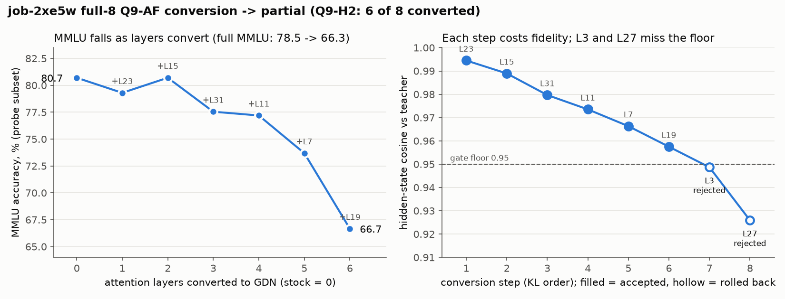

# full8 (job-2xe5w): partial conversion. Q9-AF is not reached under rule v1; the result is the hybrid Q9-H2

**Takeaway.** We tried to turn all 8 attention layers of Qwen3.5-9B into Gated DeltaNet (GDN) layers, which would
make the model attention-free (Q9-AF). The gate accepted 6 layers and rejected 2 (layers 3 and 27). Both failed
on hidden-state cosine (0.9487 and 0.9259 against a 0.95 minimum). So the model is a **hybrid that keeps 2 attention
layers (Q9-H2). It is not attention-free and cannot be the Q9-AF backbone.** None of its numbers bind anything. They
are also poor: the decision Index drops **26.0 points** against stock [−28.9, −22.2], and full MMLU drops **12.2 points**
[11.4, 13.0]. Perplexity rises only 3–4 % (ratio 1.028 at 1k, 1.040 at 4k), so perplexity hides most of the damage.
Retrieval (MQAR, NIAH) still passes. Per the rule, layers 3/27 cannot be re-converted without a new spend issue and a
new pre-registered rule. Cost: **$26.34** (31,930 s on 1×H100).

*Left:* MMLU on the per-step probe subset as each accepted layer is converted. *Right:* the gate's hidden-state cosine
at each step, against the 0.95 floor. Rendered on CPU by `make_chart.py` from `result.json`.

## What was attempted

- Job `job-2xe5w`, rule `full8-rule-v1-A1` (`jobs/full8/rule.json`, be9eed8 + Amendment A1), code at `53b4cf7`, 1×H100.
- Layers were converted one at a time, in KL-importance order, by `convert.progressive` with the enforced 511e8dd gate:
  hidden_cos ≥ 0.95, step dNLL ≤ 0.05, cumulative dNLL ≤ 0.15, and 32 windows. When a layer fails the gate, it is
  rolled back to attention and the loop moves on to the next layer.
- Outputs: `decide_full8` reported the verdict `partial-conversion`, and `gate_audit_problems` is empty. Every step
  verdict was recomputed from its recorded numbers and matched. Artifact `art-ipnxz`, sha256
  `1cc3c09c179d1e5a5a76cd5b21cc855bfbea766a81e50c8414c7c63eb976c545`, 1.63 GB. It holds `gdn_partial.pt` and
  `export.json`.

## Verdict

| | value | bound (rule v1-A1) | pass? |
|---|---|---|---|
| layers converted | 6 / 8 (23, 15, 31, 11, 7, 19) | 8 / 8 for Q9-AF | **no**: hybrid Q9-H2, attention kept at layers 3, 27 |
| Index diff vs stock (point [CI]) | −26.0 [−28.9, −22.2] | point ≥ −1, lo ≥ −2.5 | **no** |
| full MMLU drop (14,042 items, paired CI) | 12.2 pts [11.4, 13.0] (78.5 → 66.3) | ≤ 3 pts | **no** |
| ppl ratio ctx 1024 / 4096 | 1.028 / 1.040 | ≤ 1.1618 | yes |
| MQAR drop | 0.049 | ≤ 0.10 | yes |
| NIAH mean drop / worst length | 0.025 / 0.083 (L16384) | ≤ 0.10 / ≤ 0.25 | yes |

Every quality number is **non-binding** (`report.binding: false`), because the model is not attention-free. MMLU
discordant pairs: 2,483 items only stock got right, against 768 only the hybrid got right.

## Per-layer steps (conversion order)

| step | layer | accepted | hidden_cos | step dNLL | cum dNLL | KL | train tokens |
|---|---|---|---|---|---|---|---|
| 1 | L23 | yes | 0.9945 | +0.0065 | 0.0065 | 0.0112 | 33.8M |
| 2 | L15 | yes | 0.9889 | −0.0008 | 0.0056 | 0.0257 | 25.8M |
| 3 | L31 | yes | 0.9797 | +0.0016 | 0.0072 | 0.0344 | 25.7M |
| 4 | L11 | yes | 0.9735 | +0.0059 | 0.0131 | 0.0513 | 22.9M |
| 5 | L7 | yes | 0.9663 | +0.0025 | 0.0156 | 0.0684 | 20.7M |
| 6 | L19 | yes | 0.9575 | +0.0172 | 0.0329 | 0.0940 | 20.6M |
| 7 | L3 | **no** | **0.9487** | −0.0051 | 0.0277 | 0.1113 | 18.7M |
| 8 | L27 | **no** | **0.9259** | +0.0419 | 0.0748 | 0.1629 | 20.5M |

Both rejections came from the cosine floor alone. L27's step dNLL of 0.0419 was inside its 0.05 bound, and both
cumulative values were inside 0.15. Each later step got fewer training tokens (33.8M down to 18.7–20.5M). Hidden_cos
fell with each step, by about 0.005–0.009 per layer through L3, then 0.023 at L27. The last two layers were measured on a model that
already had 6 converted layers.

## Curve: attention layers kept vs quality

| layers converted | attention kept | layer added | MMLU (subset, %) | MQAR | NIAH | ppl 1k | ppl 4k |
|---|---|---|---|---|---|---|---|
| 0 | 8 | stock | 80.7 | 0.921 | 1.000 | 8.453 | 7.174 |
| 1 | 7 | L23 | 79.3 | 0.918 | 1.000 | 8.511 | 7.220 |
| 2 | 6 | L15 | 80.7 | 0.910 | 1.000 | 8.515 | 7.231 |
| 3 | 5 | L31 | 77.5 | 0.920 | 1.000 | 8.507 | 7.241 |
| 4 | 4 | L11 | 77.2 | 0.921 | 1.000 | 8.545 | 7.292 |
| 5 | 3 | L7 | 73.7 | 0.905 | 1.000 | 8.577 | 7.312 |
| 6 | 2 | L19 | 66.7 | 0.872 | 0.975 | 8.691 | 7.461 |

MMLU here is the per-step probe subset. Its drop at 6 layers is 14.0 points, against 12.2 on the full test set. The
curve bends at layers 5–6, where L7 and L19 cost 3.5 and 7.0 points while ppl moves only about 1–2 %. The Index
(−26.0) was measured only on the final hybrid, not at every step.

## Throughput and state memory (stock vs converted_6), 1×H100

Forward tok/s is the median over runs. The state is per sequence: the fixed GDN state plus the KV cache, at that length.

| seq len | stock tok/s | Q9-H2 tok/s | Δ | stock state (MiB) | Q9-H2 state (MiB) |
|---|---|---|---|---|---|
| 4096 | 23,620 | 23,163 | −1.9 % | 178.2 | 94.8 |
| 8192 | 23,889 | 23,776 | −0.5 % | 306.2 | 126.8 |
| 16384 | 23,901 | 24,621 | +3.0 % | 562.2 | 190.8 |
| 32768 | 22,086 | 24,124 | +9.2 % | 1,074.2 | 318.8 |

- KV bytes per token: stock **32,768** (8 attention layers), Q9-H2 **8,192** (2 attention layers). That is 4× smaller,
  but it does not stay constant with length. Fixed GDN state: 50.3 MiB stock (24 GDN layers), 62.8 MiB Q9-H2 (30 GDN layers).
- Call latency (2,048-token prefix, 6 reps): small call 75.6 ms stock vs 81.0 ms Q9-H2. Pack call 240.6 ms stock vs
  214.4 ms Q9-H2.
- The speed gain shows up only at long context: +9 % at 32k, and nothing at 4–8k.

## Cost

| | |
|---|---|
| billed | 31,930 s (532 min elapsed), 1 attempt, 0 restarts, 0 preemptions |
| charged | **$26.34** (26,341,700 µUSD; rate 49,498 µUSD/GPU-min) |
| image | `sha256:96a1c7044f7b91959f228c95d5aaf1ed863e07ac5ecae581c86504b025351dee` |
| time split (s) | progressive 29,260 · stage1 843 · mmlu_full 236 · controls 117 · load 64 · importance 63 · throughput 35 |

## What this means downstream

- The Q9-AF cell (`jobs/q9af_cell`, PR #121) and the m2 pilot's q9af parent both refuse this export unless the
  config is explicitly set to run it as a labelled hybrid. Even then the cell rule only gives `HYBRID_REPORT`, which
  is never promoted. Details are in the PR and the decision issue.
- `jobs/common/costs.py` `partial-conversion` → m2 runs on RWKV7. Reporting the Q9-H2 hybrid and the curve is this
  receipt. Whether to ship the hybrid is a decision for the user.

## Files

- `result.json`: the job's `result` (the $GMN_RESULT_PATH JSON), verbatim from `get_job(job-2xe5w, links=false)`,
  plus the platform `receipt` block, `artifact`, `label`, and `finished_at`.
- `make_chart.py` → `curve.png`.
