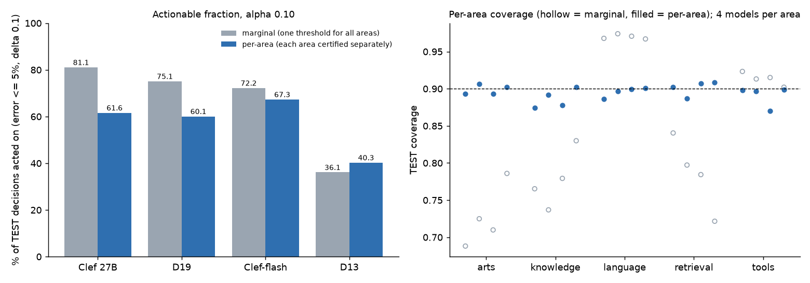

# Area-conditional guarantees on full DEV: D19, D13, Clef 27B, Clef-flash

Pre-registered as **B-PREREG-GUAR-AREA** (state @312222f8, pushed before any area-conditional number was computed). Same inputs, gold, splits and FIT/LTT cut as B-PREREG-GUAR-FULLDEV (`receipts/2026-10-10-B-guarantees-fulldev/`, branch claude/b-guarantees-fulldev @62028486). Code: `jevkit/guarantees.py` @ 7c131f1 (sha 972775c0…4d24d) unmodified; the Mondrian group key is the 0.2.1 area. Driver: `guarantees_area.py`. Numbers: `GUARANTEES_AREA.json`. Figure: `guarantees_area.png`.

## Takeaway

- **Once every area must keep its own guarantee, the ranking changes. Clef-flash leads, and D19's edge over Clef-flash reverses.** Share of TEST decisions each model may act on, with acted-on error ≤ 5% certified **in every area at once** (ε = 0.05, δ = 0.10, α = 0.10, Bonferroni over 5 areas × 101 λ):

  | Model | Marginal (published) | **Per-area (this run)** | Change |
  |---|---|---|---|
  | Clef-flash | 72.2% | **67.3%** | −4.9 |
  | Clef 27B | 81.1% | **61.6%** | −19.5 |
  | D19 | 75.1% | **60.1%** | −15.0 |
  | D13 | 36.1% | **40.3%** | +4.2 |

- **D19 vs Clef-flash: D19 is now less actionable.** The difference is −7.2 points [−9.6, −5.3] at α = 0.10 and −2.9 [−4.4, −1.6] at α = 0.05. In the marginal run it was +2.9 [+0.2, +5.1] and +6.9 [+3.5, +9.7].
  - The case-keyed split agrees on direction but the margin is small: −1.5 [−3.2, −0.0] at α = 0.10 and −2.0 [−3.9, −0.6] at α = 0.05.
  - **D19's marginal actionability edge over Clef-flash does not survive area conditioning.**
- **D19 vs Clef 27B: Clef 27B stays ahead, but the gap shrinks** from −6.0 to −1.5 points [−3.2, −0.1] at α = 0.10.
  - Under the Holm secondary correction the gap is −1.4 [−3.0, +0.0], which is no separation.
  - At α = 0.05 the gap is −1.3 [−1.8, −0.8].
- **Why: knowledge decides the contest. No model is certified on arts or retrieval.**
  - Clef-flash is the only model certified on **knowledge**: 39.6% of knowledge decisions acted on at λ = 0.94, with 4.1% TEST error.
  - D19 and Clef 27B abstain on all of knowledge.
  - Clef 27B loses its whole marginal advantage there: it acted on 69.9% of knowledge decisions under the marginal rule, but its knowledge coverage under that rule was only 0.765.
  - No model gets a λ certified on **arts** or **retrieval**, so every model abstains outright on 18% of TEST decisions (arts plus retrieval).
  - On **tools**, Clef 27B leads (86.2% acted on vs 69.6% for D19).
  - On **language**, all models act on 90–93%.
- **Coverage is now near 1 − α in every area, instead of 0.69–0.84 in arts, knowledge and retrieval.**
  - The cost is set size in the hard areas. At α = 0.10, arts sets average 2.3 labels (Clef 27B) to 8.9 (D13), against 1.0–1.7 under the marginal fit.
  - Language sets shrink below 1 (0.90–1.03).
- **Set size: D19 is now tighter than Clef-flash** (−0.15 labels [−0.21, −0.10]), because Clef-flash's arts sets average 5.9 labels. Clef 27B is still the tightest overall.
- **The guarantee held out of sample in every certified area.** TEST acted-on error per area is 0.9–4.1%, and overall it is 1.3–3.4%.
- **Pre-registered flag (coverage below 1 − α − 2·SE_test): 4 of 20 area cells miss at α = 0.10** in the primary split.
  - Clef 27B: knowledge 0.875, language 0.886.
  - Clef-flash: knowledge 0.878, tools 0.870.
  - D19 and D13 have no misses.
  - Under the marginal fit, 12 of 20 cells missed.
  - The flag line counts only TEST noise, not FIT-half noise. Conditional on one FIT draw of about 600–1,200 decisions, a shortfall of 1–2 points is within that extra variability. These are reported as flagged, not explained away.

## What is guaranteed, under which assumptions

- **Per-area coverage.** For every area a with n_fit ≥ 100 (all five here; nothing was pooled), P(y ∈ C(x) | area = a) ≥ 1 − α.
  - This assumes FIT-half and deployment decisions are exchangeable *within the area*.
  - It also assumes area labels are fixed in advance: they come from `harness.suite.area_of("0.2.1")`, a catalog → area map.
- **Per-area LTT.** With probability ≥ 1 − δ over the LTT half, the acted-on error is ≤ ε in every area simultaneously.
  - This is Bonferroni over 5 × 101 hypotheses (per-hypothesis level δ/505). It follows that the pooled acted-on error is also ≤ ε.
  - An area with no certified λ abstains on all its decisions.
- **Not guaranteed:**
  - Coverage per benchmark, per case, or per type within an area. Noul coverage inside language is 0.57–0.69 at α = 0.10, with n = 139. It sits inside the language group and is NOT protected, because the registered groups are areas.
  - Anything under distribution shift.
  - The 14,725 no-gold decisions.
- **Exchangeability across a case.** The primary split keys on run_id, so a source case can straddle CAL and TEST. The case-keyed split checks this, and its conclusions match.
- **These are DEV numbers (0.2.1).** No TEST or held-out rows were used, and nothing here is a board claim.

## 1. Per-area coverage: marginal vs per-area (TEST, primary split)

Each cell is coverage, marginal fit → per-area fit, with mean set size in brackets. **!** marks a pre-registered flag.

**α = 0.10**

| Area (n) | flag line | D19 | D13 | Clef 27B | Clef-flash |
|---|---|---|---|---|---|
| arts (1,196) | 0.883 | 0.725! → 0.906 [2.89] | 0.786! → 0.902 [8.94] | 0.688! → 0.893 [2.32] | 0.710! → 0.893 [5.89] |
| knowledge (2,288) | 0.887 | 0.737! → 0.892 [2.06] | 0.830! → 0.903 [2.05] | 0.765! → **0.875!** [1.51] | 0.779! → **0.878!** [1.55] |
| language (9,985) | 0.894 | 0.974 → 0.897 [0.91] | 0.967 → 0.901 [1.03] | 0.968 → **0.886!** [0.90] | 0.971 → 0.899 [0.93] |
| retrieval (1,943) | 0.886 | 0.797! → 0.887 [1.43] | 0.722! → 0.908 [1.89] | 0.840! → 0.902 [1.27] | 0.784! → 0.907 [1.53] |
| tools (2,073) | 0.887 | 0.913 → 0.897 [1.04] | 0.902 → 0.899 [1.27] | 0.923 → 0.898 [0.95] | 0.915 → **0.870!** [0.93] |
| **overall** | | 0.899 → 0.896 [1.27] | 0.902 → 0.902 [1.83] | 0.903 → 0.888 [1.12] | 0.901 → 0.893 [1.42] |

**α = 0.05** (per-area coverage; flagged misses only)
- D19: retrieval 0.939 (line 0.940).
- Clef 27B: language 0.944 (line 0.946).
- Every other cell is ≥ its line.
- Under the marginal fit, 13 of 20 cells missed at α = 0.05.

## 2. Per-area LTT (ε = 0.05, δ = 0.10, Bonferroni over 5 areas × 101 λ): TEST act fraction / acted-on error, primary split

Each cell is act fraction / acted-on error. **—** = no λ certified, so the model abstains on that area.

**α = 0.10**

| Area | D19 | D13 | Clef 27B | Clef-flash |
|---|---|---|---|---|
| arts | — | — | — | — |
| knowledge | — | — | — | **0.396 / 0.041** (λ 0.94) |
| language | 0.908 / 0.012 (λ 0) | 0.587 / 0.035 (λ 0.89) | 0.900 / 0.016 (λ 0) | 0.927 / 0.030 (λ 0) |
| retrieval | — | — | — | — |
| tools | 0.696 / 0.020 (λ 0.89) | 0.570 / 0.011 (λ 0.90) | **0.862 / 0.021** (λ 0.82) | 0.777 / 0.019 (λ 0.80) |
| **overall** | **0.601 / 0.013** | **0.403 / 0.031** | **0.616 / 0.017** | **0.673 / 0.029** |
| marginal (published) | 0.751 / 0.043 | 0.361 / 0.037 | 0.811 / 0.038 | 0.722 / 0.037 |

- **α = 0.05 overall:** D19 0.645, D13 0.386, Clef 27B 0.658, Clef-flash 0.674. Marginal: 0.728, 0.059, 0.765, 0.659.
- **The certification pattern by area is the same as at α = 0.10:** only Clef-flash is certified on knowledge (0.349), and no model on arts or retrieval.
- **Holm (secondary) agrees with Bonferroni to within 0.5 points** on every overall act fraction. The step-down gains almost nothing, because the binding constraint is the per-area acted-on error, not the multiplicity correction.
- The marginal reference recomputed in this run reproduces the published numbers exactly (0.751 / 0.722 / 0.811 / 0.361), so the inputs and splits are unchanged.

## 3. Paired contrasts (case-cluster bootstrap, B = 2000, seed 0; q_hat and λ fixed)

Δ is the first model minus the second. The marginal column is GUARANTEES_FULLDEV recomputed here.

| Pair | α | Split | **Δ act, per-area** | Δ act, marginal | Δ set size, per-area |
|---|---|---|---|---|---|
| D19 − Clef-flash | 0.10 | run_id | **−0.072 [−0.096, −0.053] Clef-flash** | +0.029 [+0.002, +0.051] D19 | −0.147 [−0.206, −0.099] D19 tighter |
| D19 − Clef-flash | 0.05 | run_id | **−0.029 [−0.044, −0.016] Clef-flash** | +0.069 [+0.035, +0.097] D19 | −0.322 [−0.423, −0.239] D19 tighter |
| D19 − Clef-flash | 0.10 | case | −0.015 [−0.032, −0.000] Clef-flash | +0.035 [−0.001, +0.064] none | −0.191 [−0.270, −0.127] D19 tighter |
| D19 − Clef-flash | 0.05 | case | −0.020 [−0.039, −0.006] Clef-flash | +0.068 [+0.023, +0.102] D19 | −0.380 [−0.522, −0.263] D19 tighter |
| D19 − Clef 27B | 0.10 | run_id | **−0.015 [−0.032, −0.001] Clef 27B** (Holm: −0.014 [−0.030, +0.000] none) | −0.060 [−0.086, −0.039] Clef 27B | +0.144 [+0.126, +0.165] Clef 27B tighter |
| D19 − Clef 27B | 0.05 | run_id | −0.013 [−0.018, −0.008] Clef 27B | −0.037 [−0.068, −0.012] Clef 27B | +0.194 [+0.162, +0.234] Clef 27B tighter |
| D19 − Clef 27B | 0.10 | case | −0.019 [−0.038, −0.003] Clef 27B | −0.070 [−0.104, −0.045] Clef 27B | +0.100 [+0.084, +0.119] Clef 27B tighter |
| D19 − D13 | 0.10 | run_id | +0.198 [+0.169, +0.225] D19 | +0.390 [+0.361, +0.416] D19 | −0.559 [−0.690, −0.454] D19 tighter |
| Clef 27B − Clef-flash | 0.10 | run_id | −0.057 [−0.069, −0.047] Clef-flash | +0.088 [+0.080, +0.097] Clef 27B | −0.291 [−0.363, −0.237] Clef 27B tighter |
| Clef 27B − Clef-flash | 0.10 | case | +0.004 [−0.002, +0.011] none | +0.105 [+0.094, +0.116] Clef 27B | −0.291 [−0.376, −0.225] Clef 27B tighter |

**Per-area Δ act, α = 0.10, run_id split (secondary).** A difference of +0.000 means both models abstain on that area.
- **D19 − Clef-flash:**
  - knowledge −0.396 [−0.422, −0.369]
  - tools −0.081 [−0.097, −0.065]
  - language −0.019 [−0.048, +0.001]
  - arts and retrieval 0
- **D19 − Clef 27B:**
  - tools −0.166 [−0.189, −0.142]
  - language +0.007 [−0.019, +0.027]
  - all other areas 0
- At α = 0.05, D19 beats Clef-flash on language (+0.042 [+0.033, +0.050]), but knowledge (−0.349) outweighs it.

## 4. Sensitivity: case-keyed split

- The case-keyed split has 6,116 TEST rows and nothing was pooled. Overall per-area act fractions at α = 0.10:
  - Clef 27B: 0.627
  - Clef-flash: 0.623
  - D19: 0.608
  - D13: 0.296
- **Clef-flash is NOT certified on knowledge in this split at α = 0.10.** So its lead over Clef 27B disappears (no separation), and its lead over D19 narrows to −1.5 [−3.2, −0.0].
  - At α = 0.05 Clef-flash is certified on knowledge again (0.381) and the leads return.
  - **The knowledge certificate sits at the edge of LTT power** (LTT n about 1,100, error rate near 4%), so the per-area ranking between the top three is fragile. D19 is never ahead of either Clef model in any split or at any α.
- **Coverage flags at α = 0.10:**
  - D19: arts 0.879, language 0.890, retrieval 0.871.
  - Clef 27B: arts 0.879, knowledge 0.877.
  - Clef-flash: knowledge 0.886, tools 0.882.
  - Same caveat about FIT-half noise as above.

## What changed vs the marginal result (honest summary)

1. **The marginal headline mostly reflected "act on easy language/tools and on hard areas where coverage was not actually kept".**
   - Clef 27B's and D19's marginal act fractions included 28–72% of the decisions in each of arts, knowledge and retrieval.
   - Those decisions were acted on at a pooled threshold whose coverage in those areas was 0.69–0.84.
   - Under per-area certification, that share goes to zero for both models.
2. **D19's claimed actionability edge over Clef-flash is gone and reversed** (−7.2 points primary, −1.5 case-keyed). **This verdict replaces the marginal one for any "guarantee" statement.**
3. **D19 still trails Clef 27B, by a smaller margin** (−1.5 points). Under Holm it is no longer separated at α = 0.10.
4. **The bottleneck for every model is now hard-area actionability.** A model that could certify knowledge or retrieval at ε = 0.05 would gain up to 13 (knowledge) + 11 (retrieval) points of act fraction. That is a model-quality target in those areas, not a procedure change.

## 5. Add-on: per-area accuracy and ECE (descriptive, not pre-registered)

Full DEV gold decisions (34,719; 0 invalid or missing for every model). Top-1 = argmax of the decision's distribution. ECE = `harness.calibration.debiased_ece(bins=15)` (debiased L2, 15 equal-mass bins). CIs are case-cluster bootstrap (8,473 cases, B = 2000, seed 0). Driver `area_accuracy.py`; numbers `AREA_ACCURACY.json`.

| Area (n) | D19 acc / ECE | Clef-flash acc / ECE | Clef 27B acc / ECE | **Δ acc D19 − Clef-flash** |
|---|---|---|---|---|
| arts (2,434) | 61.3 [58.4, 64.3] / 0.074 | 65.3 [62.1, 68.4] / 0.029 | 66.4 [63.4, 69.1] / 0.053 | **−3.9 [−6.4, −1.5]** |
| knowledge (4,532) | 66.7 [64.8, 68.5] / **0.157** | 75.8 [74.3, 77.3] / 0.029 | 75.8 [74.3, 77.4] / 0.058 | **−9.1 [−10.6, −7.8]** |
| language (19,300) | 95.5 [94.2, 96.4] / 0.038 | 94.5 [93.6, 95.3] / 0.058 | 95.8 [95.0, 96.4] / 0.049 | +0.9 [−0.0, +1.7] (none) |
| retrieval (3,883) | 72.5 [70.2, 74.8] / 0.104 | 73.4 [71.2, 75.5] / 0.071 | 81.5 [79.7, 83.3] / 0.047 | −0.9 [−3.5, +1.8] (none) |
| tools (4,570) | 88.0 [86.8, 89.1] / 0.046 | 90.5 [89.3, 91.5] / 0.024 | 91.8 [90.7, 92.7] / 0.028 | **−2.4 [−3.4, −1.5]** |
| overall (34,719) | 85.8 [83.7, 87.4] / 0.062 | 87.1 [85.7, 88.4] / 0.023 | 89.0 [87.6, 90.1] / 0.011 | **−1.4 [−2.2, −0.6]** |

- D19 − Clef 27B is negative in every area except language (−0.3 [−1.1, +0.3], none). Retrieval is −9.0 [−11.7, −6.1].
- **Why D19 is not certified on knowledge: it is overconfident there.** Its mean confidence is 0.801 against 66.7% accuracy (ECE 0.157). Clef-flash is at 0.783 against 75.8% (ECE 0.029).
- **Acted-on accuracy under the per-area LTT rule** (TEST, run_id split):
  - Knowledge: only Clef-flash acts. At α = 0.10 (λ 0.94) it acts on 906 of 2,288 decisions at 95.9% accuracy [94.3, 97.3]. At α = 0.05 (λ 0.93) it acts on 799 at 97.0% [95.6, 98.2].
  - D19, Clef 27B and D13 act on 0 knowledge decisions.
  - Retrieval: no model acts (no λ certified).
  - For context, the marginal pooled rule acted on knowledge at 86.1% (D19), 92.6% (Clef-flash) and 90.2% (Clef 27B). That is below the 95% the ε = 0.05 target needs. On retrieval it acted at 77.9%, 85.6% and 88.3%.
- The recomputed act fractions match `GUARANTEES_AREA.json` exactly (asserted in the script).

## Receipts

- `GUARANTEES_AREA.json`: the full output, including per-group q_hat and n_fit, every LTT record (with UCB and LTT-half act rate), Holm λ, per-(area, type) coverage, and all bootstrap CIs.
- `guarantees_area.py`: the driver. It imports `../2026-10-10-B-guarantees-fulldev/guarantees_fulldev.py` for load_gold / split / load_model. Run with `python -X utf8 -I guarantees_area.py <agent-main @7c131f1> GUARANTEES_AREA.json` from `ssdm-wt/m0-harness/.venv`. CPU, about 95 s.
- `plot_area.py`: the figure.
- `area_accuracy.py` → `AREA_ACCURACY.json`: section 5. Run with `python -X utf8 -I area_accuracy.py <agent-main @7c131f1> GUARANTEES_AREA.json AREA_ACCURACY.json` from `ssdm-wt/m0-harness/.venv`. CPU, about 16 s.
- **Independent rerun (evidence worker, 2026-10-10):** `guarantees_area.py` was rerun from `m0-harness/.venv` (77 s). Its output is identical to the committed `GUARANTEES_AREA.json` except for the timing fields.
- `run.log`: the run log.
- `SHA256SUMS`: hashes of the Windows working copies.
- **Input sha256** (checked at run time):
  - D19 b6bab803…46a8
  - D13 7b42f4c3…b1dd
  - Clef 27B f5ad788b…b09e
  - Clef-flash 2cb2e961…49c5
